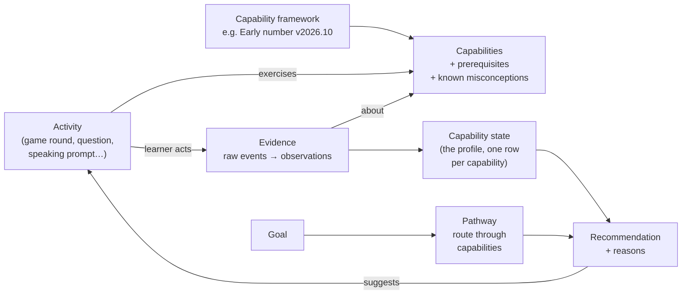
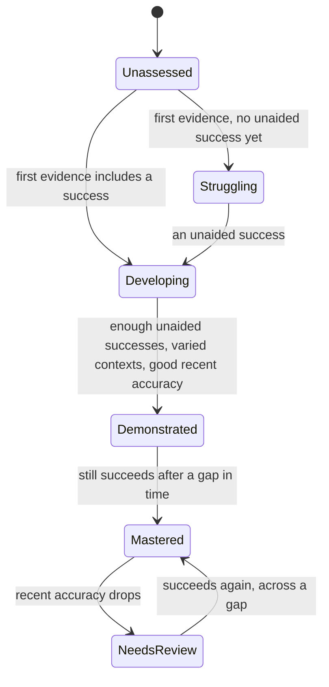

# Capability model and core data

*Item E of the architecture instruction: the minimum records and interfaces
for:*

- *a capability profile*
- *a development goal*
- *learning evidence*
- *an activity*
- *a pathway*
- *an adaptive recommendation*

| Label | Meaning |
|---|---|
| **Agreed** | You stated this as a requirement. |
| **Recommended** | My proposal. It waits for your approval. |
| **Future** | Room is kept for it. It is not approved. |
| **Open** | Needs your decision (see `DECISION_LOG.md`). |

Two people appear in the examples. Both are invented.

- **Meena**, 6, plays the children's game. Her guardian set it up.
- **Arun**, 27, is preparing for TNPSC Group 1 in the practice app.

---

## 1. Ideas first

**Capability.** Something a person can *do*, stated so that it can be
observed. Examples:

- "Knows how many: says the last number counted is the size of the set, and
  stops there"
- "Identifies which Fundamental Right a described situation involves"

**Framework.** A versioned map of related capabilities, owned by someone and
reviewed. Examples:

- "Early number"
- "TNPSC Group 1 · Indian polity (sample)"
- "Spanish A1 conversation" *(future)*

**Prerequisite.** "B needs A first." The links form a graph, not a list.
Frameworks can point to capabilities in other frameworks. *(Future: one
framework's step relying on another's.)*

**Evidence.** What a person actually did, stored exactly as it happened. From
it, *rules* draw **observations**: small conclusions about one capability on
one occasion. Each observation records:

- the outcome: *independent*, *supported* or *not yet*
- the context it happened in
- whether the situation was new to the person (transfer)
- the misconception it suggests, if any

**Capability state.** The current reading of all observations about one
capability for one person. It is recomputed whenever evidence arrives or the
rules change.

---

## 2. Stages of a capability

**Agreed:** distinguish *unassessed*, *struggling*, *demonstrated* and
*mastered*.
**Recommended:** keep the finer stages the engine already uses, and group
them under your four names.

| Your stage | Engine status today | Meaning | Example |
|---|---|---|---|
| **Unassessed** | `no_evidence` | We have seen nothing yet. This says nothing about the person | Meena has never been asked to compare two amounts |
| **Struggling** | `emerging` | Some evidence, but no unaided success yet | Arun has missed both questions on the President's election |
| *(between)* | `developing` | Some unaided success, but the criteria are not all met | Meena got 5 apples right once, alone |
| **Demonstrated** | `secure_pending_retention` | Enough unaided success, in varied contexts, with good recent accuracy, but all of it recent | Meena: 4 unaided successes in 2 contexts this week |
| **Mastered** | `mastered` | All of the above, and it held up after a gap | …and again 4 days later |
| *(after mastered)* | `needs_review` | Was mastered, but recent evidence has slipped | Arun, two months on, misses three in a row |

**Rules that always hold (Agreed):**

1. **One interaction never makes *mastered*.** It needs successes in at least
   two sessions, separated by the framework's retention gap.
2. **A stage describes the evidence about a capability, not the person.**
   Learner-facing words are chosen per product. A child never sees
   "struggling". **Open:** the exact words in each product (O-6).
3. **A stage can always be explained.** The state lists each criterion and
   whether it is met.

## 3. Confidence, retention, transfer, misconceptions

**Confidence (Recommended for V1).**

- **An interpretable label, not a hidden score.** Each state carries *low*,
  *medium* or *high*, derived from:
  - how many independent observations there are
  - how many different contexts they come from
  - how recent the latest observation is
  - whether recent observations agree with each other

  The state also shows the reason, for example "high: 6 observations, 3
  contexts, latest 2 days ago".
- **Future:** statistical models (Bayesian knowledge tracing, item response
  theory, Elo-style ratings) can be added *beside* this as extra signals, once
  real data exists to check them against.

**Retention (Agreed in principle; Recommended detail).**

- **First check.** Once a capability is *demonstrated*, a retention check falls
  due after the framework's gap (3 days for early number).
- **Later checks.** After *mastered*, the gap doubles with each successful
  check, up to a ceiling (60 days today). The engine already does this. What
  is new is that the recommender will *act* on due checks.

**Transfer (Recommended change).**

- **A property of evidence, not a separate skill.** Every observation already
  carries an `is_transfer` flag: an unfamiliar number, object or
  representation, or a question phrased in an unfamiliar way.
- **Shown for every capability.** Each state reports "transfer shown: yes or
  no".
- **Required by the framework.** A framework may require transfer before
  *mastered*.

**Misconceptions (Recommended, small in V1).**

- **Named by the framework.** A framework lists known misconceptions for each
  capability. For example, for early number: *keeps counting past the
  target*.
- **Tagged by rules.** A rule may tag an observation with one of them. The
  state lists misconceptions seen recently and not yet contradicted.
- **Not new in principle.** The current engine already records *how* a child
  went wrong, for example overshooting or taking the wrong fruit. V1 gives
  these a name in the capability map.

**What is never stored or inferred (Agreed):**

- intelligence
- personality
- psychological traits
- potential
- any sensitive personal characteristic

Learning preferences are recorded only when the person states them, or when
evidence clearly supports them *(Future)*.

---

## 4. The minimum records

These are the fields needed for V1. Optional fields are marked *(opt.)*.
Field names will be finalised in code; the meaning is what matters here.

### 4.1 Capability framework and capability

| Field | Example (Meena) | Example (Arun) |
|---|---|---|
| framework id, version | `math.early_number` · `2026.10.1` | `tnpsc.g1.polity_sample` · `2026.11.0` |
| owner, licence, review status | OpenPath · internal · *published* | OpenPath · internal · *sample, unreviewed* |
| mastery policy | 3 independent · 2 contexts · 2 sessions · 3-day gap · 80% | e.g. 4 independent · 2 phrasings · 2 sessions · 7-day gap · 75% *(Open, O-7)* |
| capability id | `math.counting.cardinality` | `polity.fundamental_rights.identify` |
| name, description | Knows how many · … | Identifies the Fundamental Right involved · … |
| prerequisites | `math.counting.one_to_one` | `polity.constitution.parts` |
| assessable | yes | yes |
| known misconceptions *(opt.)* | `counts_past_target` | `confuses_rights_with_directive_principles` |
| policy override *(opt.)* | — | — |

Capability ids are permanent. A new framework version may change wording or
links, but never reuses an id for a different meaning.

### 4.2 Learning evidence

Three layers, as today. The new fields are **bold**.

| Record | Fields | Example |
|---|---|---|
| **Session** | learner · client session id · **product** · **activity id + version** · **recommendation id** *(opt.)* · started/finished · integrity | Meena · apple-shopping v3 · recommended by R-118 |
| **Event** (raw, never changed) | session · sequence no. · type · time offset · round · data | `item_added {kind: apple}` at 12.4 s |
| **Observation** (derived) | learner · capability · outcome (independent / supported / not yet) · context · is transfer · **support given** · **misconception** *(opt.)* · **rule id + rule version** · **framework version** · observed at | Meena · cardinality · independent · "numeral 5, apples" · no transfer · rule `produce_set@3` |

Following the trail from an observation gives its **provenance**: observation
→ session → its raw events → activity version → rule version → framework
version. That is how "why does it say Meena knows how many?" is answered with
facts.

### 4.3 Capability state (one row of the profile)

| Field | Example |
|---|---|
| learner · capability | Meena · `math.counting.cardinality` |
| stage (and fine status) | Demonstrated (`secure_pending_retention`) |
| criteria, each met or not | enough ✔ · varied ✔ · accurate ✔ · several sessions ✘ · held over time ✘ |
| counts | 4 independent · 1 supported · 0 not yet |
| contexts seen | numeral-apples, numeral-pears |
| transfer shown | yes (pears, number 7) |
| confidence + reason | medium: 5 observations, 2 contexts, latest today |
| recent misconceptions | — |
| last evidence at · next retention check due | 12 Oct · 15 Oct |
| computed with | engine version · framework version |

**The profile** is the set of these rows for one learner in one product. It
also carries pointers to the learner's goals. A *linked* profile view, across
products, only exists if a grant allows it.

### 4.4 Development goal

| Field | Example (Arun) | Example (Meena) |
|---|---|---|
| learner | Arun | Meena |
| in the person's own words | "Clear TNPSC Group 1" | *(set by guardian)* "Early number" |
| target capabilities and target stage | all capabilities in `tnpsc.g1.polity_sample` → mastered | `math.early_number` assessed capabilities → mastered |
| set by | self | guardian |
| target date *(opt.)* | 2027-06-01 | — |
| status | active / paused / achieved / dropped | active |
| history | created, edited, paused… with dates | — |

### 4.5 Pathway

| Field | Example (Arun) |
|---|---|
| goal | "Clear TNPSC Group 1" |
| source | generated from the prerequisite graph *(V1)* · or chosen template *(Future)* · or customised *(Future)* |
| version | 3, because it was re-planned after a diagnostic |
| steps (ordered) | 1. Parts of the Constitution · 2. Fundamental Rights · 3. Directive Principles · … |
| each step's state | done (mastered) / current / waiting on prerequisites / skipped because already demonstrated |
| changes and reasons | "v3: skipped Parts of the Constitution: demonstrated in diagnostic" |

**Recommended for V1:** a pathway is *computed*. It is the goal's target
capabilities in prerequisite order, minus what is already demonstrated. It is
stored each time it changes, so its history can be shown. Authored and
customised pathways are **Future**.

### 4.6 Activity (catalogue entry in the registry)

| Field | Example (Meena) | Example (Arun) |
|---|---|---|
| activity id · version | `kids.apple_shopping` · 3 | `practice.mcq_set` · 1 |
| product | children's game | practice |
| kind | game round | question set |
| task type (which rules judge it) | `produce_set` | `select_response` |
| exercises (capability · role) | cardinality · practise/assess; numeral reading · assess; one-to-one · assess | each item lists its capability |
| settings it accepts | target number, representation, object kinds | which items, how many, time limit *(opt.)* |
| what makes a round "transfer" | unfamiliar number / object / no numeral | unfamiliar phrasing or case |
| author · licence · review status | OpenPath · internal · published | OpenPath · internal · *sample* |
| needs | offline OK · audio | text only |

**Items.** Questions with their correct answer and the misconception each
wrong option reveals are catalogue entries too. They have the same author,
licence and review fields.

### 4.7 Adaptive recommendation

| Field | Example |
|---|---|
| learner · goal · pathway version | Meena · Early number · v2 |
| chosen activity + settings | apple-shopping v3 · round 1: numeral 4, apples; round 2: set of 6, pears |
| target capability + purpose | cardinality · **retention check** |
| reason (codes + one plain sentence) | `retention_due` · "Knows how many was shown 3 days ago; checking it has stuck." |
| alternatives considered | numeral reading (developing, no unaided success in 2 sessions) |
| inputs snapshot | state versions used, policy version |
| created at · outcome | 15 Oct 09:02 · completed (session S-7731) |

Because recommendations are stored, a guardian or Arun can always ask "why
this?" and get the answer that was true *at the time*.

---

## 5. The interfaces between modules

These are small and stable on purpose. Everything else may change behind
them.

| Interface | Direction | In | Out |
|---|---|---|---|
| **Submit evidence** | product → evidence | learner, session id, activity id + version, recommendation id, events | integrity result; changed capability states |
| **Rule set** (one per task type) | evidence → assessment | the events of one round | a round summary, then observations |
| **Compute state** | profiles | one capability's observations, policy, current time | capability state with criteria, confidence and next check |
| **Get profile** | product → profiles | learner (+ an optional linked-product grant) | capability states the caller is allowed to see |
| **Set or update goal** | product → goals | learner, words, target capabilities or framework | goal; recomputed pathway |
| **Next activities** | product → recommendations | learner, goal, how many (1 for online, a few for offline) | recommendation(s) with reasons |
| **Generate round** (one per activity) | recommendations → activity | target capability, purpose, difficulty | concrete settings, e.g. "numeral 4, apples" |
| **Explain** | product → recommendations / profiles | recommendation id or capability | plain-language reasons + evidence trail |
| **AI task** *(Future)* | any → AI adapter | task name, input, policy | output + provider, model, prompt version |

The **recommender policy** is one plain function, so it can be tested on
pretend learners with no database. It takes the profile, goal, pathway,
catalogue, recent history and the current time. It returns a ranked list of
choices with reasons.

**Recommended V1 policy, in priority order:**

1. **A retention check is due:** check it, but at most one per session.
2. **A capability is in *needs review*:** revisit it.
3. **The current pathway step** (prerequisites met, not yet demonstrated):
   practise it. Difficulty is set from its state: *struggling* gets support,
   *developing* gets core, *demonstrated* gets a transfer challenge.
4. **Everything on the pathway is demonstrated:** use transfer checks to firm
   up confidence.
5. **No evidence at all:** run a short **diagnostic** that samples across the
   framework, starting with capabilities that have no prerequisites.

This generalises what `choose_band` does today for counting alone.
