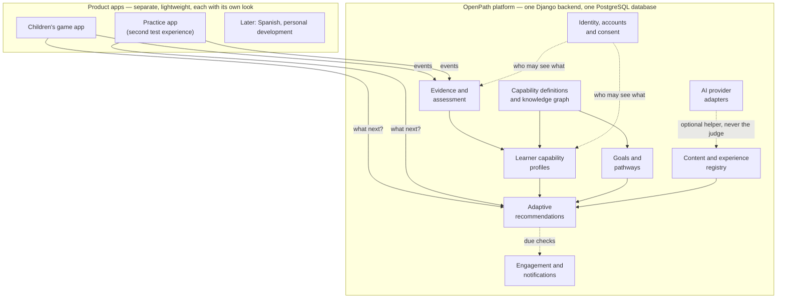
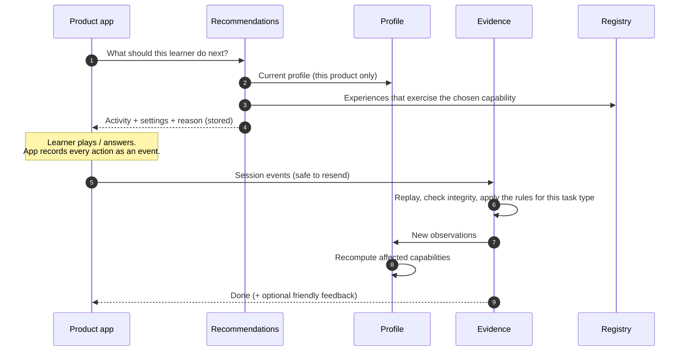
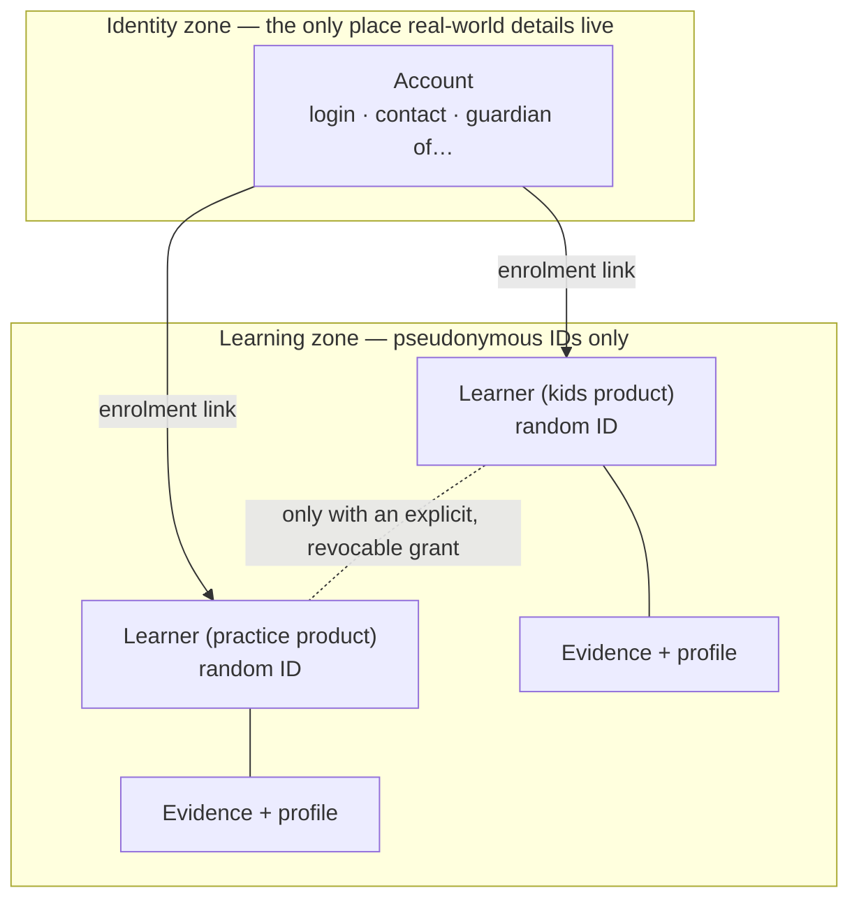

# Platform architecture

*Item D of the architecture instruction. Everything in this document is
**Recommended** unless it is labelled otherwise. Nothing here has been built
yet.*

| Label | Meaning |
|---|---|
| **Agreed** | You stated this as a requirement. |
| **Recommended** | My proposal. It waits for your approval. |
| **Future** | Room is kept for it. It is not approved. |
| **Open** | Needs your decision (see `DECISION_LOG.md`). |

---

## 1. The shape in one picture

**Agreed:** a *modular monolith*. That means one backend program and one
database, divided inside into modules with clear borders. These modules are
logical boundaries, not separate services.



*Media and animation adapters are not shown. They live **inside each product
app** (section 6).*

## 2. The modules, in plain words

| Module | Its job | Example question it answers | Built from existing code? |
|---|---|---|---|
| **Identity, accounts and consent** | Who is this person, who looks after them, and what have they agreed to? | "Has Meena's guardian agreed to store her play on our server?" | Grows out of `learners` |
| **Capability definitions and knowledge graph** | What can be learned, and what depends on what | "What must come before *knows how many*?" | Grows out of `shared/curriculum` |
| **Evidence and assessment** | Receive what a learner did, check it, and turn it into observations using rules | "Did Arun answer the Fundamental Rights question unaided?" | `evidence` and `assessment`, largely kept |
| **Learner capability profiles** | The current reading of all evidence for a person, capability by capability | "Is *counts one by one* mastered, and how sure are we?" | `mastery.py` and `progression.build_profile` |
| **Goals and pathways** | What the person wants, and the route there through the graph | "Arun wants Group 1. Which capabilities, in what order?" | **New** |
| **Adaptive recommendations** | Pick the next experience, and record why | "Next: a retention check on numerals, because it is 6 days since the last success" | Replaces `plan_next_session` |
| **Content and experience registry** | The catalogue of experiences and items: what each exercises, version, author, licence and review state | "Which activities can give evidence for *cardinality*?" | **New** |
| **Engagement and notifications** | Reminders and nudges the person has allowed | "Arun asked for one reminder on Sundays" | **New, deferred** |
| **AI provider adapters** | One door to any AI model, so providers can change | "Draft five practice questions on topic X for human review" | **New, deferred** |
| **Product apps** | The experience itself | — | `frontend/` (children), `game/` (Amma) |
| **Animation and media adapters** | Play the art and sound in whatever tool the illustrator uses | — | Lives inside product apps |

### Rules between modules

**Recommended.** These rules keep the borders clean.

1. **Only the evidence module writes evidence.** Products send *events*, never
   conclusions. The platform, not the game, decides what the events show.
2. **Profiles are derived.** They can always be deleted and rebuilt from
   evidence plus the rules of the day.
3. **The recommender only reads.** It reads the profile, goal, pathway and
   registry, and writes one thing: a recommendation with its reasons.
4. **Nothing below the product layer knows about apples, Amma, exams or
   Spanish.** Subject knowledge lives in two places:
   - capability maps (data)
   - rule sets for task types (small code modules)
5. **Modules talk through a small set of functions.** They do not reach into
   each other's tables.

## 3. One turn of the loop

What happens when a learner opens a product:



**Offline (children's game only).** The app asks for the next *few*
recommendations in advance and plays them without a connection, then uploads
the events later. Whether offline play is a hard requirement is decision O-8.

## 4. Privacy and product separation

**Agreed** principles, with a **Recommended** design for each:



- **One learner identity per product.** A person who uses two products has two
  pseudonymous learner IDs. Evidence from one product is invisible to the
  other unless the person, or the guardian of a child, grants a link. The
  grant is recorded, can be withdrawn, and says exactly what is shared, for
  example "show my numeracy profile to the practice app".
- **Identity is kept apart from evidence.** Accounts hold the few real-world
  details we need. Evidence tables hold only random IDs. The mapping between
  them is a single, access-controlled table.
- **Children's accounts.** A child has no login of their own. A guardian
  account enrols the child, gives or withdraws consent, sees the profile,
  exports and deletes.
- **Consent is recorded per purpose.** The purposes are:
  - storing evidence on our server
  - linking two products
  - receiving reminders
  - using an AI provider on the person's content

  Each grant records who gave it, when, under which policy version, and when
  it was withdrawn.
- **Export and delete** keep working as today, extended to accounts, goals and
  recommendations.
- **Open:** legal review for India's Digital Personal Data Protection Act
  (2023) and its rules, especially verifiable guardian consent for children,
  before any real children's data is collected (decision O-10).

## 5. Lightweight, separate product apps

**Agreed:** a TNPSC app must not download children's assets.

- **Recommended:** each product is its own small web app with its own build.
  They share only a thin client library for talking to the platform: send
  events, ask what to do next, sign in. A Practice app build will be checked
  automatically to confirm it contains none of the children's assets.
- **Target repository layout.** **Agreed (A-24):** restructuring is minimal and
  happens only where it improves a boundary. So existing folders move only in
  the milestone that genuinely needs it: `frontend/` stays where it is until
  the practice app arrives (M7), and the shared client is extracted only then.
  Nothing moves just to match this picture.

```
backend/                Django: one module per platform area
  identity/  capabilities/  evidence/  assessment/  profiles/
  goals/  recommendations/  registry/  engagement/  ai/
apps/
  kids-web/             today's frontend/ (apple shopping, grown-ups view)
  kids-game/            today's game/ (Amma, parked)
  practice-web/         the second test experience
packages/
  platform-client/      the small shared client: events, next activity, sign-in
content/
  frameworks/           capability maps as versioned files (early number, exam sample…)
  activities/           activity and item definitions
```

- **Future:** whether products later become separate store apps or modules
  downloaded inside one app is kept open. Separate builds over a shared client
  allow either.

## 6. Media, animation and art

- **Agreed:** no animation-tool licences or new art production at this stage.
- **Recommended:** media stays entirely inside the product app that uses it.
  The platform only knows *which experience* was played and *which version*,
  never how it was drawn. When your illustrator delivers art, each product
  chooses its own player: PixiJS sprites today, or Rive or Spine later if you
  approve a licence. The platform does not change.
- **Recommended:** Amma's home scene (PRs #2 and #3) is parked as the visual
  reference. It is not extended during V1.

## 7. AI provider adapters

- **Agreed:** an LLM is never the sole authority on mastery, and we must not
  be locked to one provider.
- **Recommended:**
  - **One adapter, many providers.** All AI calls go through one adapter with
    a simple contract: *task, input in, output out*. The adapter records which
    provider, which model and which prompt version produced each output.
  - **AI output is content or a suggestion, never evidence.** If an AI
    generates a question, the question goes through review in the registry.
    If an AI judges a free-text answer, its judgement is stored as a *labelled
    hint* that the rules may weigh alongside other evidence. It is never a
    mastery decision by itself.
  - **No AI in the V1 loop.** The interface is described but not built
    (decision O-9).

## 8. Running it

- **Recommended.** For development, everything runs on a laptop, with SQLite
  or a local PostgreSQL database via Docker. This is already working.
- **Open.** For a pilot, hosting costs money, so no service will be set up
  without your approval (decision O-12).
- **Recommended.** A single server, one PostgreSQL database and static hosting
  for the product apps are enough well beyond a pilot. We split into separate
  services only if a real load or team boundary demands it.

## 9. How existing code maps to the new modules

| Existing (PR #1) | Becomes | Change |
|---|---|---|
| `backend/learners` | `identity` | Add accounts, guardian links, per-product enrolment and per-purpose consent. The pseudonymous learner stays as it is |
| `backend/evidence` (sessions, events, observations) | `evidence` | Add provenance fields: activity version, rule version, product |
| `backend/assessment/evaluate.py`, `rules/` | `assessment` | Unchanged in idea. Add a second task type |
| `backend/assessment/mastery.py` | `profiles` | Policy per framework, a confidence summary and the status vocabulary (see `CAPABILITY_MODEL.md`) |
| `backend/assessment/progression.py` | Split into `recommendations` (general) and the apple-shopping **round generator** | The shopping tables leave the platform |
| `shared/curriculum/*.json` | `capabilities` registry | Several frameworks, versioned. **Kept as checked files in M1**, validated by tests and locked by a fingerprint once published. They move into the database only if contributor editing later needs it |
| `frontend/` | `apps/kids-web` | Shopping-shaped types move out of `core`. Talks to the platform through the shared client |
| `frontend/src/core/engine` (TypeScript mirror) | Kids app only | Evaluation only, for offline play. Planning moves to the server |
| `game/` (PRs #2 and #3) | `apps/kids-game` | Parked |

**Agreed:** nothing is deleted without your approval. Moves and splits happen
in reviewed pull requests, one milestone at a time, with the existing tests
kept green throughout.
