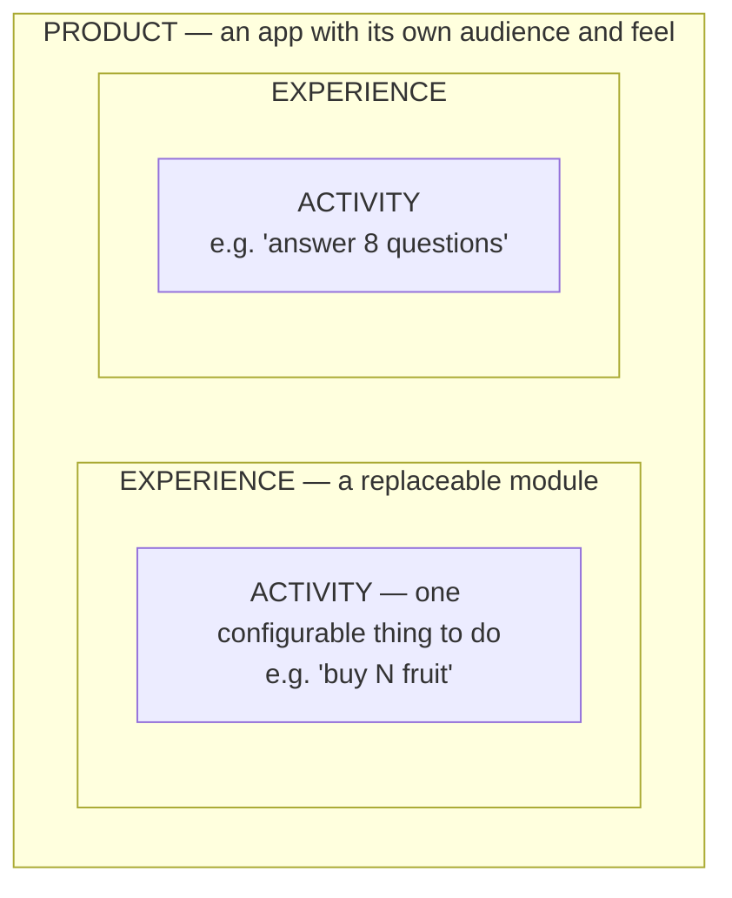

# Product modules and experiences

*How independent products and replaceable experiences sit on the shared
platform, and what any experience must provide in order to plug in.*

| Label | Meaning |
|---|---|
| **Agreed** | You stated this as a requirement. |
| **Recommended** | My proposal. It waits for your approval. |
| **Future** | Room is kept for it. It is not approved. |
| **Open** | Needs your decision (see `DECISION_LOG.md`). |

---

## 1. Three words



| Word | Meaning | Example |
|---|---|---|
| **Product** | An app someone installs or opens, with its own audience, look, account type and tone | The children's game · TNPSC preparation |
| **Experience** | A module inside a product that a person spends time in. It can be swapped out without changing the platform | Amma's shopping trip · a mock exam · a conversation with an avatar |
| **Activity** | One configurable unit of an experience that produces evidence. The recommender chooses which activity to run and how to configure it | "Buy N apples, shown as a numeral" · "8 questions on Fundamental Rights" |

## 2. The contract every experience follows

**Recommended.** An experience plugs in by honouring the following. Nothing
else is shared.

**It declares (a manifest in the registry):**

- id, version, product
- which activities it offers
- for each activity:
  - its task type, which decides which rules judge it
  - the capabilities it exercises
  - the settings it accepts
  - what counts as "transfer"
- author, licence, review status
- needs: offline, audio, minimum screen

**It receives:** a recommendation, made up of an activity id, its settings and
a recommendation id.

**It sends:** a session of plain events, in order, each with a time offset.
Some examples:

```
round_started { task_type: "produce_set", target: 5, representation: "numeral", is_transfer: false }
item_added    { item: "i1", kind: "apple" }
check_requested
round_completed
```

```
round_started   { task_type: "select_response", item: "q-fr-014", is_transfer: true }
option_selected { option: "b" }
answer_submitted
```

**It never:**

- decides mastery itself
- reads another product's data
- needs to know how the platform stores anything

**It may** show the learner its own immediate feedback: Amma smiling, or "the
correct answer is…". That feedback is part of the experience. The platform
still draws its own conclusions from the events.

**A new subject or task type** needs exactly two additions:

- a capability map (data)
- a rule set for any task type that does not exist yet (a small, tested code
  module)

The recommender, profile, goals and storage are untouched.

## 3. The products

### 3.1 Children's learning game

| | |
|---|---|
| Status | **Agreed** as a product. The apple-shopping activity exists (PR #1). Amma's home scene exists as a visual reference (PRs #2 and #3) |
| Audience | Young children. A guardian creates the account and gives consent |
| Feel | **Agreed:** a game, with no visible assessment, nothing to read and no chores for parents |
| Capabilities now | Early number: numerals, one-to-one counting, cardinality, transfer |
| Capabilities later *(Future)* | Comparing, combining, early language |
| Experiences | Apple shopping (task type `produce_set`). Amma's story scenes later, when your illustrator's art is ready |
| Account | **Recommended:** guardian account, child learner with no login, per-device play |
| Offline | Works offline today. Whether that stays a requirement is **Open** (O-8) |
| Agreed visual direction | Small Indian-town setting, child's first-person view, no avatar choice, handing the basket to the shopkeeper ends the trip. Amma and the warm home are the current reference |

### 3.2 Practice app: the second test experience

| | |
|---|---|
| Status | **Recommended** for V1, in order to prove reuse. Which subject is **Open** (O-3) |
| Why it is needed | **Agreed:** "a second, substantially different minimal experience" proves the core is not shopping-shaped |
| My recommendation | **Exam-style practice** (a small TNPSC Group 1 sample unit, e.g. Indian polity). It differs from the children's game on every axis that matters (table below) and leads into a product you have already named |
| Alternative | A small Spanish vocabulary and phrase activity. It is also different, but it is pulled quickly toward speech recognition and AI conversation, which are deferred |
| Content | **Open (O-4).** I can write 25–40 *sample* items, clearly marked unreviewed, so the loop can be tested. Real exam content needs a qualified reviewer |
| Feel | Plain, fast, text-based. It shows the learner's goal, what to do next and *why* |
| Account | Adult account, self-consent |

How the two test experiences differ:

| | Children's game | Practice app |
|---|---|---|
| Learner | Child, via guardian | Adult, self |
| Interaction | Dragging fruit, tapping | Choosing and submitting answers |
| Task type | `produce_set` | `select_response` (new) |
| Capability map | 6 maths skills | ~8 syllabus capabilities |
| Mastery policy | Short gaps, few items | Longer gaps, more items *(Open, O-7)* |
| Goal | Set by guardian, implicit | Stated by learner, may have a date |
| Assessment visible? | Never | Yes: progress and reasons |
| Offline | Yes | Not needed |
| Assets | Art, audio | Text only, kilobytes |

If the same platform code serves both columns without special cases, the
interfaces are reusable.

### 3.3 TNPSC Group 1 preparation (full product)

**Future.** This means the full syllabus map, diagnostics, a personal study
plan, revision, mock examinations and agreed nudges. The practice app is its
seed.

### 3.4 Spanish learning

**Future.** This means conversational avatars, pronunciation practice, lessons
and proficiency levels. It needs speech and AI adapters and a rule set for
spoken responses, none of which are in V1.

### 3.5 General personal development

**Future.** People create or customise their own pathways. This depends on
authored pathways, which are deferred, and on a review process for
user-created capability maps.

## 4. Products stay separate

**Agreed.**

- **Separate apps.** Each product is its own app, with its own build,
  downloads and look.
- **Separate learner identities.** A person using two products has two learner
  identities. Their histories are not connected unless the person, or a
  guardian, grants it (`PLATFORM_ARCHITECTURE.md` §4).
- **Shared, but small.** Products share only the small platform client:
  events, next activity and sign-in. Shared UI code is the exception, used
  only where it clearly helps.

**Future (both kept possible).** Products might ship as standalone store apps,
or as modules downloaded inside one app.

## 5. Contributors and content

- **Agreed (design for, do not build).** Contributors can propose activities,
  items, capability maps and pathways, with review, versioning, licensing and
  quality control.
- **Recommended for V1.** Every catalogue entry and framework carries these
  fields, filled in by us for now:
  - author
  - licence
  - version
  - review status (*draft → in review → published → retired*)
- **Future.** Contributor accounts, review queues and quality measures (for
  example, does an item reliably separate learners who have the capability
  from those who do not?).
- **Agreed.** There is no marketplace in V1.
