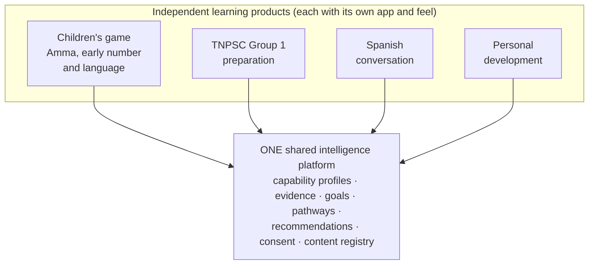
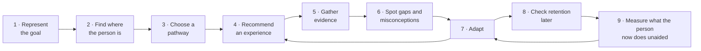

# OpenPath: product vision

*This is my restatement of your "Master product direction" (October 2026), so
you can check that I have understood it. Where I add something of my own, it
is labelled.*

| Label | Meaning |
|---|---|
| **Agreed** | You stated this as a requirement. |
| **Recommended** | My proposal. It waits for your approval. |
| **Future** | A possibility we are keeping room for. It is not approved. |
| **Open** | A question only you can decide (see `DECISION_LOG.md`). |

---

## In one sentence

OpenPath helps each person develop capabilities they have chosen, and shows,
with evidence, that the development actually happened.

> It is not primarily about delivering lessons.

## The problem, in your words

Take 100 people with different starting points, interests and ambitions. The
aim is for **all 100** to make meaningful progress toward goals they chose.
Most learning products serve the middle of that group and measure activity
(minutes spent, lessons finished). OpenPath measures **capability**: what a
person can now do on their own, in an unfamiliar situation, some time later.

## What we are building, and what we are not

**Agreed.** We are building the intelligence and infrastructure underneath.
Each of the following may become a *product* on top of it, but none of them is
the platform:

- a children's game
- a quiz app
- a TNPSC preparation app
- an AI chatbot
- a course marketplace
- a learning management system

**Agreed.** Products are *not* forced into a single dashboard, and do not
share frontend code unless it helps. Each one feels right for its audience: a
child sees a game with no visible assessment, and an exam candidate sees a
study plan.

**Agreed.** We do not need to invent every technology. Our ambition is to be
excellent at putting the pieces together:

- integration
- effectiveness
- reliability
- personalisation
- user experience

## The central asset: a living capability profile

**Agreed.** Every person has a durable, evidence-based record of what they can
do. It is not a score of who they are. `CAPABILITY_MODEL.md` describes it in
detail. In short:

- **It is built from capabilities and the links between them.** An example is
  "knows how many", which needs "counts one by one" first.
- **Every statement in it is backed by evidence you can trace.** You can see
  which activity, when, what the person did, and which rule drew the
  conclusion.
- **It distinguishes four broad stages:** *not yet assessed*, *struggling*,
  *demonstrated* and *mastered*.
- **It tracks four further things:** misconceptions, confidence, retention
  over time and transfer to new situations.
- **It never judges intelligence, personality or potential, and never infers
  sensitive traits.**
- **An LLM may help, but is never the sole judge of mastery.**
- **It can be revised.** When the rules improve, the profile is recomputed
  from the original evidence.
- **It is portable across our own products, but only with the person's
  permission.**

## The learning loop

**Agreed.** For any goal, whether it is "clear TNPSC Group 1", "speak
conversational Spanish" or "understand division", the platform should:

## Engagement

- **Agreed.** The platform may act as a long-term learning partner: study
  plans, reminders, revision and encouragement, and a way back after missed
  sessions.
- **Agreed.** Not every product needs daily use. There are no chores for
  parents or learners.
- **Agreed.** Nudges are configurable, permission-based, relevant and easy to
  switch off.

## Experiences are replaceable

**Agreed.** Games, stories, AI conversation partners, lessons, videos,
quizzes, simulations, projects and teacher observations are all *experiences*.
Each one is a module that can be swapped out. Amma's shopping game is one
example, and its art and story must not shape the platform. Your illustrator
will create original art. For now we use placeholders and **do not spend on
animation tools or art production**.

## Pathways and contributors

- **Agreed (eventually).** People can choose a pathway, customise it, combine
  resources, set goals and explore new subjects.
- **Agreed (design for).** Qualified contributors can author lessons,
  activities, capability maps and pathways, with review, versioning, licensing
  and quality control.
- **Agreed.** There is no marketplace in V1.

## Privacy

**Agreed.**

- **No automatic sharing.** Products do not share a person's learning history
  automatically. Connecting them requires explicit permission.
- **Guardian controls.** Children's accounts have guardian controls and
  consent.
- **Minimal data.** We collect as little as possible, and identity is kept
  separate from evidence.
- **Export and delete.** People can understand, export and delete their data.
- **Light apps.** A TNPSC app never downloads children's animation assets.

## What success looks like

**Recommended.** These are the measures I suggest for judging the platform.

1. **Development is demonstrated, not claimed.** For a capability marked
   *mastered*, we can show:
   - unaided success
   - in more than one situation
   - surviving a gap in time
2. **Recommendations can be explained.** For any recommendation, the platform
   can say in plain words why it was made, from which evidence.
3. **The core is general.** A second, very different product works on the
   same core without changing it, adding only its own capability map,
   activities and rules.
4. **Learners have a better path.** Learners who start behind get a different,
   gentler path, not the same path more slowly.

## Future possibilities (not approved)

These are listed so the design leaves room for them. They are not requirements.

- Standalone apps versus downloadable modules inside one app *(you said: preserve both possibilities)*
- Conversational AI avatars, pronunciation scoring and speech recognition
- Training or customising our own AI components
- Teacher and school accounts, including teacher observations as evidence
- A creator portal and, later, a marketplace
- Learning preferences, but only where evidence supports them
- Native mobile apps (React Native / Expo)
