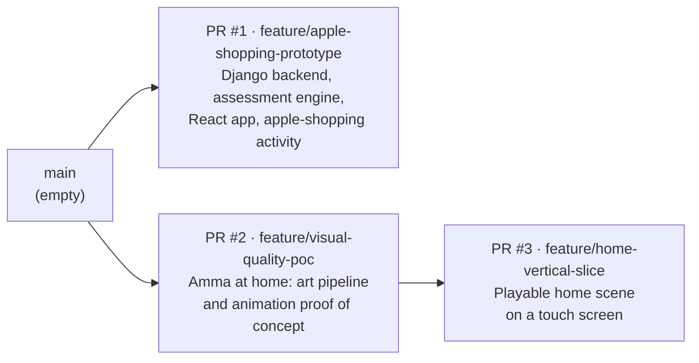
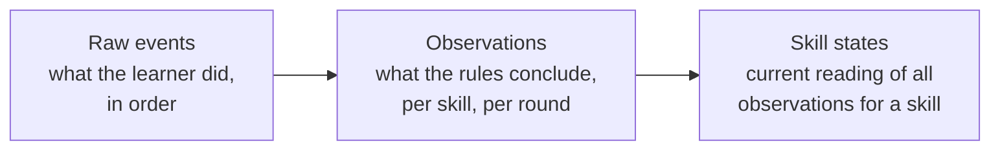

# Repository audit

*October 2026. Covers items A–C of the architecture instruction: what is in
`premsethutmc/openpath`, what works, what is missing and what is too tied to the
shopping game.*

**Labels used in every document in this folder**

| Label | Meaning |
|---|---|
| **Agreed** | You stated this as a requirement. |
| **Recommended** | My proposal. It waits for your approval. |
| **Future** | A possibility we are keeping room for. It is not approved and not planned for V1. |
| **Open** | A question only you can decide. |

---

## 1. Where the code is today

`main` is empty apart from the first commit. All the work so far sits on three
pull requests that have **not been merged**:

| Branch | What it holds | Size | Status |
|---|---|---|---|
| `feature/apple-shopping-prototype` (PR #1) | The **platform seed**: backend, assessment engine, web app, first activity, tests, CI | 75 files | All CI checks pass: backend on Python 3.10, 3.12 and 3.13; frontend typecheck, tests and build; browser end-to-end against PostgreSQL |
| `feature/visual-quality-poc` (PR #2) | Art and animation experiment for Amma's home | — | Accepted by you as the visual reference |
| `feature/home-vertical-slice` (PR #3) | The playable home scene built on PR #2 | — | Playable preview. Not yet tried on a real Android phone |

This audit branch is cut from `main`, so its pull request contains documents
only. Links to code below point to the branch where the code lives.

---

## 2. What already exists and works

### 2.1 Identity and privacy (backend app `learners`)

- **Pseudonymous learners.** A learner is a random ID and nothing else: no name,
  birth date, e-mail or school
  ([`learners/models.py`](https://github.com/premsethutmc/openpath/blob/feature/apple-shopping-prototype/backend/learners/models.py)).
- **An access token per learner.** Only a hash of the token is stored, and enrolment is rate-limited.
- **Consent records.** Each record notes who gave consent (guardian or school) and the policy version.
- **Export and delete.** Export returns everything held about a learner as one file. Delete removes the learner and all their evidence.

### 2.2 Evidence (backend app `evidence`)

- **Raw events are the source of truth** and are only ever added to.
  Observations and skill states are *derived* from them. When the rules
  improve, everything can be recomputed from the raw events with one command
  (`manage.py reassess`).
- **Safe uploads.** Sending the same session twice changes nothing, so a phone on a poor connection can simply retry.
- **Integrity check.** The engine replays the events itself and never trusts the game's own "correct". A session that does not replay cleanly produces no evidence.
- **Engine version.** Every session records the engine version that judged it.

### 2.3 Assessment engine (`backend/assessment`, pure Python)

This is the most valuable part of the repository, and most of it is already
domain-neutral.

| Part | What it does | Shopping-specific? |
|---|---|---|
| [`evaluate.py`](https://github.com/premsethutmc/openpath/blob/feature/apple-shopping-prototype/backend/assessment/evaluate.py) | Splits a session into rounds and hands each round to the rule set registered for its *task type* | No |
| [`rules/produce_set.py`](https://github.com/premsethutmc/openpath/blob/feature/apple-shopping-prototype/backend/assessment/rules/produce_set.py) | Rules for "build a set of N things" (the classic give-N task). Decides independent, supported or not yet for numeral reading, one-to-one counting, cardinality and transfer | It is maths-specific, which is correct for a rule set. Shopping is only its skin |
| [`mastery.py`](https://github.com/premsethutmc/openpath/blob/feature/apple-shopping-prototype/backend/assessment/mastery.py) | Turns a skill's observations into a status with named criteria, from *no evidence* through *mastered* to *needs review*. One good session can never produce *mastered* | No, though its thresholds are tuned for young children |
| [`progression.py`](https://github.com/premsethutmc/openpath/blob/feature/apple-shopping-prototype/backend/assessment/progression.py) | Builds the profile with prerequisites, then plans the next session | **Yes.** See section 4 |
| [`scenarios.py`](https://github.com/premsethutmc/openpath/blob/feature/apple-shopping-prototype/backend/assessment/scenarios.py) | Scripted pretend learners for tests | Yes, which is acceptable for test helpers |

- **49 engine tests** pass. The engine imports nothing from Django, so it can
  be tested and reused on its own.
- **A matching TypeScript copy** lets the children's app work offline
  ([`frontend/src/core/engine`](https://github.com/premsethutmc/openpath/tree/feature/apple-shopping-prototype/frontend/src/core/engine)).
  Shared test cases in `shared/golden/cases.json` prove the two copies agree.

### 2.4 Capability definitions

A single file,
[`shared/curriculum/math-early-number.json`](https://github.com/premsethutmc/openpath/blob/feature/apple-shopping-prototype/shared/curriculum/math-early-number.json).

- **Six skills:**
  - reads numerals
  - counts one by one
  - knows how many
  - uses quantity in new situations
  - compares two amounts *(not yet assessed)*
  - puts two amounts together *(not yet assessed)*
- **Prerequisites** between the skills.
- **One mastery policy:**
  - at least 3 unaided successes
  - in at least 2 different contexts and 2 sessions
  - at least 3 days apart
  - with at least 80% accuracy over the last 5 attempts

### 2.5 Web app (`frontend/`, React and TypeScript)

- **The apple-shopping activity.** It opens straight into the game, the child has nothing to read, and every action is recorded as an event.
- **Offline first.** Play is stored on the device, and uploaded once a grown-up gives consent.
- **A grown-ups' view.** It shows each skill's status and the criteria behind it.
- **Tests.** 19 frontend tests pass, and a browser end-to-end test plays a whole visit against a real PostgreSQL database.

### 2.6 Amma's home scene (`game/`, PRs #2 and #3)

- **A self-contained PixiJS scene** with the approved character and room. It
  is already split into stage, actor, gameplay rules and a content file of
  lines and timings, so artwork can be replaced without touching gameplay.
- **Not connected to anything.** It records taps in memory only: no evidence,
  no learner and no backend.
- **Built through a custom art pipeline.** Under the new direction
  ("avoid unnecessary art-production work") I recommend parking this pipeline,
  not extending it.

---

## 3. What is missing for the platform you described

| Platform area | Today | Gap |
|---|---|---|
| Identity, accounts, consent | Pseudonymous child learner with one consent record | No **accounts** for adults or guardians, no guardian–child link, no per-product enrolment, and consent is not split by purpose |
| Capability definitions | One file of 6 skills, one subject, loaded from a server setting | No way to hold **several frameworks** at once (early number, TNPSC syllabus, Spanish). No versioning in the database, no misconceptions, and no policy per framework |
| Learner profile | Statuses computed on demand, plus a cached table | No explicit **confidence**. Transfer is modelled as a separate skill instead of a property of evidence for every skill. No product scoping |
| Evidence | Strong: raw events, derived observations, integrity, replay | Only one task type. Observations do not record which **activity version** or **rule version** produced them, which provenance needs |
| Goals | — | **Missing entirely** |
| Pathways | — | **Missing entirely**. The prerequisite graph exists but nothing plans a route through it toward a goal |
| Adaptive recommendations | `plan_next_session` returns one shopping plan with one sentence of reason | Not general, and the **recommendation itself is not stored**, so "why was this recommended last Tuesday?" cannot be answered |
| Retention checks | A next-review date is calculated | Nothing **acts** on it |
| Content and experience registry | An activity is just a text label on a session | No catalogue of experiences, of which capabilities they exercise, or of version, author, licence or review state |
| Engagement and notifications | — | Missing (fine for now) |
| AI provider adapters | — | Missing (fine for now) |
| Animation and media adapters | Inside the game only | Missing (fine for now) |
| Second, different experience | — | Missing: needed to prove the interfaces are reusable |
| Product separation | One web app | No separate product frontends yet. A second product would currently be built into the children's bundle |

---

## 4. What is too tied to the shopping game

These are the places where shopping has leaked into what should be shared
platform. They are listed from most to least important.

1. **"What next" is a shopping plan.** `plan_next_session` in
   [`progression.py`](https://github.com/premsethutmc/openpath/blob/feature/apple-shopping-prototype/backend/assessment/progression.py)
   returns three apple-shopping rounds: fixed tables of fruit kinds and target
   numbers, with a difficulty band chosen by looking at two counting skills by
   name. The *decision* ("practise cardinality with small numbers") and the
   *activity details* ("3 apples, then 2 oranges") are fused together.
   Every new product would need its own copy of this.
   **Recommended:** split it into a general recommender that picks *what
   capability to work on, and why*, and a small per-activity generator that
   turns that choice into concrete rounds. The shopping tables move into the
   apple-shopping activity.

2. **"Core" types in the web app describe shopping.** In
   [`frontend/src/core/types.ts`](https://github.com/premsethutmc/openpath/blob/feature/apple-shopping-prototype/frontend/src/core/types.ts),
   `RoundSpec` has `target_kind`, `available` (the shelf) and a task type that
   can only be `"produce_set"`. Any other activity would have to pretend to be
   shopping.
   **Recommended:** keep a small shared envelope (session, events, outcome) and
   move round shapes into each activity.

3. **One global curriculum.** The server loads exactly one curriculum file from
   a setting, and every learner's profile is computed against it.
   **Recommended:** a capability registry holding several versioned
   frameworks.

4. **One mastery policy for everything.** The policy (3 successes, 2 contexts,
   3-day gap) suits a six-year-old counting apples. An adult revising for an
   exam needs different evidence, such as more items and longer retention
   intervals.
   **Recommended:** a policy per framework, overridable per capability.

5. **Transfer is a skill.** "Uses quantity in new situations" is a separate
   skill. In the platform you describe, transfer applies to *every*
   capability: can you do it somewhere unfamiliar?
   **Recommended:** keep the `is_transfer` flag that observations already carry
   and report transfer per capability. The existing skill stays in the early
   number framework for compatibility.

6. **Two copies of the whole engine.** Python and TypeScript both contain
   evaluation, mastery *and* shopping planning. That is justified for an
   offline children's game, but the instruction warns against duplicated
   implementations, and a TNPSC web app does not need it.
   **Recommended:** keep the device copy only where offline play is a real
   requirement, and only for evaluation. Recommendations come from the server,
   with a few next activities fetched ahead for offline use.

7. **Child-only identity.** Consent can only be given by a guardian or a school.
   An adult studying for TNPSC consents for themselves.

**Not too tied to shopping (keep as is):**

- the event format
- the rules registry by task type
- the integrity replay
- the mastery status logic
- the derived-and-rebuildable evidence design
- the privacy model

---

## 5. Smaller findings

- **The older architecture document is out of date.**
  `docs/ARCHITECTURE.md` on PR #1 describes the shopping prototype's design.
  It predates the new direction, and the documents in this folder supersede it
  for platform matters.
- **PR #1's last commit `df50049` has not been confirmed by you.** It opens
  the children's app straight into the game, moves consent to the grown-ups'
  area and keeps one kind of fruit per trip until counting looks secure. See
  `DECISION_LOG.md`, decision O-2.
- **PR #1's description is slightly stale.** It still refers to commit
  `bb6e79e` as its latest.
- **The game is not wired to evidence.** That is by design for a visual proof
  of concept, but it means no learning evidence comes out of PRs #2 and #3
  today.
- **PR #3 is untested on hardware.** It has been tested in emulation only (a
  Pixel 7 profile), not on a physical Android phone.
- **No production infrastructure exists.** There is no hosting, no paid service
  and no deployed database, so nothing is at risk.
