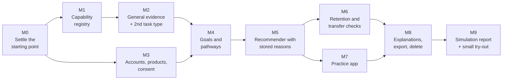

# V1 implementation plan

*Items F, G and I of the architecture instruction. This whole plan is
**Recommended** and waits for your approval. No code will be written for it
until you approve.*

| Label | Meaning |
|---|---|
| **Agreed** | You stated this as a requirement. |
| **Recommended** | My proposal. It waits for your approval. |
| **Future** | Room is kept for it. It is not approved. |
| **Open** | Needs your decision (see `DECISION_LOG.md`). |

---

## 1. The smallest credible V1 (item I)

**V1 must prove one claim:** *the same platform can take two very different
learners toward their own goals, adapt to what each actually does, check later
that the learning stuck, and explain every recommendation, without any
subject- or game-specific code in the core.*

### What V1 contains

| In V1 | Detail |
|---|---|
| **Two product apps** | 1. The **children's app**, with today's apple-shopping activity and simple placeholder art. 2. The **practice app**, a plain web page of exam-style questions (subject: O-3) |
| **Two capability frameworks** | Early number (the existing 6 skills). One small sample syllabus unit (~8 capabilities, 25–40 sample items) |
| **Two task types** | `produce_set` (exists) and `select_response` (new) |
| **Accounts** | Adult account. Guardian account with a child learner who has no login. Per-product learner identities. Consent per purpose |
| **Goals and pathways** | One active goal per learner per product. A pathway computed from the prerequisite graph and stored when it changes |
| **Recommender** | The five-step policy in `CAPABILITY_MODEL.md` §5, with every recommendation stored with its reasons |
| **Diagnostic start** | A short first session that samples the framework, so the profile starts from evidence, not from age or grade |
| **Retention and transfer** | Due checks appear in recommendations when the learner returns |
| **Explanations** | "Why this next?" and "What is this based on?" pages: for guardians in the children's app, for the learner in the practice app |
| **Privacy** | Export and delete covering everything. No cross-product view without a grant |
| **Proof** | A simulation report of pretend learners going through both products over weeks. Then a small real try-out (O-13) |

### What V1 does not contain

The following are left out of V1 (item G):

- notifications and nudges
- AI or LLM features
- speech
- avatars
- new illustration or animation
- animation-tool licences
- native mobile apps
- teacher or school accounts
- pathway authoring and customisation UI
- contributor accounts and review queues
- marketplace
- statistical learner models (IRT or BKT)
- learning-preference detection
- analytics dashboards
- payments
- microservices
- production hosting (until O-12)

## 2. Milestones (item F)

Each milestone is a separate pull request. Each one can be tested on its own
and leaves everything working. The existing 49 engine tests, 19 app tests, the
Django tests and the browser end-to-end test stay green at every step.

Sizes are relative: **S** is a few days of work, **M** is about a week, **L**
is more than a week.

### M0 · Settle the starting point (S)

**What changes:**

- PR #1 is merged into `main` after your approval (O-1), so `main` holds the
  platform seed.
- Your call on `df50049` is applied (O-2).
- PRs #2 and #3 stay open and parked.
- If you approve the layout (O-11), folders are moved, but no logic changes.

**How you will know it works:** CI is green on `main`, and the apple-shopping
game plays exactly as before.

### M1 · Capability registry (M)

**What changes:**

- Frameworks and capabilities are loaded from versioned files into the
  database.
- Several frameworks can coexist, each with its own mastery policy.
- Capability ids are permanent.
- The early-number file becomes framework #1. A sample syllabus file becomes
  framework #2.

**Tests:**

- Both frameworks load.
- Prerequisites contain no loops.
- Changing a framework version keeps old evidence readable.

**How you will know it works:** a page lists both frameworks with their
capabilities and links. Meena's profile is unchanged.

### M2 · General evidence and a second task type (M)

**What changes:**

- Observations record product, activity version, rule version and framework
  version.
- Stage names are mapped to your four (`CAPABILITY_MODEL.md` §2).
- Confidence and misconception fields are added.
- The `select_response` rule set is added: independent means right first
  time, supported means right after a hint, not yet means wrong.
- Wrong options can name a misconception.

**Tests:**

- Pretend practice-app sessions produce the expected observations.
- Recomputing from raw events gives identical results.

**How you will know it works:** a test report showing each scripted answer
pattern and its conclusion.

### M3 · Accounts, products and consent (M)

**What changes:**

- Adult and guardian accounts are added. A child learner has no login.
- Each product has its own learner identity.
- Consent is recorded per purpose.
- A grant to link two products is recorded, though it has no UI yet.
- V1 sign-in method: decision O-5.

**Tests:**

- The practice app cannot read children's evidence.
- A guardian can see, export and delete their child's data.
- Withdrawing consent stops server storage.

**How you will know it works:** a short click-through: sign up, add a child,
play, export, delete.

### M4 · Goals and pathways (M)

**What changes:**

- The goal record is added.
- The pathway is computed from the goal and the graph, and stored with its
  change history.
- The children's app gets a default goal set by the guardian.

**Tests:**

- Pretend learners at different starting points get different pathways.
- A pathway re-plans after new evidence and records why.

**How you will know it works:** for three pretend learners, a printed pathway
with its changes.

### M5 · Recommender with stored reasons (L)

**What changes:**

- The general recommender replaces `plan_next_session`.
- The shopping fruit and number tables move into the apple-shopping
  activity's *round generator*.
- Every recommendation is stored with its reasons and the alternatives it
  considered.
- The diagnostic start is added.
- The children's app requests a few recommendations ahead for offline play
  (if O-8 keeps offline).

**Tests:**

- The existing golden cases still produce the same children's sessions, or
  any differences are listed and justified.
- The recommender policy is tested on its own, against pretend learners.

**How you will know it works:**

- The game behaves as before.
- A new page shows "next: …, because …" for any learner.

### M6 · Retention and transfer checks (S)

**What changes:**

- Due retention checks and transfer challenges enter the recommendations.
- Each learner has at most one retention check per session.

**Tests:** simulated time. A pretend learner who succeeds today is checked in 3
days. Success doubles the gap, and failure moves the capability to *needs
review*.

**How you will know it works:** a timeline chart for a pretend learner over 30
days.

### M7 · Practice app (M)

**What changes:**

- A separate small web app is added: sign in, state a goal, take the
  diagnostic, answer recommended question sets, and see progress and reasons.
- It uses sample content (O-4).
- No children's code or assets are included.

**Tests:**

- A browser end-to-end test of a full loop.
- An automatic size check that the build contains no children's assets.

**How you will know it works:** a link you can open on your phone. This needs
local or approved hosting (O-12). Until then: a screen recording and a
self-contained file.

### M8 · Explanations, export and delete everywhere (S)

**What changes:**

- A guardian page shows Meena's capabilities, the evidence behind each and
  why the next activity was chosen, with no "struggling" labels shown to the
  child.
- The learner page in the practice app does the same for the learner.
- Export and delete now cover accounts, goals, pathways and recommendations.

**How you will know it works:** a click-through, and an exported file you can
read.

### M9 · Proof (M)

**What changes:**

- **Simulation report.** About 100 pretend learners with different starting
  points and behaviours (fast, slow, forgetful, guessing, careless) run
  through both products over simulated weeks. The report shows:
  - who reached *mastered*, and how long it took
  - that nobody reached it from one session
  - that forgetful learners were caught by retention checks
  - that guessers stayed below *demonstrated*
  - that every recommendation has a reason
- **Small try-out**, with your approval (O-13). Real adults use the practice
  app. Children play only after legal review and proper guardian consent
  (O-10).

**How you will know it works:** the report, written for you, not for
engineers.

## 3. What can wait (item G)

These can be added later without reshaping the core. The fields and borders
that make each one possible are already in this plan.

| Deferred | Why it is safe to wait | What V1 does to keep the door open |
|---|---|---|
| Nudges and notifications | The loop works when the person returns on their own | Retention due dates and per-purpose consent already exist |
| AI and LLM features | V1 judges with rules | An AI adapter contract is written down. AI output would be content or a hint, never mastery |
| Speech and avatars (Spanish) | Needs new task types only | Rule sets are plug-ins by task type |
| New art and animation, tool licences | Media stays inside product apps | Activity versions are recorded, so new art means a new version, not a new platform |
| Authored and customised pathways | Computed pathways prove the loop | Pathways are stored records with a *source* field |
| Contributors, review, marketplace | We author V1 content ourselves | Author, licence, version and review status on every entry |
| Statistical learner models | Need real data to validate | Raw evidence is kept, so new models can be computed from history |
| Teacher and school accounts | Not needed for the loop | Consent's "given by" already allows *school* |
| Mobile apps (Expo) | Web works on Android | The platform client is plain HTTP plus JSON |
| Cross-product linking UI | Needs two real products first | The grant record exists from M3 |
| Separate services | One server is enough well beyond a pilot | The modules talk through narrow functions |

## 4. Risks I see

| Risk | What reduces it |
|---|---|
| The sample exam content is wrong or unrepresentative | Label it *sample*. Have a qualified reviewer check it before any real learner uses it (O-4) |
| The mastery thresholds for adults are guesses | Start conservative, make them per-framework data, and revisit after the try-out (O-7) |
| Children's data and the law | No real children's data on a server before legal review (O-10). Offline play stores data on the device only |
| Two engine copies drift apart | Shrink the device copy to evaluation only, and keep the shared golden cases |
| Scope creep toward art or AI | This plan; anything else goes through `DECISION_LOG.md` first |
