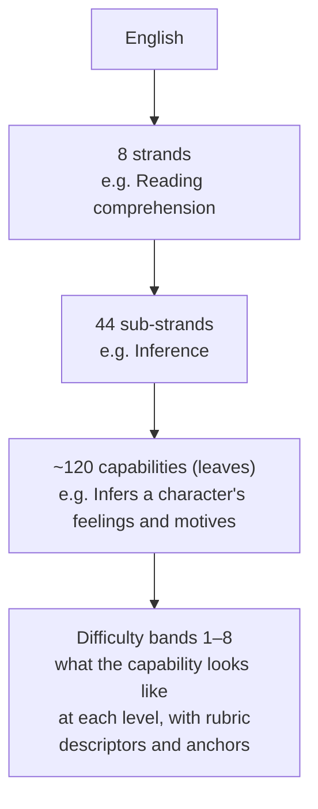

# English capability framework (ages 10–15)

*Draft v0 for review. It is **Recommended** throughout, and should be reviewed
by an English-education specialist before learners see anything built on it
(decision D-4).*

## 1. Shape of the framework



- **Capabilities (leaves) are where estimates live.** A capability is
  something a learner can *do*, stated so that it can be observed.
- **Sub-strand and strand values are computed** from their leaves (see
  `COMPOSITE_MODEL.md` §3). They are never estimated directly.
- **Difficulty is a level within a capability, not a separate capability.**
  "Uses vocabulary from context" exists at band 2 (simple sentences, familiar
  topic) and at band 7 (abstract text, subtle clues). This keeps the tree
  manageable while still letting it run from foundational gaps up to advanced
  work.
- **Context is described, not modelled as capabilities.** Genre, topic
  familiarity, text length, response format and support given are recorded
  with each piece of evidence as *facets*. They affect an item's difficulty,
  and they show transfer: success across different facets.

### The band scale

There is **one scale for every capability**, from 1 to 8. It is continuous, so
a learner can be at 4.6. Bands are written so that the same number means
roughly the same level of demand across capabilities.

| Band | Working description | Rough CEFR alignment* |
|---|---|---|
| 1 | Foundational gap: early-primary literacy not yet secure | below Pre-A1 / Pre-A1 |
| 2 | Simple words and sentences with support | A1 |
| 3 | Short familiar texts, basic accuracy | A2 |
| 4 | Everyday texts handled independently | A2+ / B1 |
| 5 | Age-typical secondary texts, mostly accurate | B1 |
| 6 | Longer, less familiar texts, good control | B1+ |
| 7 | Complex texts, inference and style, consistent accuracy | B2 |
| 8 | Advanced for age 15: nuance, argument, precision | B2+ / C1 |

\* The alignment is to the Common European Framework of Reference (Council of
Europe, Companion Volume 2020). It is *indicative only*. We write our own
descriptors rather than copying CEFR text, and whether to align formally with
CEFR or with Indian school standards (CBSE, NCERT or the state board) is
decision D-4.

**The scale describes demonstrated English, not the learner.** A 15-year-old at
band 3 in writing is a learner with a writing gap that the product should
close. It is not a label (A-11). Whether any status refers to age expectations
is decision D-5. My recommendation is that it does not.

## 2. The hierarchy

Each sub-strand lists its capabilities.

- **◆** marks the **walking-skeleton slice** (17 capabilities, built in E1).
- **★** marks the **core V1 set** (about 56 capabilities, fully specified in E2,
  including the ◆ ones).
- The rest are in the framework from the start but are specified later.
  Listening and speaking need audio and speech recognition, so they come
  later (D-7).

### EN.FND · Foundations of literacy

Used to find gaps. Most learners at band 4 or above test out within a few
items.

| Sub-strand | Capabilities |
|---|---|
| FND.PHON Phonics and decoding | letter–sound correspondence · digraphs and blends · vowel patterns · decoding multisyllabic words *(audio)* |
| FND.WREC Word recognition | high-frequency words · irregular words · recognition speed (timed) |
| FND.SPL Spelling | regular patterns · ◆ inflection spelling rules (doubling, *-ies*, dropping *e*) · ★ homophones · ★ morphological spelling (prefix and suffix) · commonly confused words |
| FND.FLU Reading fluency *(audio)* | accuracy · rate · phrasing and prosody |

### EN.VOC · Vocabulary

| Sub-strand | Capabilities |
|---|---|
| VOC.BRD Breadth | ◆ general vocabulary breadth (frequency bands serve as its difficulty) · ★ academic vocabulary |
| VOC.MOR Word structure | ★ prefixes · ◆ suffixes and word class · roots and word families |
| VOC.CTX Meaning in context | ◆ meaning from context clues · ★ multiple-meaning words |
| VOC.REL Word relations | ★ synonyms and antonyms · shades of meaning · ★ collocations |
| VOC.FIG Figurative and idiomatic | ★ similes and metaphors · idioms · ★ phrasal verbs |
| VOC.USE Productive use | ★ precise word choice in writing · register-appropriate words |

### EN.GRM · Grammar and usage

| Sub-strand | Capabilities |
|---|---|
| GRM.NOUN Nouns and determiners | ★ plurals and countability · ◆ articles · quantifiers · possessives |
| GRM.PRON Pronouns | forms and case · clear reference |
| GRM.VERB Verbs | ★ present and past simple · ◆ progressive and perfect aspect · ◆ subject–verb agreement · ★ modals · ★ passive voice · ★ conditionals · future forms · gerunds and infinitives |
| GRM.MOD Modifiers | adjective and adverb forms · ★ comparatives and superlatives · order of modifiers |
| GRM.PREP Prepositions | ★ time and place · dependent prepositions |
| GRM.CLS Clauses and sentence types | ★ questions · negatives · ★ relative clauses · ★ reported speech · subordinate clauses |
| GRM.PUN Punctuation and mechanics | ★ capitalisation · ★ end punctuation · ◆ commas · ★ apostrophes · quotation marks · semicolons and colons |

### EN.SEN · Sentence construction

| Sub-strand | Capabilities |
|---|---|
| SEN.CMP Completeness | ★ complete sentences vs fragments · ◆ avoiding run-ons and comma splices |
| SEN.CMB Combining | ★ coordination · ◆ subordination · ★ embedding (relative and participle phrases) |
| SEN.VAR Variety and control | sentence variety · word order for emphasis · parallel structure |
| SEN.COH Cohesion | reference across sentences · ★ connectives and transitions |
| SEN.PRE Precision | concision and redundancy · avoiding ambiguity |

### EN.RDG · Reading comprehension

| Sub-strand | Capabilities |
|---|---|
| RDG.LIT Literal | ◆ locate explicit detail · ★ sequence events |
| RDG.INF Inference | ◆ infer feelings and motives · ★ cause and effect · implied meaning · prediction |
| RDG.SUM Main idea | ◆ identify main idea · ★ summarise |
| RDG.STR Structure and features | ★ non-fiction text structure · text features (headings, captions, tables) |
| RDG.CRF Author's craft | ★ purpose and audience · tone and mood · narrative viewpoint · effect of figurative language |
| RDG.CRT Critical reading | ★ fact vs opinion · evaluate argument and evidence · compare texts |
| RDG.RNG Range | sustained comprehension of longer texts |

### EN.WRT · Writing

| Sub-strand | Capabilities |
|---|---|
| WRT.TSK Task and ideas | ◆ task response and relevance · ★ idea development and detail |
| WRT.ORG Organisation | ◆ paragraphing · openings and closings · ★ logical sequencing |
| WRT.GEN Genres | ★ narrative · descriptive · informative or explanatory · ★ persuasive or argument · ★ functional (letters, emails, notices) · summary writing |
| WRT.STY Style | ★ audience and register · voice and tone |
| WRT.ACC Accuracy in writing | ◆ grammatical accuracy in context · ◆ spelling in context · punctuation in context |
| WRT.PRC Process | revising for meaning · editing own work |

### EN.LIS · Listening *(audio, E5 or later)*

| Sub-strand | Capabilities |
|---|---|
| LIS.GST Gist and detail | main idea · specific detail |
| LIS.INF Inference | speaker attitude and purpose · implied meaning |
| LIS.FNC Functional listening | follow multi-step instructions · note-taking |
| LIS.PHN Sound discrimination | sounds, stress and intonation (supports FND) |

### EN.SPK · Speaking *(speech recognition, later; D-7)*

| Sub-strand | Capabilities |
|---|---|
| SPK.PRN Pronunciation | intelligibility · word stress and intonation |
| SPK.FLU Fluency | pace and pausing |
| SPK.ACC Accuracy and range | grammatical accuracy and range in speech |
| SPK.INT Interaction | asks and answers questions, takes turns |
| SPK.PRS Organised talk | short presentations, retelling |

**Totals:** 8 strands, 44 sub-strands and about 120 capabilities, of which 17
are ◆ and about 56 are ★ (counting the ◆ ones).

## 3. What each capability record holds

Example, abbreviated:

```yaml
id: EN.SEN.CMP.run_ons
name: Avoids run-on sentences and comma splices
description: Ends or joins independent clauses correctly when writing.
strand: EN.SEN            # parent chain gives the hierarchy
weight_in_parent: 1.0
observable_through: [error_find, sentence_repair, extended_writing]
bands:                    # what success looks like at each band (own wording)
  2: Separates two short, simple statements with a full stop.
  4: Correctly joins or separates clauses in everyday writing, most of the time.
  6: Controls sentence boundaries in longer writing, including with transitions.
  8: Uses boundary choices (semicolon, dash, subordination) deliberately for effect.
misconceptions:           # controlled list: the only tags an evaluator may use
  - comma_splice: Joins two independent clauses with only a comma.
  - fused_sentence: Runs two independent clauses together with no punctuation.
  - over_fragmenting: Splits dependent clauses off as sentences.
relationships:
  - {type: prerequisite, to: EN.SEN.CMP.fragments, strength: soft}
  - {type: draws_on, to: EN.GRM.PUN.commas, coupling: 0.35}
  - {type: related, to: EN.SEN.CMB.subordination, coupling: 0.30}
rubric: rubric.sentence_boundaries.v1   # used by human and LLM evaluators
anchors: [anchor.run_ons.b3.a, anchor.run_ons.b5.a, anchor.run_ons.b7.a]
review: {status: draft, author: OpenPath, licence: internal}
```

## 4. Relationships between capabilities

There are three kinds. Each has a distinct, limited effect on the composite
(`COMPOSITE_MODEL.md` §4).

| Kind | Meaning | Example | Effect |
|---|---|---|---|
| **Hierarchy** | Leaf belongs to sub-strand, sub-strand to strand | *infer motives* → Inference → Reading | Parent values are computed from leaves |
| **Prerequisite** (soft) | B is usually built on A | *summarise* needs *main idea* | Guides selection. Never caps an estimate |
| **Coupling** (draws on, or related) | Evidence about A carries a little information about B | *grammatical accuracy in writing* draws on *subject–verb agreement* (0.4) | A small, flagged, *inferred* adjustment to B, and a better starting guess for B |

**Coupling strengths start as expert guesses.** They are stored as data, shown
in reports, and are meant to be re-estimated from real learner data later
(Future).

## 5. Rubrics, reference standards and anchors

- **Rubric:** criteria per capability, with descriptors per band. One rubric
  can cover several capabilities in a writing task. For example, a persuasive
  letter is scored for task response, organisation, register, grammatical
  accuracy and spelling.
- **Reference standard:** the rubric plus the band descriptors. It is what the
  evaluator must judge against, never a vague "quality".
- **Anchors:** trusted reference points. There are two kinds:
  - **Anchor responses.** Real or carefully written learner responses with an
    agreed human score at a known band. They show the evaluator what band 3
    or band 6 looks like, and they are re-scored regularly to check the
    evaluator has not drifted (`EVALUATION_AND_UPDATES.md` §4).
  - **Anchor items.** Objective items whose difficulty is well established.
    They keep the scale fixed over time.
- **Who makes them (D-4):** I can draft rubrics and candidate anchor
  responses. They only become *trusted* anchors once a qualified English
  educator has scored them, ideally two educators independently, keeping only
  the responses where they agree.

## 6. Versioning

- **Published versions are locked.** As in the earlier M1 design, a published
  framework version is locked by a fingerprint.
- **Ids are never reused.** Capability ids are permanent, and a renamed or
  split capability gets a new id plus a mapping from the old one.
- **Every estimate records its framework version.** So a composite can always
  say which framework version produced it.
