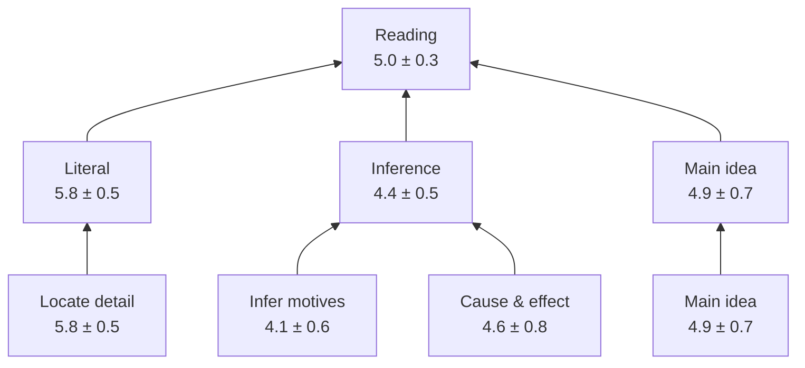
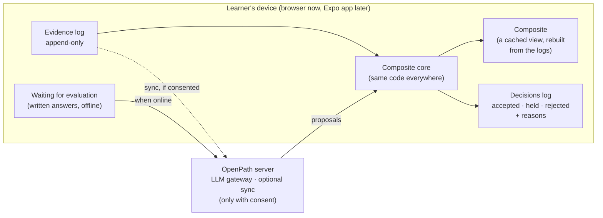

# The learner composite

*Every part of this document is **Recommended**: a design for your approval.
The formulas are deliberately simple, so that every number can be explained
and tested. Exact constants are set and tested in milestone E1.*

## 1. What the composite is

The composite is the learner's persistent, numerical English profile. For
**every capability leaf** it holds:

| Field | Meaning | Example |
|---|---|---|
| `mean` | Best estimate on the 1–8 band scale | 4.62 |
| `sd` | Uncertainty: how far off the estimate could be | 0.61 |
| `direct_n` | Number of evidence items about this capability itself | 7 |
| `inferred` | Whether part of the estimate comes only from *related* capabilities | false |
| `contexts` | Distinct formats or genres where it was directly observed | `["cloze","writing:letter"]` |
| `last_direct_at` | When it was last directly observed | 2026-11-03 |
| `misconceptions` | Tags from the framework's controlled list, each with a strength that fades | `{"comma_splice": 0.7}` |
| `levels` | The highest band *demonstrated* and *mastered* (§5) | demonstrated 4.5 · mastered 3.5 |
| `evidence` | Ids of the accepted observations behind it (newest 50, plus a full log) | `[ev_0193, ev_0187, …]` |

Values for sub-strands, strands and overall English are **computed from the
leaves** whenever they are needed (§3). They are never stored as independent
truths.

> The composite describes demonstrated English, with stated uncertainty. It
> never judges intelligence or potential, and holds no inferred personal traits
> (A-11).

## 2. How evidence moves an estimate

Every estimate is a bell curve: a `mean` and an `sd`. Evidence narrows it and
moves it. There are two kinds of evidence, and one effect of time.

### 2.1 Right-or-wrong items, scored by code

These are items such as cloze, multiple choice, error-finding and sentence
repair. Each item has a **difficulty** `b` on the band scale and a
**discrimination** `a` (how sharply it separates learners).

- **Predicted chance of success:** `p = c + (1 − c) · logistic(a · (mean − b))`,
  where `c` is the guessing rate (for example, 0.25 for four options and 0 for
  typed answers).
- **The update after a right or wrong answer** is the standard one-step
  Bayesian update for this model:
  - a surprising answer moves the mean more than an expected one
  - every answer shrinks the sd a little
  - guessable items count for less

**Worked example (typed answer, `c = 0`, `a = 1.2`).**

| Step | Item difficulty | Answer | p before | mean | sd |
|---|---|---|---|---|---|
| Start (no evidence) | — | — | — | 4.00 | 1.50 |
| Item 1 | 4.5 | right | 0.35 | **5.00** | 1.14 |
| Item 2 | 5.5 | wrong | 0.35 | **4.62** | 0.95 |

After two items the engine already "knows" more, and it says how much more:
the sd fell from 1.50 to 0.95.

### 2.2 Judged evidence

This covers writing and open answers, scored against a rubric by an LLM or a
human. The evaluator reports a **band** for each capability it could see,
together with a confidence. That judgement is treated as a measurement with
known noise. The noise comes from how well that evaluator agrees with trusted
anchors (`EVALUATION_AND_UPDATES.md` §4).

The update weights the judgement by its reliability:

```
gain     = sd² / (sd² + noise²)
mean_new = mean + gain · (judged_band − mean)
sd_new   = sd · √(1 − gain)
```

**Worked example.** The current estimate is mean 4.62, sd 0.95. The LLM judges
band 3.5 with noise 0.8. Then:

- gain = 0.59
- the new mean is 3.96, and the new sd is 0.61
- the change of −0.66 is within the per-evidence cap of ±0.75 (see
  `EVALUATION_AND_UPDATES.md` §5)

### 2.3 Time

Without evidence, certainty fades slowly. `sd² grows by q · days`, up to the
starting uncertainty, so a capability last seen months ago is reported as less
certain.

**Retention checks are scheduled by due date, not by uncertainty growth** (E1,
third review).

- **The first check** falls due 7 days after a capability is first
  demonstrated.
- **Each check** is judged on that session's fresh evidence alone: does it
  favour the retained level over one band lower?
- **A pass doubles the interval** (up to 60 days). **A failure halves it** (down
  to 2 days) and marks the capability *needs review*.
- **Past the due date**, mastery is *not currently verified* (stage *review
  due*), however small the sd is. Previously demonstrated mastery is still
  recorded separately.

- The **mean does not decay automatically.** Forgetting is only concluded from
  evidence.
- `q` is set so that an sd of 0.6 grows to about 0.8 after roughly two months
  without evidence. It is tuned in the simulation.

## 3. From leaves to strands



- **A parent is the weighted average of its children.** Its range is a
  *conservative summary*, not a calibrated measurement. It is the weighted
  average of the children's sds, which is what the sd would be if every
  child's error pointed the same way.
- **Why not combine them as independent?** That was the original rule, and it
  was too narrow. Errors within a strand share causes: the pull of the
  starting value, and coupled updates. In simulation, its "80%" ranges held
  the true value only 57–67% of the time (E1 review, 12 Oct).
- **Only capability-level estimates are measurements.** Aggregates carry
  `calibrated: false` in the data.
- **Weights come from the framework.** They are visible and changeable.
- **Learner and guardian views show the shape across strands, with
  uncertainty.** An overall English figure exists for summaries only.

## 4. Relationships between dimensions

The composite stays *fine-grained* while still using what one capability says
about another. It does this in two ways, both deliberately limited.

**1. Better starting guesses.**

- A capability never observed starts from a guess informed by the coupled
  capabilities that *have* been observed, with wide uncertainty. For example,
  strong evidence on *subject–verb agreement* slightly raises the starting
  guess for *grammatical accuracy in writing*.
- Without coupled evidence, the starting point is a neutral prior: mean 4.0,
  sd 1.5. Age does not set it (D-5).

**2. Small, flagged follow-on changes.**

- When a capability's estimate moves, each coupled capability moves by
  `coupling × change`, capped at ±0.25 per evidence item.
- Those capabilities are marked `inferred`.
- **Inferred changes never count towards a capability being demonstrated or
  mastered.** Only direct evidence can do that.

Couplings are framework data (`CAPABILITY_FRAMEWORK.md` §4). Prerequisites do
*not* move estimates. They only guide selection.

## 5. From numbers to the agreed stages

**Agreed:** distinguish unassessed, struggling, demonstrated and mastered, and
never claim mastery from one interaction (A-2, A-11).

**Recommended:** each stage is defined from the numbers, *per band*, so no age
expectation is needed.

| Stage | Rule (per capability) | Plain-language example |
|---|---|---|
| **Unassessed** | Fewer than 2 direct observations. Inferred values do not count | "Not tried yet. Our starting guess comes from related skills" |
| **Developing** | Some direct evidence, but nothing yet *demonstrated* at the band being worked on | "Getting there at band 5" |
| **Struggling** | In the last 2 sessions on this capability, under 40% success on items *at or below* the current estimate, even with support. This makes selection step down and target the recorded misconception | "Finding run-on sentences hard right now. Practising easier joins" |
| **Demonstrated at band B** | At least 80% probability that true level ≥ B, from at least 3 direct observations in at least 2 contexts | "Shown at band 4.5" |
| **Mastered at band B** | Demonstrated at B, and demonstrated again on *fresh* items in a later session at least 7 days later (gap: D-8) | "Mastered at band 4" |

A learner's report reads, for example: *"Avoiding run-ons: shown at 4.5,
mastered at 4.0, misconception 'comma splice' fading."*

## 6. Where it lives: local-first



- **The device is the primary home of the learner's state.** It runs without a
  connection. Items scored by code update the composite immediately and
  offline. Written answers wait in a queue until they can be evaluated.
- **The composite is a view, not a source of truth.** It can be rebuilt at any
  time from the evidence log plus the decisions log. So:
  - **any decision can be undone** by rebuilding without it
  - **a better evaluator or framework version can re-score history** without
    losing the original evidence
  - **sync is simple:** logs are append-only with unique ids, so merging two
    devices means taking the union and rebuilding
- **The server is optional and stores nothing without consent.** It provides
  the LLM gateway, so provider keys never sit on a child's device. With
  guardian consent it can also provide backup and sync. Export and delete work
  as they do today.

## 7. The records, in brief

These shapes are written in TypeScript in milestone E1, with a JSON schema for
each.

```ts
Composite      { learner_id, framework: "en@0.1.0", model: "composite@1",
                 nodes: Record<CapabilityId, NodeEstimate>, applied_through: DecisionId }

NodeEstimate   { mean, sd, direct_n, inferred, contexts[], last_direct_at,
                 misconceptions: Record<Tag, strength>, levels: {demonstrated?, mastered?},
                 evidence: EvidenceId[] }

Evidence       { id, learner_id, at, activity: {id, version}, item: {id, version},
                 facets: {format, genre?, topic?, support}, response: <raw answer>,
                 scoring: "code" | "evaluator" }

Observation    { evidence_id, capability, kind: "binary" | "band",
                 value, noise, source: {scorer | evaluator+model+prompt version},
                 misconceptions[], quotes[] }

Decision       { id, observation, verdict: "accepted" | "held" | "rejected",
                 reasons[], before: {mean, sd}, after: {mean, sd}, inferred_effects[] }
```
