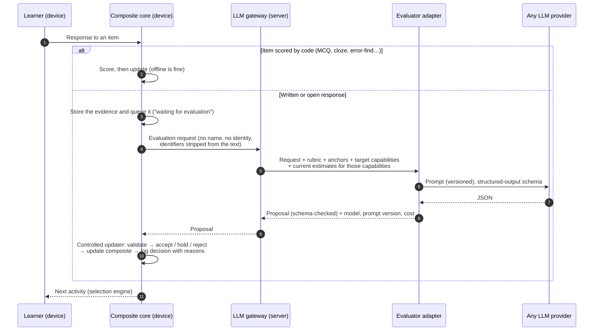

# Evaluation pipeline and controlled updater

*Everything here is **Recommended**, except where a line is marked **Agreed**.*

**Agreed:**

- An LLM-assisted pipeline returns *structured proposed updates*. A
  *controlled updater* validates and persists them.
- No foundation-model training or fine-tuning.
- The provider is interchangeable.
- An LLM is never the sole authority (A-12).

## 1. The workflow, end to end



## 2. What the evaluator is given

| Input | Why | Example |
|---|---|---|
| **The task**: item text, instructions, target capabilities and the band window it was written for | So the evaluator judges only what the task could show | "Write a short email asking your school librarian to order a book (80–120 words)." Targets: task response, functional writing, register, grammatical accuracy, spelling, run-ons |
| **Reference standards**: the rubric criteria and band descriptors for each target capability | The evaluator judges *against our standard*, not general quality | Run-ons, band 4: "Correctly joins or separates clauses in everyday writing, most of the time." |
| **Trusted anchors**: two to four human-scored responses to the same or a parallel task, at neighbouring bands | Calibration by example. The same anchors are later used to check for drift | An email scored band 3 and another scored band 5, each with its scores per criterion |
| **The learner's response**, exactly as written | The evidence | — |
| **Current estimates for the target capabilities only** (mean and sd, plus active misconceptions) | Requested in the direction. Used to flag *surprises* and check consistency, not to set the score | "Run-ons: 4.6 ± 0.9, comma splice active" |

**Guarding against anchoring bias.** Seeing the current estimate could pull an
evaluator's score towards it. So in milestone E3 we measure the effect:

- **The test.** We score the anchor set with the true estimates, then again
  with estimates deliberately set too high and too low.
- **The rule.** If the scores shift by more than 0.3 bands, scoring runs
  without the estimates. The estimates are then shown only in a second,
  separate "consistency" step.

## 3. What the evaluator must return: a structured proposal

A JSON schema is enforced by the adapter (most providers support structured
output). Example:

```json
{
  "evidence_id": "ev_0412",
  "item": {"id": "wr.email.librarian", "version": 2},
  "judgements": [
    {
      "capability": "EN.SEN.CMP.run_ons",
      "band": 3.5,
      "confidence": "medium",
      "criteria": [{"id": "boundaries_marked", "score": 1, "max": 3}],
      "quotes": ["I want this book it is about space, my friends also want it"],
      "misconceptions": ["comma_splice"],
      "rationale": "Two of four sentences join independent clauses with a comma or nothing."
    },
    {
      "capability": "EN.WRT.STY.register",
      "band": 5.0,
      "confidence": "high",
      "quotes": ["Dear Mrs. Rao,", "Thank you for your help."],
      "misconceptions": [],
      "rationale": "Polite opening and closing suit a request to an adult."
    }
  ],
  "not_observable": ["EN.VOC.USE.word_choice"],
  "flags": {"off_task": false, "too_short": false, "possibly_copied": false, "safeguarding": false},
  "surprise": {"capability": "EN.SEN.CMP.run_ons", "note": "Lower than current estimate 4.6"}
}
```

- **The evaluator proposes *observations*, not new estimates.** It says what
  the response shows: a band, criteria scores, quoted evidence and
  misconception tags. The updater does the arithmetic itself
  (`COMPOSITE_MODEL.md` §2.2).

## 4. Trusting the evaluator: calibration with anchors

- **Calibration set.** For each rubric, 20 or more anchor responses carry agreed
  human scores (D-4).
- **Qualification.** Before an evaluator configuration (provider, model and
  prompt version) is allowed to update composites, it scores the calibration
  set. From this we get its **noise**, the typical difference from the human
  score, and its **bias**, the average lean. Its noise becomes the `noise` in
  the update formula. It is used only if its noise is at most 0.9 bands and
  its bias at most 0.3, both per capability.
- **Drift checks.** About 1 in 20 real requests is mixed with a hidden anchor
  response. If live anchor scores drift outside tolerance, that evaluator's
  new proposals are **held**, not applied, until it is re-qualified.
- **Self-consistency (optional).** Two samples, with acceptance only if they
  agree within 1 band. Otherwise the proposal is held. This costs more, so it
  is configurable.

## 5. The controlled updater

**Deterministic code that runs on the device.** The same code re-checks on the
server when synced data arrives. Each proposal comes out **accepted**, **held**
(kept for re-evaluation or human review, with no effect yet) or **rejected**,
and the reasons are always logged.

| # | Check | If it fails |
|---|---|---|
| 1 | The proposal matches the schema, the evidence id exists, and it has not already been applied | Reject. A repeat is ignored, so retries are safe |
| 2 | Each capability is one of the item's targets or its declared secondary capabilities | That judgement is rejected |
| 3 | The band is within the scale and within ±2 of the item's band window | That judgement is rejected |
| 4 | **Every quote appears word for word in the learner's response** (after normalising whitespace) | Rejected as unsupported. This catches invented evidence |
| 5 | Misconception tags come from the capability's controlled list | Unknown tags are dropped |
| 6 | Code-checkable signals agree. For example, a spelling band cannot contradict an automatic misspelling count by more than 1.5 bands | Held |
| 7 | The evaluator configuration is qualified and not drifting (§4) | Held |
| 8 | The flags show the response was on task, long enough, not copied and safe | Rejected with no update. A safeguarding flag goes to the safeguarding process, not to learning |
| 9 | **Surprise check.** Is the judged band more than 2.5 sd away from the current estimate? | Held for a second evaluation (another sample or another provider). If the second agrees, it is accepted with doubled noise |
| 10 | **Movement cap.** No single piece of evidence moves a mean by more than 0.75 bands (0.25 for inferred effects) | Accepted, but capped. The cap is logged |
| 11 | **Status guard.** A single piece of evidence can never change a capability's stage to *demonstrated* or *mastered* on its own. Those come only from §5 of the composite rules | Enforced by construction |
| 12 | **Criterion–band consistency** (E3, approved 12 Oct; protocol v2). Every rubric criterion is scored on the band scale with a verbatim quote, and the band agrees with them | Missing, unknown or repeated criteria, or a band outside their range by more than 0.5: rejected. More than one band from their mean: held |
| 13 | **Possible instructions to the marker** (E3). The response contains words such as "ignore the rubric" or "give me band 8" | Held for a person to review; no update; a precaution, not a judgement about the learner |

**E3a additions.** Protocol `evaluate.v1` is kept unchanged, so earlier evidence and the frozen
simulation are interpreted as before. Protocol `evaluate.v2` requires criterion scores (check 12).
Grammar-pattern signals are research-only and do not affect any decision (E3a review). Short written answers (`short.v1`)
are marked key point by key point with quotes; code decides right or wrong, deterministic guards
outrank the evaluator (check 6), and the result enters through the same update as a code-scored item
of the same difficulty, with no guessing floor. See [`E3A_REPORT.md`](E3A_REPORT.md) and
[`E3A_VALIDATION_LIMITS.md`](E3A_VALIDATION_LIMITS.md).

**Repeated and varied items (E1 final review).** The updater, not the client,
decides whether an answer is on a *fresh* item, a *variant* (an item sharing a
`family` with one answered before) or a *repeat* of the same item. The
decision records it. A repeat is kept as retention evidence for that session
only and never changes the estimate, so a remembered answer cannot inflate it.
A variant updates the estimate like any new item and is flagged.

**Every decision is recorded:** the before and after values, the reasons and
the inferred effects. That gives three guarantees:

- **Explainable:** "Why did run-ons drop to 3.96? This email, these quotes,
  this evaluator, this rubric."
- **Reversible:** remove a decision and rebuild.
- **Re-scorable:** a better evaluator later re-scores the same raw evidence
  and produces new decisions, while old ones are kept and marked superseded.

## 6. Keeping the provider interchangeable

```ts
interface Evaluator {
  id: string                      // "anthropic:<model>", "openai:<model>", "local:<model>", "mock", "replay"
  evaluate(req: EvaluationRequest): Promise<Proposal>   // must return schema-valid JSON
}
```

| Adapter | Purpose | Cost |
|---|---|---|
| `mock` | A deterministic stand-in with configurable noise and bias. Used for tests and the simulation | none |
| `replay` | Returns recorded real outputs, so demos and tests are repeatable without new calls | none |
| `http` (one per provider family) | Real evaluation through the server gateway. Prompts are versioned files in the repository, never hard-coded in an adapter | per call: **needs your approval** (D-2) |
| `local` (Future) | A self-hosted open-weight model behind an OpenAI-compatible endpoint | hosting |

- **Switching provider is a configuration change** plus a qualification run
  against the anchors (§4). No change to the composite, the updater or the
  selection.
- **Agreed:** no training or fine-tuning. Improvement comes from better
  rubrics, anchors, prompts and model choice.

## 7. Children's data and the LLM

The learners are 10–15. That makes this the most sensitive part of the
design (D-3).

- **No raw writing leaves the device without consent.** It goes to an LLM only
  with guardian consent for "AI evaluation of written answers", recorded per
  purpose, as already designed.
- **Nothing identifying is sent.** The gateway sends no name or learner id,
  and replaces anything that looks like a name, phone number, e-mail or
  address before the request leaves our server.
- **Provider settings.** Use provider options that exclude our data from model
  training and minimise retention, where offered. Check each provider's terms
  on users under 18.
- **Legal review** under India's Digital Personal Data Protection Act (2023)
  and its rules before real learners use this. Earlier decision O-10 applies.
- **A fully working fallback.** Without consent, the learner still gets
  code-scored activities. Writing can be self-checked against a model answer,
  or reviewed by a teacher, whose judgement enters the same updater as a
  "human evaluator" with its own noise.
