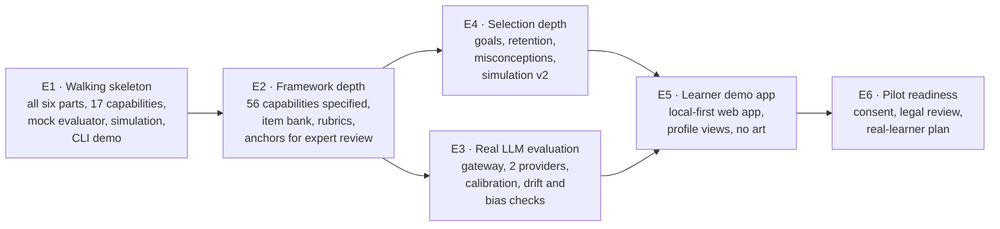

# Implementation plan: OpenPath English

*This plan is **Recommended** and awaits your approval. No milestone starts
until you approve its scope. Each one ends with a report and a request for
approval (A-30). Each one leaves working, tested software (A-29).*

## 1. The smallest coherent plan

**Build a thin version of all six core parts first, then deepen them.**
Building the framework fully before the composite, or the composite before
selection, would leave months with nothing that runs end to end. Instead,
milestone **E1 is a walking skeleton**:

- every part works, on a 17-capability slice
- a stand-in evaluator replaces the paid LLM
- the ten-learner simulation and a demonstration you can run are included



| Milestone | Size | Needs from you first |
|---|---|---|
| **E1** Walking skeleton | L | Approval of this plan, plus D-1 |
| E2 Framework depth and content | L | D-4 (standards and an English educator) |
| E3 Real LLM evaluation | M | D-2 (provider and budget), D-3 (children's data) |
| E4 Selection depth | M | — |
| E5 Learner demo app | M | D-7, D-9 |
| E6 Pilot readiness | M | D-3, legal review, pilot plan |

**Sizes:** S is a few days, M about a week, L one to two weeks.

## 2. E1 · Walking skeleton (detailed scope)

### Delivers

1. **The framework as a validated data file.**
   - The full hierarchy: 8 strands, 44 sub-strands and about 120 capabilities,
     each with an id and a name.
   - The 17 skeleton capabilities fully specified: band descriptors,
     misconception lists, couplings and rubric references.
   - A validator that refuses bad frameworks, and fingerprint locking of
     published versions.
2. **Draft content, marked unreviewed.**
   - About 120 code-scored items across the 17 capabilities: cloze, multiple
     choice, error-finding, sentence repair, and two short reading passages
     with question sets.
   - Three writing tasks, each with a rubric and candidate anchor responses.
   - Everything is written by me, original and unreviewed. That is good enough
     to exercise the engine, but not to teach with (D-4).
3. **The composite core,** one self-contained TypeScript package
   (`packages/english-core`) with no outside dependencies:
   - the composite: updates, couplings, time effect, aggregation and stages
   - the controlled updater, with all 11 checks
   - the evaluator interface, with the `mock` and `replay` adapters
   - the selection engine: diagnostic and practice modes, goals and stored
     reasons
   - a learner store interface, with an in-memory version and a local-file
     version. The browser storage version comes in E5.
4. **The ten-learner simulation,** with a self-contained HTML report, including
   runs that inject faults into the evaluator.
5. **A command-line demonstration** (§3).
6. **A new CI job** for the package. Existing jobs are untouched.

### Does not include

- real LLM calls
- server changes
- any user interface beyond the report and the CLI
- listening and speaking content
- browser storage
- any change to the paused children's work

### Engineering notes

- **No new installs.** The repository's Node version (22) runs TypeScript
  directly, and the typecheck uses the TypeScript version already pinned in
  the lockfile. So E1 adds **no new third-party packages** and needs no paid
  service.
- **New folders only, nothing moved (A-24):**

```
content/english/        framework, items, rubrics, anchors (data, versioned)
packages/english-core/  composite, updater, evaluators, selection, store + tests
tools/english-sim/      ten-learner simulation and report
tools/english-demo/     command-line end-to-end demonstration
```

### Acceptance tests for E1

| # | Test | Passes when |
|---|---|---|
| E1-1 | **The framework is valid** | 8 strands, 44 sub-strands and at least 115 capabilities. Ids are unique, prerequisites have no loops, couplings are between 0 and 0.6, and every skeleton capability has band descriptors, misconceptions and at least 6 items |
| E1-2 | **Bad frameworks are refused** | Each broken variant fails with a message naming the problem: duplicate id, loop, unknown link, coupling out of range, missing descriptors, or an edited published version |
| E1-3 | **The arithmetic is right** | The worked examples in `COMPOSITE_MODEL.md` reproduce to 2 decimals |
| E1-4 | **Built-in rules always hold** | Tested over thousands of random sequences: evidence never *raises* uncertainty; time raises it only up to the starting value; inferred changes never make anything demonstrated or mastered; one session never makes anything mastered |
| E1-5 | **The state can be rebuilt and undone** | Rebuilding from the logs equals the stored composite. Removing one decision and rebuilding equals never having applied it |
| E1-6 | **The updater controls every proposal** | Each of the 11 checks has a failing-proposal test. In the fault-injection simulation, 0 faulty proposals are applied |
| E1-7 | **The provider stays interchangeable** | The core contains no network code and no provider names. Swapping `mock` for `replay` by configuration gives identical decisions for identical proposals |
| E1-8 | **Selection is explained and repeatable** | The same inputs and seed give the same choice. Every recommendation has reason codes and a plain sentence |
| E1-9 | **The ten-learner simulation reports honestly** | All 10 learners run. The report shows every measure in `SELECTION_AND_SIMULATION.md` §3.3 against pass levels that were frozen before the run. Any miss is reported with an analysis and a proposed fix, not hidden or re-tuned silently |
| E1-10 | **Local-first** | The demo makes no network requests. It is stopped and restarted from its local files with identical state |
| E1-11 | **Nothing else breaks** | All existing tests and CI jobs pass, plus the new job |
| E1-12 | *(your review)* **The demonstration makes sense** | You run or watch the demo and read the simulation report |

## 3. The initial end-to-end demonstration

**In E1** this is a command-line walkthrough, which I will also record as a
short screen capture. **In E5** the same flow becomes a plain web app.
Everything below is produced by the real engine; nothing is scripted except
the learner's answers.

*"Asha" is an invented 12-year-old learner. She reads well but writes in
run-on sentences.*

| Step | What happens | What you see |
|---|---|---|
| 1 | **New learner.** The composite is created with every skeleton capability at 4.0 ± 1.5 | A profile table, every row "Not tried yet" |
| 2 | **Diagnostic** of about 20 code-scored items. Selection samples widely, then narrows | Each item, the answer, and the change it caused, e.g. *"Locate detail 4.0 → 5.0 (± 1.5 → 1.1), surprising right answer"* |
| 3 | **Profile after the diagnostic** | Reading about 6 with narrowing uncertainty. Sentence boundaries uncertain. Grammar mid |
| 4 | **Writing task** (an email to a librarian). Her answer has two comma splices | The evaluation request, as it *would* be sent to an LLM |
| 5 | **Proposal** from the evaluator (`replay` of a realistic output, or `mock`) | The structured JSON. One judgement contains a quote that **is not in her text** |
| 6 | **Controlled updater** | Run-ons: accepted (for example 4.62 → 3.96), comma splice tagged. The invented-quote judgement is **rejected, with the reason shown**. Coupled capabilities show small *inferred* changes |
| 7 | **Next activity** | *"Sentence-joining practice, band 3.5–4.5: recent writing showed comma splices; goal is 'write better'."* |
| 8 | **Close and reopen** | State reloads from local files, unchanged. A "rebuild from logs" check confirms it |
| 9 | **Undo one decision** | Removing the step-6 decision and rebuilding returns the composite to its step-5 state, exactly |

## 4. Later milestones, in brief

- **E2 · Framework depth.**
  - Specify the 56 core capabilities.
  - Build about 600 code-scored items and 8 writing tasks with rubrics.
  - Prepare candidate anchor sets for scoring by English educators.
  - Produce a readable framework report for reviewers.
- **E3 · Real LLM evaluation.**
  - Add a server gateway: a consent check, identifier removal and two
    provider adapters, to prove they are interchangeable.
  - Qualify evaluators against the anchors, then add drift checks and the
    anchoring-bias test.
  - Report costs per evaluation. Nothing is spent without your approval.
- **E4 · Selection depth.**
  - Goals and target bands, retention checks, misconception targeting, and
    the *struggling* step-down.
  - Simulation v2 on the 56 capabilities, including the efficiency comparison.
- **E5 · Learner demo app.**
  - A plain web app with no art. Its state lives on the device, in browser
    storage.
  - The diagnostic, practice and writing flows.
  - "My English profile" views with explanations, for the learner and the
    guardian, plus an inspector view for you.
  - Possibly listening items using synthesised audio (D-7).
- **E6 · Pilot readiness.**
  - The consent flow, legal review, export and delete.
  - A real-learner validation plan that defines measurable success.

## 5. What stays paused and preserved

- **The children's game and Amma's scene.** PRs #2 and #3 stay open and
  unmerged. The apple-shopping game and early-number engine stay on `main`,
  tested, but they are not developed.
- **TNPSC as the second product (A-23)** is paused.
- **The M1 proposal** is superseded by E1.
- **Nothing is deleted.**

## 6. Decisions for you

| # | Decision | My recommendation |
|---|---|---|
| **D-1** | Write the English composite core in **TypeScript, once**, running on device, in the simulation and on the server; or in Python with a device copy | **TypeScript once.** Local-first requires the core on the device, and one copy avoids drift. Django keeps identity, consent, sync and the LLM gateway |
| **D-2** | LLM provider(s) and budget for E3. Who owns the API account | Start with **two** providers to prove interchangeability. I'll bring per-evaluation cost estimates before anything is spent. No spending before E3 |
| **D-3** | Sending 10–15-year-olds' writing to an LLM provider | Only with recorded guardian consent, no identifiers, provider settings that exclude our data from model training, and legal review before real learners. A full code-scored fallback without consent |
| **D-4** | Reference standards and expertise: align to **CEFR**, Indian school standards (**CBSE/NCERT** or the state board), or both. Who reviews the framework and scores anchors | Write our own descriptors, mapped to both for reference. **At least one, ideally two, English educators** to review E2 content and score anchors. Reading passages are original or properly licensed |
| **D-5** | Should stages or estimates use **age or grade expectations**? | **No.** Estimates and stages are absolute (bands). An optional "typical for age" reference for guardians can be considered later |
| **D-6** | Record the learner's **home language** (to help interpret errors)? | Not in E1–E4. Revisit with the educators. If used, it would be optional and stated by the family, never inferred |
| **D-7** | When listening and speaking arrive | Listening in E5 with synthesised audio, if wanted. **Speaking later.** It needs speech recognition, and children's voice data is highly sensitive |
| **D-8** | Retention gap required for *mastered* in English | 7 days, on fresh items |
| **D-9** | First platform | A **web app** that works offline (installable), then React Native / Expo using the same core |
| **D-10** | Confirm the pauses in §5 | Confirm |
