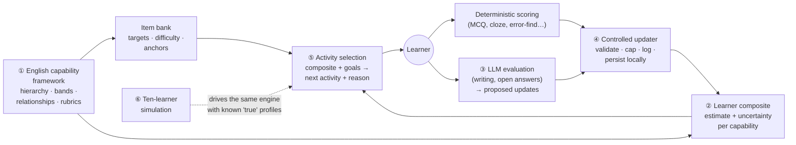

# OpenPath English (ages 10–15): audit and plan

*12 October 2026. These began as planning documents. **E1 is now implemented
and merged** (see [`E1_REPORT.md`](E1_REPORT.md)). E2 is proposed in
[`E2_SCOPE.md`](E2_SCOPE.md) and waits for approval.*

| Label | Meaning |
|---|---|
| **Agreed** | You stated it (direction of 12 Oct, or earlier decisions still in force). |
| **Recommended** | My proposal. It waits for your approval. |
| **Future** | Room is kept for it. It is not planned for the first build. |
| **Open** | Needs your decision ([`IMPLEMENTATION_PLAN.md`](IMPLEMENTATION_PLAN.md) §6). |

## Reading order

1. **This page:** the direction, plus the audit of what exists.
2. [`CAPABILITY_FRAMEWORK.md`](CAPABILITY_FRAMEWORK.md): the English
   capability hierarchy, from foundational gaps to advanced reading, writing,
   listening and speaking.
3. [`COMPOSITE_MODEL.md`](COMPOSITE_MODEL.md): the learner's numerical
   composite, covering estimates, uncertainty, evidence, relationships and
   local-first storage.
4. [`EVALUATION_AND_UPDATES.md`](EVALUATION_AND_UPDATES.md): the LLM-assisted
   evaluation pipeline and the controlled updater.
5. [`SELECTION_AND_SIMULATION.md`](SELECTION_AND_SIMULATION.md): adaptive
   activity selection and the ten-learner simulation.
6. [`IMPLEMENTATION_PLAN.md`](IMPLEMENTATION_PLAN.md): milestones, the
   end-to-end demonstration, acceptance tests and open decisions.
7. [`E1_REPORT.md`](E1_REPORT.md): what E1 built, its acceptance results and
   its known limitations.
8. [`E2_SCOPE.md`](E2_SCOPE.md): the proposed E2 scope, for approval.

---

## 1. The direction, as I understand it

**Agreed (12 Oct):**

- **First product:** a comprehensive adaptive English-learning application for
  learners aged 10–15.
- **Paused:** animation, character development, shopping-game polish and visual
  experiments. That existing work and its PRs (#2 and #3) are kept, not
  deleted.
- **The core intellectual property is six things, in this order:**
  1. a deep, hierarchical English capability framework
  2. a persistent numerical composite per learner, with fine-grained
     estimates, uncertainty, evidence and relationships between dimensions
  3. an LLM-assisted evaluation pipeline that returns *structured proposed
     updates*
  4. a controlled updater that validates and persists them, keeping learner
     state local-first
  5. adaptive activity selection driven by the composite and the learner's
     goals
  6. a ten-learner simulation that tests whether the engine can tell different
     English profiles apart
- **No foundation-model training or fine-tuning.** The LLM provider stays
  interchangeable.

**How this fits the earlier principles, which remain in force:**

- **The LLM proposes; deterministic code decides.** An LLM is never the sole
  authority on a learner's state (A-12). The LLM's output is a *proposal*. It
  only changes the composite after rule-based checks, and every change can be
  traced and undone.
- **The simulation tests the software, not learning (A-27).** It shows whether
  the engine can tell profiles apart. Whether learners actually improve needs
  real learners.
- **Still in force:** mastery is never claimed from one interaction (A-2),
  evidence keeps its provenance, and the platform holds no judgement of
  intelligence and no inferred sensitive traits.

## 2. Audit: what exists, measured against this direction

`main` currently holds the platform seed (PR #1) and the architecture
documents (PR #4). The game work sits on PRs #2 and #3, which stay parked.

### Reusable, and worth keeping

| What exists | Where | How English uses it |
|---|---|---|
| **Evidence discipline**: raw learner actions are stored unchanged, conclusions are derived and can be rebuilt, sessions are checked for integrity, uploads are safe to repeat | `backend/evidence`, `backend/assessment/evaluate.py` | The same rule: the composite is a *view* over an append-only evidence log, rebuildable at any time |
| **Pseudonymous learners, consent records, export, delete** | `backend/learners`, `backend/evidence/services.py` | Kept unchanged for English learners |
| **Device-first storage** with optional server sync after consent | `frontend/src/core/store.ts` (DeviceStore and ServerStore) | The pattern behind local-first learner state |
| **Graph validation** of prerequisites (unknown links, loops) | `backend/assessment/curriculum.py` | Reused for the much larger English framework |
| **The rule "mastery needs success that holds over time"** | `backend/assessment/mastery.py` | Kept as a hard rule for the *mastered* status |
| **Shared test cases that keep two engines identical** | `shared/golden/` | Same discipline, if two runtimes are ever needed |
| **CI** with a guard that fails when a test step finds no tests | `.github/` | Extended to the new packages |
| **Django backend** | `backend/` | Accounts, consent, optional sync, plus a thin *LLM gateway* that keeps provider keys off devices |

### Not suitable for English as it stands

| What exists | Why it does not fit |
|---|---|
| **Count-based mastery** (`mastery.py`) | It counts right and wrong answers per skill. It produces no numerical estimate, no uncertainty, and no way for evidence about one skill to inform a related one. **The English composite needs a different model**, described in `COMPOSITE_MODEL.md` |
| **Flat curriculum format** (6 skills, prerequisites only) | No hierarchy depth, no difficulty bands, no relationships beyond prerequisites, no rubrics, no anchors |
| **Rule sets for counting** (`rules/produce_set.py`) and the **shopping planner** (`progression.py`) | Maths-specific and shopping-specific. They stay with the paused children's game |
| **Shopping-shaped frontend types** (`frontend/src/core/types.ts`) | Not usable for English activities |
| **No LLM integration** | Correct until now. The direction now requires an evaluator adapter, but still no AI infrastructure beyond it (A-28 is refined, not dropped) |

### Superseded or paused by this direction

- **The M1 proposal** (registry for early number and TNPSC) is superseded.
  Its useful parts carry into English milestone E1: several versioned
  frameworks, strict validation, and fingerprint locking of published versions.
- **TNPSC as the second product (A-23) is paused.** The original reason for a
  second product was to prove the core is not shopping-shaped. The English
  product proves that with many different activity formats inside one product.
- **The early-number engine and the apple-shopping game** remain on `main`,
  working and tested. They are not developed further for now.

### The one structural choice the audit forces

**Local-first** means the composite must be updated *on the learner's device*,
including offline. Today's engine is Python on the server, with a partial
TypeScript copy on the device.

**Recommended (decision D-1):** write the English composite core *once*, in
TypeScript, as a self-contained package. It then runs unchanged in three
places:

- in the browser, where it is the local-first learner state
- in Node, for the simulation and the tests
- on the server, for re-validation when synced data arrives

The Django backend keeps identity, consent, sync and the LLM gateway. This
avoids maintaining two copies of the most important code.

## 3. The plan in one picture

**First build (E1, which needs your approval):** a *walking skeleton*. All six
parts work end to end on a slice of about 17 capabilities, with a stand-in
evaluator in place of a paid LLM. It includes the ten-learner simulation and a
command-line demonstration. Each part then deepens in later milestones (E2–E6),
each approved separately. Details are in
[`IMPLEMENTATION_PLAN.md`](IMPLEMENTATION_PLAN.md).
