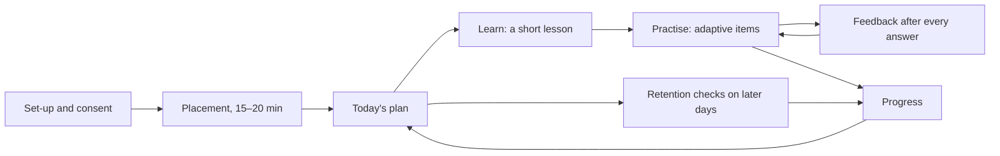
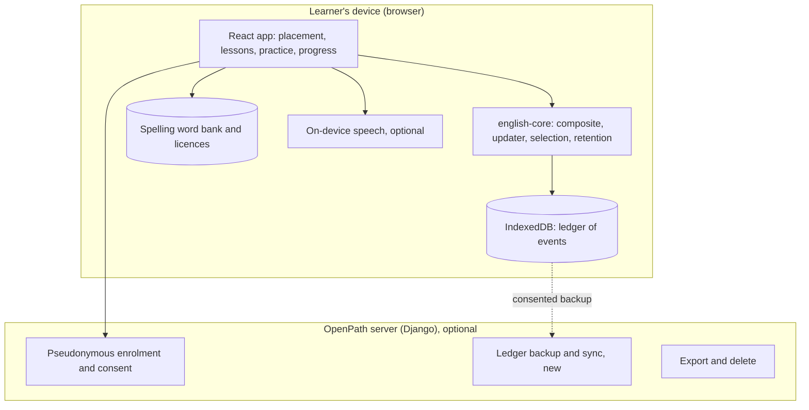

# Proposal: the first usable private OpenPath English web experience

*12 October 2026 · proposal · **decided 13 October** (see "Decisions recorded" below; the build is
described in [`WEB_APP.md`](WEB_APP.md)). No live LLM, no external transmission of learner writing,
and no spending are assumed or needed.*

## 1. What this is

A first version of OpenPath English that a small, invited group can actually use. It covers:

- **placement** (finding out where a learner is);
- **teaching** (short explanations);
- **practice** (adaptive);
- **feedback** (immediate and specific);
- **progress** (an honest profile);
- **persistence** (state kept on the device, with optional backup).

It includes a **spelling module** as the first focused experiment.

**Principles:**

1. **Private.** The group is invited, perhaps 5–15 learners aged 10–15, with guardian consent. There
   are no public sign-ups, adverts or tracking.
2. **The engine already built is the engine used.** The composite, the controlled updater, selection,
   retention and verification from E1–E3a run unchanged in the browser. The core is
   platform-free TypeScript.
3. **Code-scored activities only.** Nothing is sent to an LLM. Extended writing and short written
   answers stay out of v1, or are offered as self-check practice that changes nothing.
4. **Honest about uncertainty.** A capability with little evidence is shown as *not yet assessed* or
   *early estimate*, never as a measurement (E4 investigation G).
5. **All content is labelled candidate** until educators review it.

## 2. The learner's journey

### 2.1 Set-up and consent

- A guardian enrols the learner and gives consent. This uses the existing pseudonymous enrolment: no
  name or school is stored on the server.
- The learner chooses a display name, kept **on the device only**.
- The guardian can export or delete everything at any time; this already exists on the server, and
  is added on the device.

### 2.2 Placement

- **Goal:** a usable starting profile in about 15–20 minutes, without spreading questions too thinly.
  This is E4 investigation F.
- **Proposal: hierarchical placement.**
  1. Two or three informative items per strand estimate the six strands.
  2. Selection then branches into the capabilities of the weakest or most uncertain strands, and
     those the learner's goal weights most.
  3. It stops when the remaining uncertainty no longer changes what to teach next, or at about 25
     items.
- **What changes:** this is a selection change only, a placement controller around the existing
  `recommend()`. The update mathematics do not change.
- **Validation:** checked against the frozen simulation and the breadth simulation, without tuning to
  them.
- **Afterwards,** capabilities not yet placed are shown as *not yet assessed*.
- **Pausing:** the learner can stop and resume; nothing is lost.

### 2.3 Teaching

- **Micro-lessons.** For each step of a capability's difficulty ladder, a micro-lesson of one or two
  screens: a plain explanation, two worked examples, and one quick check.
- **Placement in the plan.** Lessons appear when a learner first meets a step, or after two or three
  wrong answers on it (the existing *struggling* step-down).
- **Content to write.** Lessons do not exist yet: 56 capabilities × about 4 steps, roughly 220
  lessons. v1 would start with:
  - the spelling module (§3);
  - six high-value grammar and sentence capabilities: present and past simple, subject–verb
    agreement, articles, run-ons, capital letters, apostrophes;
  - about **45 lessons**, all candidate.

### 2.4 Practice

- **The engine's learning mode:** items near a 70% chance of success, mixing capabilities, plus
  assessment probes and retention checks on later days.
- **Sessions** of 10–15 minutes (about 15–20 items), with a clear end.
- **Uses the 780 code-scored items** already in the bank: choice, typed, order, match and
  choose-all-that-apply.

### 2.5 Feedback

- **After every answer:**
  - right or wrong;
  - the correct answer;
  - one short explanation.
- **Explanation tied to the error.** Where the wrong answer carries a misconception tag (*goed* →
  regularised past), the explanation addresses that misconception. The framework lists 114
  misconceptions. v1 would write feedback for the 30–40 that the first capabilities use; the others
  get a generic explanation from the item's rationale.
- **No grades, scores or rankings.** Encouragement is about effort and progress.

### 2.6 Progress

- **For the learner, per strand and capability:**
  - *not yet assessed*;
  - *early estimate*;
  - *measured* (with words for the band, not decimals);
  - *demonstrated*;
  - *verified*;
  - *check due*.

  These come from the existing verification statuses, plus the display rule from E4 investigation G.
- **For the guardian:**
  - the same profile;
  - time spent;
  - what is being practised and why (the engine's existing explanations).
- **Uncertainty in words:** "We're not sure yet: a few more questions will tell us."
- **No comparisons** with other children or with age norms (decision D-5).

### 2.7 Persistence

- **On the device:** the learner's append-only ledger of events, stored in browser storage
  (IndexedDB). The composite is rebuilt from it, as it already is in the core and tests.
- **Offline:** the app works offline once installed, through a service worker.
- **Optional backup and sync:** with consent, ledger events are uploaded to the existing pseudonymous
  backend, so a learner can move devices. This needs a new endpoint for English events; the server
  stores events and can re-check them with the same core.
- **Item versions:** handled exactly as now. Old answers keep their meaning.

## 3. Spelling module: the first focused experiment

### 3.1 Why spelling first

- Spelling can be scored entirely by code, so no LLM is needed.
- It is a frequent difficulty for learners aged 10–15.
- It maps onto capabilities already defined: inflections, homophones, morphological spelling, and
  spelling in writing.
- It works well with spaced practice of individual words.
- It tests whether a **dictionary-driven** word bank can replace hand-writing thousands of items.

### 3.2 Word data from licensed sources, not a hand-made bank

| Need | Proposed source | Licence (to confirm in a licence review) | Notes |
|---|---|---|---|
| Valid words, British spelling, and size levels (a proxy for commonness) | **SCOWL** (Spell Checker Oriented Word Lists), with its British variants (VarCon) | Permissive. Use, copy, modify and sell, provided the copyright and permission notices are kept. Some components carry their own conditions: the UKACD notice must be included verbatim; Ispell-derived lists must keep notices and mark changes; no endorsement by the authors | Indian schools generally teach British spelling. American variants can be accepted as alternatives, but British is taught |
| Pronunciation and syllables (for patterns and homophones) | **CMU Pronouncing Dictionary** | 2-clause BSD (versions 0.7a/0.7b) | North American pronunciations; good enough for syllable counts and many patterns, but not for British vowel distinctions. Homophone groups need checking |
| Meanings (for "write the word that means…" clues) | **Open English WordNet** | CC BY 4.0 (attribution) | Definitions are written for adults. Only short, simple glosses would be used, after review, or none at all |
| How common a word is | **wordfreq** | Code Apache 2.0; data **CC BY-SA 4.0**, with extra attribution terms for some sources | Share-alike would apply to a frequency table derived from it. No longer updated (data to about 2021). Alternative: SCOWL's size levels alone |
| Example sentences (optional) | **Tatoeba** | CC BY 2.0 FR; a subset under CC0 | Written by volunteers, so quality and age-suitability vary. Use only filtered, reviewed sentences, or simple templates instead |

**How the data would be built.**

- A **build-time pipeline** reads these sources and writes one word-bank file. It records, per word:
  - the British spelling and accepted variants;
  - its size level and frequency;
  - syllables;
  - part of speech;
  - inflections;
  - pattern tags;
  - the source and licence of every field.
- A **licence-notice file** ships with the app.
- **Excluded words:** offensive words (SCOWL includes some), proper nouns, abbreviations and
  archaic words, using a block-list, a review step and an age screen like the item bank's.
- **Pattern tags** are found by rule, with no hand-made list:
  - doubling at a suffix;
  - dropping a final *e*;
  - *y* to *i*;
  - *-tion*, *-sion* and *-ssion*;
  - *ie*/*ei*;
  - silent letters (*kn*, *wr*, *mb*);
  - double consonants;
  - homophone groups (same pronunciation, different spelling);
  - prefix and suffix joins.

  Each tag links a word to a capability and a ladder step.

### 3.3 Activities, from templates

| Template | What the learner does | Scoring |
|---|---|---|
| **Hear and spell** | Hears the word, and a sentence that uses it, then types it | Exact match; accepted variants allowed |
| **Meaning and first letter** | Reads a simple clue and the first letter, then types the word | Exact match |
| **Add the ending** | *hope* + *ing* → types *hoping* | Exact match; the error's pattern is tagged (no doubling, kept the *e*) |
| **Choose the spelling** | Picks the right spelling among rule-generated misspellings | Choice. Used sparingly, because recognising is easier than recalling |
| **Homophone in context** | Types *their*, *there* or *they're* into a sentence | Exact match |

- **Audio.** Hear and spell needs speech. Proposal: the browser's **on-device** speech synthesis,
  choosing local voices only. Some browsers send text to an online voice; only the dictionary word
  would be sent, never learner data, but local voices avoid even that. If no suitable voice exists,
  the other templates are used.
- **Pre-recorded audio** (for example, from Wikimedia Commons) has mixed licences and would need
  review per file.
- **This needs an exception to decision E2-3** (hand-written variants only, no item generator).
  Generated items are tagged as such, their difficulty labels are estimates from word features, and
  they never enter the hand-written bank's gates.

### 3.4 Learning model for spelling

- **Capability evidence.**
  - Each answer is evidence for its pattern's capability, through the existing typed-item update with
    the word's estimated difficulty: commonness, length, pattern and irregularity.
  - The capabilities are EN.FND.SPL.inflections, morphological and homophones, plus *regular
    patterns*, which is currently "planned" and would need specifying in a new framework version
    (0.3.0, leaving 0.1.0 and 0.2.0 frozen).
- **Word memory.**
  - Words a learner misspells go into a per-learner spaced-review list, using simple Leitner boxes:
    1, 3, 7 and 14 days.
  - This is a **separate scheduling layer**. It chooses which words to practise and never changes the
    composite update mathematics.
  - A word answered from memory after review counts as **retention evidence only**, like a repeated
    item, so remembering one word cannot inflate the capability estimate.
- **Transfer check.** The test is whether a learner can spell **unseen** words with a practised
  pattern. These checks use fresh words and are what count for the capability.

### 3.5 The experiment

| Question | Measure | Limits |
|---|---|---|
| Does practice improve spelling of **practised** words? | Accuracy on reviewed words at 1, 7 and 14 days | Expected; not the real test |
| Does it **transfer** to unseen words with the same pattern? | Accuracy on fresh words, per pattern, before and after | The main question. With 5–15 learners: a signal, not proof |
| Are feature-based difficulty estimates sensible? | Agreement between estimated difficulty and observed success | Small sample; only shows large errors |
| Is the dictionary data suitable for ages 10–15? | Words and clues flagged as unsuitable, per 1,000 shown | Needs review before learners see anything |
| Do learners come back? | Sessions per week, retention checks completed | No engagement tricks; reported as it is |

No claims of effectiveness would be made from this group. It is to learn what to build and measure
next.

## 4. Architecture

- **Frontend:**
  - a new English entry point in the existing `frontend/` (React 19, esbuild);
  - it imports `packages/english-core` directly; no second copy of the engine;
  - the paused apple-shopping activity stays as it is.
- **Content:** shipped with the app (items, ladders, lessons, feedback, word bank). It is versioned,
  so evidence always names the version shown.
- **No LLM, no analytics service, no third-party scripts.**

## 5. Milestones (each a separate PR, reported before merge)

| Milestone | Delivers | Acceptance (proposed) |
|---|---|---|
| **W1 · Shell and persistence** | The English app entry, device ledger storage, rebuild, export and delete, offline install | A learner's state survives reloads and offline use; export restores it exactly; the core's tests run in the browser build |
| **W2 · Placement and progress** | Hierarchical placement (E4-F, selection only); progress views with the "not yet assessed" and "early estimate" display rule (E4-G) | Frozen simulation baselines unchanged; breadth simulation reported before and after; no capability shown as measured without enough direct evidence |
| **W3 · Practice, feedback, lessons** | Sessions; feedback for about 35 misconceptions; about 45 candidate lessons | Every item has an explanation; each lesson is linked to a ladder step; all content marked candidate |
| **W4 · Spelling module** | Licence review; word-bank pipeline; five templates; word memory layer; transfer checks | Licence notices complete; no unsuitable word in a 1,000-word sample review; generated items labelled; composite mathematics unchanged |
| **W5 · Private trial readiness** | Consented backup and sync (optional), guardian view, a trial plan | Consent, export and delete tested end to end; the trial plan states measures and limits |

## 6. Not in this proposal

- E3b, live LLM evaluation, or sending learner writing anywhere.
- Speaking and listening (beyond spelling dictation by on-device speech).
- Public launch, payments, schools at scale, or any claim of effectiveness.
- Changes to the composite update mathematics or the frozen thresholds.

## 7. Risks and open questions

1. **Content volume.** Lessons and feedback are the largest new writing effort. Starting narrow
   (spelling plus six capabilities) keeps it manageable. Everything stays candidate until educators
   review it.
2. **Licences.** Share-alike data (wordfreq, any Wiktionary data) would oblige us to share derived
   tables under the same licence. A short licence review should settle which sources to use before
   W4.
3. **Speech.** On-device voices vary by device and accent (Indian English voices are not always
   available). Spelling must work without audio.
4. **Placement quality** depends on E4-F and E4-G, which are investigations, not finished designs. W2
   must report its results honestly.
5. **Children's data.** Local-first keeps most data on the device. Sync needs consent, and legal
   review is still needed before any wider use (E6).

## 8. Decisions for you

1. **Approve this direction** and the milestone order W1–W5, each W as a separate PR.
2. **Approve an exception to E2-3** for the spelling module only: items generated from licensed
   dictionary data by templates, labelled as generated.
3. **The sources to evaluate** in the W4 licence review: SCOWL, CMUdict, Open English WordNet, and
   optionally wordfreq and Tatoeba.
4. **On-device speech** for dictation (local voices only), or text-only spelling in v1.
5. **Persistence:** device-only in v1, or device plus consented backup and sync.
6. **Which grammar and sentence capabilities come first** after spelling (proposed: present and past
   simple, agreement, articles, run-ons, capital letters, apostrophes).

## Decisions recorded (13 October 2026)

Implementation of the first private, mobile-friendly web application is approved, as one PR rather
than W1–W5 separately.

1. **One scoring system.** The existing composite engine and 56-capability framework; no separate
   scoring for spelling.
2. **Spelling is the first complete module:** diagnosis, personalised plan, teaching, practice,
   feedback, retention and transfer checks on unseen words.
3. **Exception to E2-3 granted:** deterministic generation of spelling exercises from validated
   lexical data, keeping source provenance, answer correctness, spelling variants and item versions.
   Generated items are **not** calibrated assessment evidence until their difficulty and quality are
   checked.
4. **Sources:** SCOWL, CMUdict and Open English WordNet, with their licences and attribution kept.
   wordfreq and Tatoeba are **deferred** pending a redistribution and licence review. No dataset is
   downloaded or bundled blindly.
5. **Speech:** device text-to-speech only; no audio uploads or speech recognition; an accessible
   alternative when speech is unavailable.
6. **Persistence:** local, with export, import and reliable resume. Designed for later consented sync;
   no accounts or remote learner data now.
7. **Scope of teaching:** placement, objective practice and the composite profile across the
   framework; guided teaching for spelling, foundational grammar and vocabulary only. Other
   capabilities are reachable through the engine without claiming to be taught.
8. **Honesty of estimates:** weakly supported estimates shown as early or uncertain; independent
   assessment, assisted practice and retention evidence kept distinct.
9. **A complete journey:** open, start or resume, placement, plan, learn, practise, feedback,
   progress, return.
10. **Still off:** E3b and live LLM evaluation, paid providers, external transmission of answers,
    educator commissioning.

Sources:

- [SCOWL copyright (Debian)](https://metadata.ftp-master.debian.org/changelogs/main/s/scowl/stable_copyright)
- [Open English WordNet (GitHub)](https://github.com/globalwordnet/english-wordnet)
- [CMU Pronouncing Dictionary (Wikipedia)](https://en.wikipedia.org/wiki/CMU_Pronouncing_Dictionary)
- [wordfreq (GitHub)](https://github.com/rspeer/wordfreq)
- [Tatoeba downloads](https://tatoeba.org/oc/downloads)
