# 6. Integrated learner journey traces

These traces were produced by the final regression run on commit `5395d2e`, using `node --import tsx frontend/scripts/d1-journeys.mts`. Only the learner submissions are scripted (`frontend/src/journey/grader-journeys.ts`).

Everything else comes from the real components: grading (the trusted grader, with working judged inside its decision), evidence, the adaptive engine, the content gate, rechecks, retention and replay. The complete machine-readable records are in [`journey-traces.json`](journey-traces.json): every submission, every teaching decision, every engine step and the learner state afterwards. The assertions are in `frontend/src/journey/grader-teaching.test.ts`, which passed 16 of 16 in the final run.

## Summary

| Journey | First submission → verdict / working | Teaching (basis; review; displayed) → recheck (fresh; credit; method) | Ended | After: status / verified / recovery / retention (history) | Families in evidence |
|---|---|---|---|---|---|
| D1-01 Wrong bare answer, general teaching, fresh recheck | `x = 4` → incorrect / none, no-method-evidence | balance (repeated-difficulty; pending_review; true) → gen:lin:2,15,1 (true; true; method-verified) | done | transfer / false / false / scheduled (pending) | authored, lin, auleq, aulwp, lboth, lbrk |
| D1-02 Correct bare answer: no method evidence | `x = 5` → correct / none, no-method-evidence | none | done | transfer / false / false / scheduled (pending) | authored, lin, auleq, aulwp, lboth, lbrk |
| D1-03 Correct answer with verified multi-step working | `3x = 15; x = 5` → correct / verified, method-verified | none | done | transfer / false / false / scheduled (pending) | authored, lin, auleq, aulwp, lboth, lbrk |
| D1-04 Correct answer reached through invalid working | `3x = 16; x = 5` → correct / invalid, method-false-step, first invalid line 1 | none | done | transfer / false / false / scheduled (pending) | authored, lin, auleq, aulwp, lboth, lbrk |
| D1-05 Incorrect answer with an identified invalid transformation | `3x = 15; x = 4` → incorrect / invalid, method-false-step, first invalid line 2 | none | done | transfer / false / false / scheduled (pending) | authored, lin, auleq, aulwp, lboth, lbrk |
| D1-06 Valid partial derivation | `3x = 15` → unresolved / partial, no-method-evidence | none | done | transfer / false / false / scheduled (pending) | lin, auleq, aulwp, lboth, lbrk |
| D1-07 Unsupported working | `3x = 15 => x = 5; x = 5` → correct / unsupported, no-method-evidence | none | done | transfer / false / false / scheduled (pending) | authored, lin, auleq, aulwp, lboth, lbrk |
| D1-08 Verified misconception, matching teaching | `3x = 15; x = 5` → correct / verified, method-verified | fix_finish (verified-misconception; pending_review; true) → gen:lin:3,3,4 (true; true; method-verified) | done | transfer / false / false / scheduled (pending) | authored, lin, auleq, aulwp, lboth, lbrk |
| D1-09 Isolated slip without unnecessary teaching | `3x = 15; x = 5` → correct / verified, method-verified | none | done | transfer / false / false / scheduled (pending) | authored, lin, auleq, aulwp, lboth, lbrk |
| D1-10 Repeated difficulty with bounded intervention | `x = 4` → incorrect / none, no-method-evidence | balance (repeated-difficulty; pending_review; true) → gen:lin:2,15,1 (true; false; no-method-evidence)<br>two_steps (repeated-difficulty; pending_review; true) → gen:lin:5,6,5 (true; false; no-method-evidence) | pause | exposure / false / false / none | authored, lin |
| D1-11 Successful independent recovery | `3x = 15; x = 5` → correct / verified, method-verified | fix_finish (verified-misconception; pending_review; true) → gen:lin:3,3,4 (true; true; method-verified) | done | transfer / false / false / scheduled (pending) | authored, lin, auleq, aulwp, lboth, lbrk |
| D1-12 Failed independent recheck | `3x = 15; x = 5` → correct / verified, method-verified | fix_finish (verified-misconception; pending_review; true) → gen:lin:3,3,4 (true; false; no-method-evidence)<br>balance (verified-misconception; pending_review; true) → gen:lin:2,15,1 (true; true; method-verified) | done | transfer / false / false / scheduled (pending) | authored, lin, auleq, aulwp, lboth, lbrk |
| D1-13 Failed delayed retention, then recovery | `3x = 15; x = 5` → correct / verified, method-verified | none | done | transfer / false / false / scheduled (failed, pending) | authored, lin, auleq, aulwp, lboth, lbrk |
| D1-14 Unapproved explanation blocked in supervised mode | `3x = 15; x = 5` → correct / verified, method-verified | none (engine: escalate to teacher) | pause | guided / false / false / none | authored, lin |
| D1-15 Restart and replay preserving authoritative evidence | replay of D1-13: 27 stored events, 27 decisions | evidence equal true; retention history equal true; next step equal true (done /  / ) | — | transfer / false / false / scheduled (failed, pending) | working replays: 20 replayable-current; @3 record → historical-version-not-replayable |

Notes:

- No journey ends with `verified: true`, because no delayed check had passed.
- D1-14: forgot-divide was established, but `fix_finish` is not eligible in supervised mode. Nothing was displayed, and the engine escalated to a teacher.
- In each journey, the first submission is on the reference problem `le-ref-3x-19-4`. After that, the engine chooses the module questions.


## Real screen: the reference problem, desktop and mobile

These screenshots were produced in the final run by `frontend/e2e/d1-grader-feedback.test.mjs`. That test types each submission into the existing answer field of the slice screen (`?start=le-ref-3x-19-4`) and asserts on what the screen shows. The grader replies behind the screenshots are in [`screenshots/d1-screens.json`](screenshots/d1-screens.json).

| Case | Typed | Grader verdict / working | Desktop | Mobile |
|---|---|---|---|---|
| A | `x = 4` | incorrect (incorrect.value) / none, no-method-evidence | 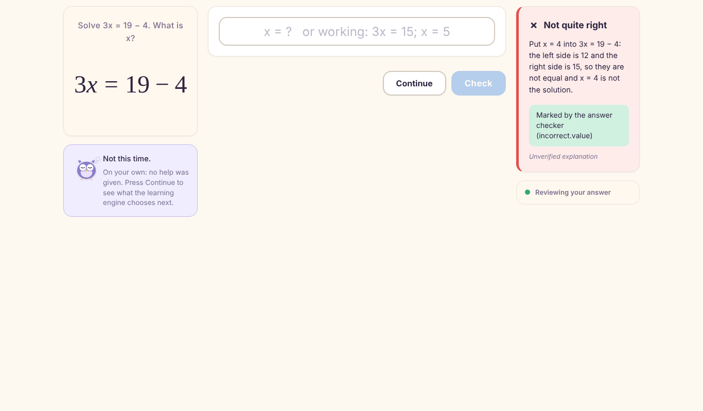 | 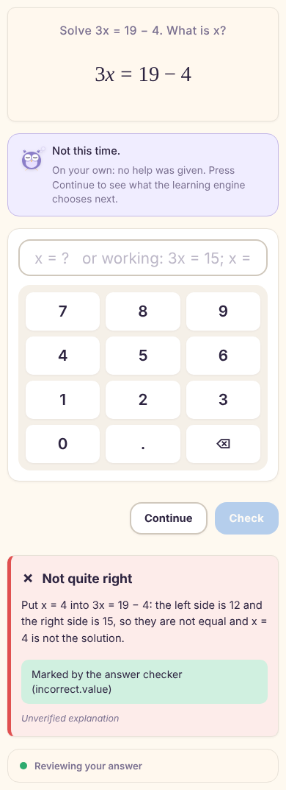 |
| B | `x = 5` | correct (correct.equal) / none, no-method-evidence | 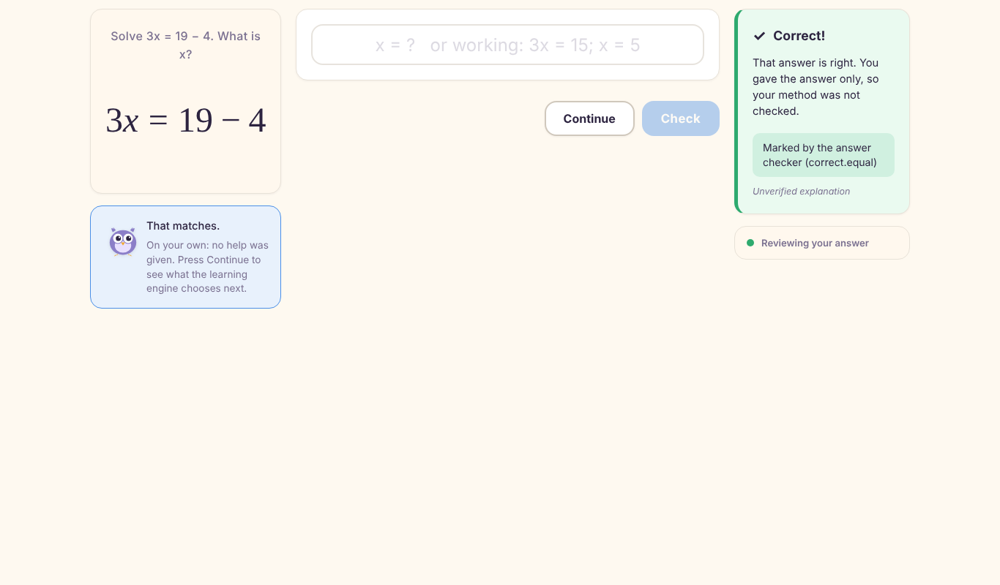 | 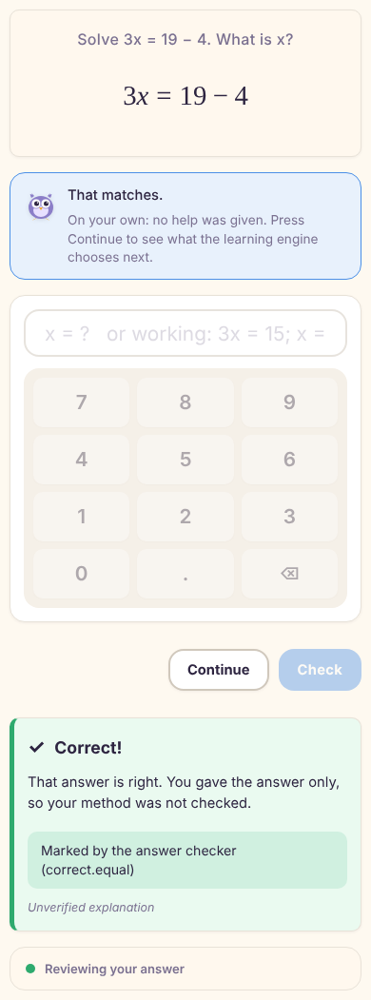 |
| C | `3x = 15; x = 5` | correct (correct.equal) / verified, method-verified | 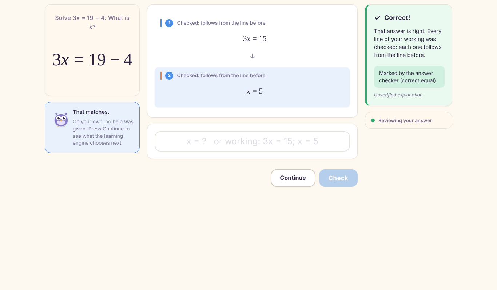 | 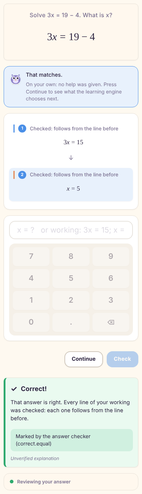 |
| D | `3x = 15; x = 4` | incorrect (incorrect.value) / invalid, method-false-step, first invalid line 2 | 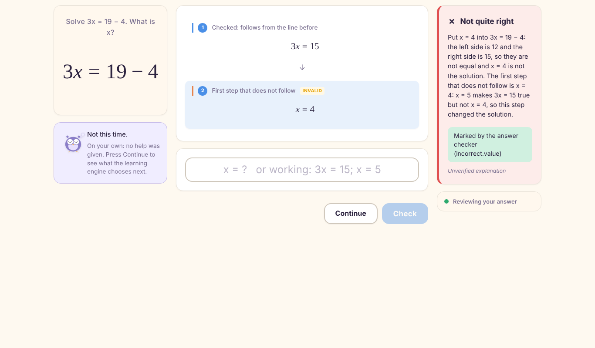 | 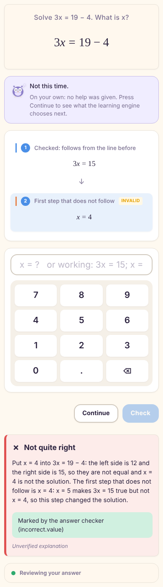 |
| E | `3x = 16; x = 16/3` | incorrect (incorrect.value) / invalid, method-false-step, first invalid line 1 | 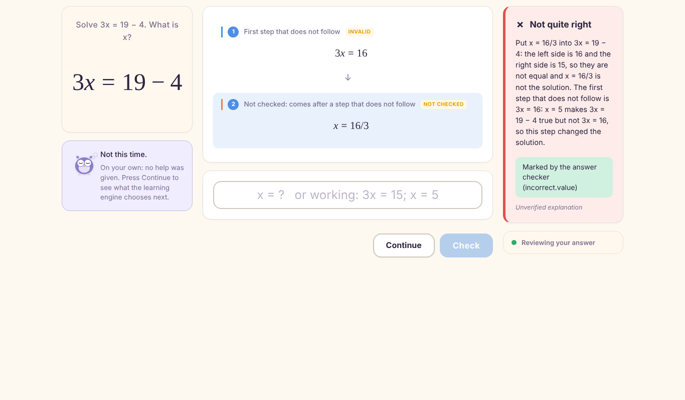 | 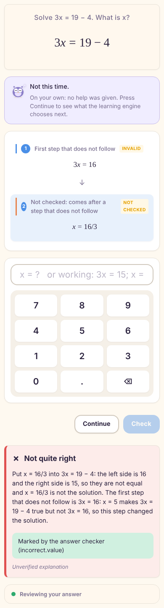 |
| F | `3x = 15` | unresolved (unresolved.invalid-response) / partial, no-method-evidence | 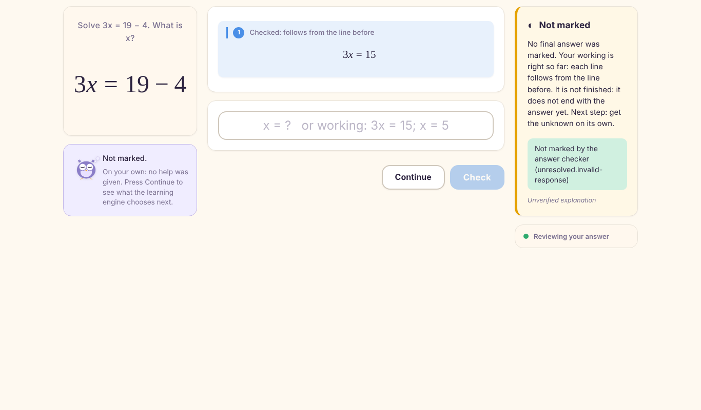 | 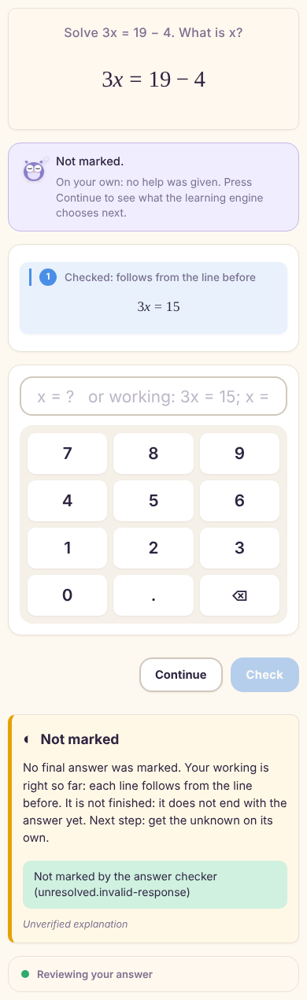 |
| G | `3x = 15 => x = 5; x = 5` | correct (correct.equal) / unsupported, no-method-evidence | 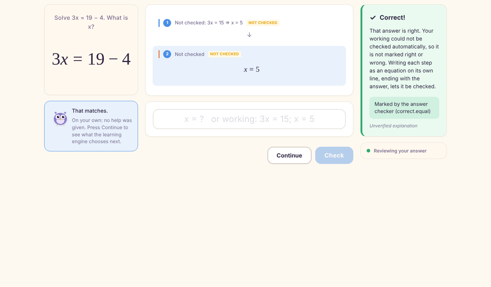 | 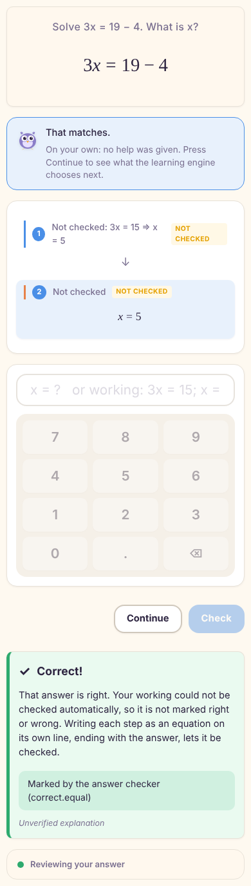 |

## Full per-submission traces

### D1-01 Wrong bare answer, general teaching, fresh recheck

Learner (scripted submissions only): wrong bare answers until taught once, then right with working. Mode: demonstration. Ended: done.

| # | Question (family) | Activity | Typed | Answer verdict | Working status / method evidence / completeness | First invalid step | Feedback shown |
|---|---|---|---|---|---|---|---|
| 1 | le-ref-3x-19-4 (authored) | diagnostic | `x = 4` | incorrect (incorrect.value) | none / no-method-evidence / no-working | — | incorrect: Put x = 4 into 3x = 19 − 4: the left side is 12 and the right side is 15, so they are not equal and x = 4 is not the solution. |
| 2 | gen:lin:3,3,2 (lin) | diagnostic | `3` | incorrect (incorrect.value) | none / no-method-evidence / no-working | — | incorrect: Put x = 3 into 3x+3=9: the left side is 12 and the right side is 9, so they are not equal and x = 3 is not the solution. |
| 3 | gen:lin:3,9,8 (lin) | diagnostic | `9` | incorrect (incorrect.value) | none / no-method-evidence / no-working | — | incorrect: Put x = 9 into 3x+9=33: the left side is 36 and the right side is 33, so they are not equal and x = 9 is not the solution. |
| 4 | gen:lin:3,9,2 (lin) | diagnostic | `3` | incorrect (incorrect.value) | none / no-method-evidence / no-working | — | incorrect: Put x = 3 into 3x+9=15: the left side is 18 and the right side is 15, so they are not equal and x = 3 is not the solution. |
| 5 | gen:lin:7,5,10 (lin) | guided | `7x = 70; x = 10` | correct (correct.equal) | verified / method-verified / complete | — | correct: That answer is right. Every line of your working was checked: each one follows from the line before. |
| 6 | gen:lin:2,15,1 (lin) | check | `2x = 2; x = 1` | correct (correct.equal) | verified / method-verified / complete | — | correct: That answer is right. Every line of your working was checked: each one follows from the line before. |
| 7 | gen:lin:2,17,11 (lin) | practice | `2x = 22; x = 11` | correct (correct.equal) | verified / method-verified / complete | — | correct: That answer is right. Every line of your working was checked: each one follows from the line before. |
| 8 | gen:lin:7,9,11:mc (lin) | practice | `B` | correct (correct.equal) | none / no-method-evidence / no-working | — | correct: That answer is right. You gave the answer only, so your method was not checked. |
| 9 | gen:lin:7,18,9 (lin) | practice | `7x = 63; x = 9` | correct (correct.equal) | verified / method-verified / complete | — | correct: That answer is right. Every line of your working was checked: each one follows from the line before. |
| 10 | gen:auleq:1,2,9,10 (auleq) | practice | `C` | correct (correct.equal) | — | — | correct: That answer is right. |
| 11 | gen:aulwp:1,5,2,7 (aulwp) | practice | `7` | correct (correct.equal) | — | — | correct: That answer is right. |
| 12 | gen:lboth:9,7,8,2 (lboth) | practice | `x + 7 = 9; x = 2` | correct (correct.equal) | verified / method-verified / complete | — | correct: That answer is right. Every line of your working was checked: each one follows from the line before. |
| 13 | gen:lbrk:5,-4,2,1 (lbrk) | practice | `3x − 20 = −17; 3x = 3; x = 1` | correct (correct.equal) | verified / method-verified / complete | — | correct: That answer is right. Every line of your working was checked: each one follows from the line before. |
| 14 | gen:lin:2,4,7:mc (lin) | transfer | `B` | correct (correct.equal) | none / no-method-evidence / no-working | — | correct: That answer is right. You gave the answer only, so your method was not checked. |
| 15 | gen:aulwp:1,5,2,9:w (aulwp) | transfer | `9` | correct (correct.equal) | — | — | correct: That answer is right. |
| 16 | gen:lin:5,6,5 (lin) | check | `5x = 25; x = 5` | correct (correct.equal) | verified / method-verified / complete | — | correct: That answer is right. Every line of your working was checked: each one follows from the line before. |
| 17 | gen:lboth:8,3,4,3 (lboth) | check | `4x + 3 = 15; 4x = 12; x = 3` | correct (correct.equal) | verified / method-verified / complete | — | correct: That answer is right. Every line of your working was checked: each one follows from the line before. |
| 18 | gen:lbrk:4,4,2,2 (lbrk) | check | `2x + 16 = 20; 2x = 4; x = 2` | correct (correct.equal) | verified / method-verified / complete | — | correct: That answer is right. Every line of your working was checked: each one follows from the line before. |
| 19 | gen:lin:3,3,4 (lin) | check | `3x = 12; x = 4` | correct (correct.equal) | verified / method-verified / complete | — | correct: That answer is right. Every line of your working was checked: each one follows from the line before. |
| 20 | gen:lin:3,9,1 (lin) | check | `3x = 3; x = 1` | correct (correct.equal) | verified / method-verified / complete | — | correct: That answer is right. Every line of your working was checked: each one follows from the line before. |
| 21 | gen:lin:5,10,2 (lin) | check | `5x = 10; x = 2` | correct (correct.equal) | verified / method-verified / complete | — | correct: That answer is right. Every line of your working was checked: each one follows from the line before. |
| 22 | gen:lboth:5,20,4,4 (lboth) | check | `x + 20 = 24; x = 4` | correct (correct.equal) | verified / method-verified / complete | — | correct: That answer is right. Every line of your working was checked: each one follows from the line before. |
| 23 | gen:lboth:7,16,5,6 (lboth) | check | `2x + 16 = 28; 2x = 12; x = 6` | correct (correct.equal) | verified / method-verified / complete | — | correct: That answer is right. Every line of your working was checked: each one follows from the line before. |
| 24 | gen:lboth:8,18,7,8 (lboth) | check | `x + 18 = 26; x = 8` | correct (correct.equal) | verified / method-verified / complete | — | correct: That answer is right. Every line of your working was checked: each one follows from the line before. |
| 25 | gen:lbrk:4,3,3,4 (lbrk) | check | `x + 12 = 16; x = 4` | correct (correct.equal) | verified / method-verified / complete | — | correct: That answer is right. Every line of your working was checked: each one follows from the line before. |
| 26 | gen:lbrk:6,-5,3,9 (lbrk) | check | `3x − 30 = −3; 3x = 27; x = 9` | correct (correct.equal) | verified / method-verified / complete | — | correct: That answer is right. Every line of your working was checked: each one follows from the line before. |
| 27 | wr:eq:find-mistakes (authored) | practice | `written:marked-correct` | pending-educator (pending-educator) | — | — | none: This answer could not be checked automatically, so it was not marked. |

| Explanation | Basis | Review | Displayed | Recheck (family, fresh) | Recheck credit | Recheck method |
|---|---|---|---|---|---|---|
| balance | repeated-difficulty | pending_review | true | gen:lin:2,15,1 (lin, true) | true | method-verified |

After: status transfer, verified false, recovery required false, retention scheduled (pending), independent 21/25; families in the evidence: authored, lin, auleq, aulwp, lboth, lbrk.

### D1-02 Correct bare answer: no method evidence

Learner (scripted submissions only): right, bare answers only. Mode: demonstration. Ended: done.

| # | Question (family) | Activity | Typed | Answer verdict | Working status / method evidence / completeness | First invalid step | Feedback shown |
|---|---|---|---|---|---|---|---|
| 1 | le-ref-3x-19-4 (authored) | diagnostic | `x = 5` | correct (correct.equal) | none / no-method-evidence / no-working | — | correct: That answer is right. You gave the answer only, so your method was not checked. |
| 2 | gen:lin:3,3,2 (lin) | diagnostic | `2` | correct (correct.equal) | none / no-method-evidence / no-working | — | correct: That answer is right. You gave the answer only, so your method was not checked. |
| 3 | gen:lin:2,17,11 (lin) | practice | `11` | correct (correct.equal) | none / no-method-evidence / no-working | — | correct: That answer is right. You gave the answer only, so your method was not checked. |
| 4 | gen:lin:7,9,11:mc (lin) | practice | `B` | correct (correct.equal) | none / no-method-evidence / no-working | — | correct: That answer is right. You gave the answer only, so your method was not checked. |
| 5 | gen:lin:7,18,9 (lin) | practice | `9` | correct (correct.equal) | none / no-method-evidence / no-working | — | correct: That answer is right. You gave the answer only, so your method was not checked. |
| 6 | gen:auleq:1,2,9,10 (auleq) | practice | `C` | correct (correct.equal) | — | — | correct: That answer is right. |
| 7 | gen:aulwp:1,5,2,7 (aulwp) | practice | `7` | correct (correct.equal) | — | — | correct: That answer is right. |
| 8 | gen:lboth:9,7,8,2 (lboth) | practice | `2` | correct (correct.equal) | none / no-method-evidence / no-working | — | correct: That answer is right. You gave the answer only, so your method was not checked. |
| 9 | gen:lbrk:5,-4,2,1 (lbrk) | practice | `1` | correct (correct.equal) | none / no-method-evidence / no-working | — | correct: That answer is right. You gave the answer only, so your method was not checked. |
| 10 | gen:lin:2,4,7:mc (lin) | transfer | `B` | correct (correct.equal) | none / no-method-evidence / no-working | — | correct: That answer is right. You gave the answer only, so your method was not checked. |
| 11 | gen:aulwp:1,5,2,9:w (aulwp) | transfer | `9` | correct (correct.equal) | — | — | correct: That answer is right. |
| 12 | gen:lin:2,15,1 (lin) | check | `1` | correct (correct.equal) | none / no-method-evidence / no-working | — | correct: That answer is right. You gave the answer only, so your method was not checked. |
| 13 | gen:lin:5,6,5 (lin) | check | `5` | correct (correct.equal) | none / no-method-evidence / no-working | — | correct: That answer is right. You gave the answer only, so your method was not checked. |
| 14 | gen:lboth:8,3,4,3 (lboth) | check | `3` | correct (correct.equal) | none / no-method-evidence / no-working | — | correct: That answer is right. You gave the answer only, so your method was not checked. |
| 15 | gen:lbrk:4,4,2,2 (lbrk) | check | `2` | correct (correct.equal) | none / no-method-evidence / no-working | — | correct: That answer is right. You gave the answer only, so your method was not checked. |
| 16 | gen:lin:3,3,4 (lin) | check | `4` | correct (correct.equal) | none / no-method-evidence / no-working | — | correct: That answer is right. You gave the answer only, so your method was not checked. |
| 17 | gen:lin:3,9,1 (lin) | check | `1` | correct (correct.equal) | none / no-method-evidence / no-working | — | correct: That answer is right. You gave the answer only, so your method was not checked. |
| 18 | gen:lin:5,10,2 (lin) | check | `2` | correct (correct.equal) | none / no-method-evidence / no-working | — | correct: That answer is right. You gave the answer only, so your method was not checked. |
| 19 | gen:lboth:5,20,4,4 (lboth) | check | `4` | correct (correct.equal) | none / no-method-evidence / no-working | — | correct: That answer is right. You gave the answer only, so your method was not checked. |
| 20 | gen:lboth:7,16,5,6 (lboth) | check | `6` | correct (correct.equal) | none / no-method-evidence / no-working | — | correct: That answer is right. You gave the answer only, so your method was not checked. |
| 21 | gen:lboth:8,18,7,8 (lboth) | check | `8` | correct (correct.equal) | none / no-method-evidence / no-working | — | correct: That answer is right. You gave the answer only, so your method was not checked. |
| 22 | gen:lbrk:4,3,3,4 (lbrk) | check | `4` | correct (correct.equal) | none / no-method-evidence / no-working | — | correct: That answer is right. You gave the answer only, so your method was not checked. |
| 23 | gen:lbrk:6,-5,3,9 (lbrk) | check | `9` | correct (correct.equal) | none / no-method-evidence / no-working | — | correct: That answer is right. You gave the answer only, so your method was not checked. |
| 24 | wr:eq:find-mistakes (authored) | practice | `written:marked-correct` | pending-educator (pending-educator) | — | — | none: This answer could not be checked automatically, so it was not marked. |

After: status transfer, verified false, recovery required false, retention scheduled (pending), independent 23/23; families in the evidence: authored, lin, auleq, aulwp, lboth, lbrk.

### D1-03 Correct answer with verified multi-step working

Learner (scripted submissions only): right with working. Mode: demonstration. Ended: done.

| # | Question (family) | Activity | Typed | Answer verdict | Working status / method evidence / completeness | First invalid step | Feedback shown |
|---|---|---|---|---|---|---|---|
| 1 | le-ref-3x-19-4 (authored) | diagnostic | `3x = 15; x = 5` | correct (correct.equal) | verified / method-verified / complete | — | correct: That answer is right. Every line of your working was checked: each one follows from the line before. |
| 2 | gen:lin:3,3,2 (lin) | diagnostic | `3x = 6; x = 2` | correct (correct.equal) | verified / method-verified / complete | — | correct: That answer is right. Every line of your working was checked: each one follows from the line before. |
| 3 | gen:lin:2,17,11 (lin) | practice | `2x = 22; x = 11` | correct (correct.equal) | verified / method-verified / complete | — | correct: That answer is right. Every line of your working was checked: each one follows from the line before. |
| 4 | gen:lin:7,9,11:mc (lin) | practice | `B` | correct (correct.equal) | none / no-method-evidence / no-working | — | correct: That answer is right. You gave the answer only, so your method was not checked. |
| 5 | gen:lin:7,18,9 (lin) | practice | `7x = 63; x = 9` | correct (correct.equal) | verified / method-verified / complete | — | correct: That answer is right. Every line of your working was checked: each one follows from the line before. |
| 6 | gen:auleq:1,2,9,10 (auleq) | practice | `C` | correct (correct.equal) | — | — | correct: That answer is right. |
| 7 | gen:aulwp:1,5,2,7 (aulwp) | practice | `7` | correct (correct.equal) | — | — | correct: That answer is right. |
| 8 | gen:lboth:9,7,8,2 (lboth) | practice | `x + 7 = 9; x = 2` | correct (correct.equal) | verified / method-verified / complete | — | correct: That answer is right. Every line of your working was checked: each one follows from the line before. |
| 9 | gen:lbrk:5,-4,2,1 (lbrk) | practice | `3x − 20 = −17; 3x = 3; x = 1` | correct (correct.equal) | verified / method-verified / complete | — | correct: That answer is right. Every line of your working was checked: each one follows from the line before. |
| 10 | gen:lin:2,4,7:mc (lin) | transfer | `B` | correct (correct.equal) | none / no-method-evidence / no-working | — | correct: That answer is right. You gave the answer only, so your method was not checked. |
| 11 | gen:aulwp:1,5,2,9:w (aulwp) | transfer | `9` | correct (correct.equal) | — | — | correct: That answer is right. |
| 12 | gen:lin:2,15,1 (lin) | check | `2x = 2; x = 1` | correct (correct.equal) | verified / method-verified / complete | — | correct: That answer is right. Every line of your working was checked: each one follows from the line before. |
| 13 | gen:lin:5,6,5 (lin) | check | `5x = 25; x = 5` | correct (correct.equal) | verified / method-verified / complete | — | correct: That answer is right. Every line of your working was checked: each one follows from the line before. |
| 14 | gen:lboth:8,3,4,3 (lboth) | check | `4x + 3 = 15; 4x = 12; x = 3` | correct (correct.equal) | verified / method-verified / complete | — | correct: That answer is right. Every line of your working was checked: each one follows from the line before. |
| 15 | gen:lbrk:4,4,2,2 (lbrk) | check | `2x + 16 = 20; 2x = 4; x = 2` | correct (correct.equal) | verified / method-verified / complete | — | correct: That answer is right. Every line of your working was checked: each one follows from the line before. |
| 16 | gen:lin:3,3,4 (lin) | check | `3x = 12; x = 4` | correct (correct.equal) | verified / method-verified / complete | — | correct: That answer is right. Every line of your working was checked: each one follows from the line before. |
| 17 | gen:lin:3,9,1 (lin) | check | `3x = 3; x = 1` | correct (correct.equal) | verified / method-verified / complete | — | correct: That answer is right. Every line of your working was checked: each one follows from the line before. |
| 18 | gen:lin:5,10,2 (lin) | check | `5x = 10; x = 2` | correct (correct.equal) | verified / method-verified / complete | — | correct: That answer is right. Every line of your working was checked: each one follows from the line before. |
| 19 | gen:lboth:5,20,4,4 (lboth) | check | `x + 20 = 24; x = 4` | correct (correct.equal) | verified / method-verified / complete | — | correct: That answer is right. Every line of your working was checked: each one follows from the line before. |
| 20 | gen:lboth:7,16,5,6 (lboth) | check | `2x + 16 = 28; 2x = 12; x = 6` | correct (correct.equal) | verified / method-verified / complete | — | correct: That answer is right. Every line of your working was checked: each one follows from the line before. |
| 21 | gen:lboth:8,18,7,8 (lboth) | check | `x + 18 = 26; x = 8` | correct (correct.equal) | verified / method-verified / complete | — | correct: That answer is right. Every line of your working was checked: each one follows from the line before. |
| 22 | gen:lbrk:4,3,3,4 (lbrk) | check | `x + 12 = 16; x = 4` | correct (correct.equal) | verified / method-verified / complete | — | correct: That answer is right. Every line of your working was checked: each one follows from the line before. |
| 23 | gen:lbrk:6,-5,3,9 (lbrk) | check | `3x − 30 = −3; 3x = 27; x = 9` | correct (correct.equal) | verified / method-verified / complete | — | correct: That answer is right. Every line of your working was checked: each one follows from the line before. |
| 24 | wr:eq:find-mistakes (authored) | practice | `written:marked-correct` | pending-educator (pending-educator) | — | — | none: This answer could not be checked automatically, so it was not marked. |

After: status transfer, verified false, recovery required false, retention scheduled (pending), independent 23/23; families in the evidence: authored, lin, auleq, aulwp, lboth, lbrk.

### D1-04 Correct answer reached through invalid working

Learner (scripted submissions only): "3x = 16; x = 5" on le-ref-3x-19-4, then right with working. Mode: demonstration. Ended: done.

| # | Question (family) | Activity | Typed | Answer verdict | Working status / method evidence / completeness | First invalid step | Feedback shown |
|---|---|---|---|---|---|---|---|
| 1 | le-ref-3x-19-4 (authored) | diagnostic | `3x = 16; x = 5` | correct (correct.equal) | invalid / method-false-step / complete | line 1 `3x = 16` (lost 5, gained 16/3) | correct: That answer is right. But a step in your working is not right. The first step that does not follow is 3x = 16: x = 5 makes 3x = 19 − 4 true but not 3x = 16, so this step changed the solution. |
| 2 | gen:lin:3,3,2 (lin) | diagnostic | `3x = 6; x = 2` | correct (correct.equal) | verified / method-verified / complete | — | correct: That answer is right. Every line of your working was checked: each one follows from the line before. |
| 3 | gen:lin:2,17,11 (lin) | practice | `2x = 22; x = 11` | correct (correct.equal) | verified / method-verified / complete | — | correct: That answer is right. Every line of your working was checked: each one follows from the line before. |
| 4 | gen:lin:7,9,11:mc (lin) | practice | `B` | correct (correct.equal) | none / no-method-evidence / no-working | — | correct: That answer is right. You gave the answer only, so your method was not checked. |
| 5 | gen:lin:7,18,9 (lin) | practice | `7x = 63; x = 9` | correct (correct.equal) | verified / method-verified / complete | — | correct: That answer is right. Every line of your working was checked: each one follows from the line before. |
| 6 | gen:auleq:1,2,9,10 (auleq) | practice | `C` | correct (correct.equal) | — | — | correct: That answer is right. |
| 7 | gen:aulwp:1,5,2,7 (aulwp) | practice | `7` | correct (correct.equal) | — | — | correct: That answer is right. |
| 8 | gen:lboth:9,7,8,2 (lboth) | practice | `x + 7 = 9; x = 2` | correct (correct.equal) | verified / method-verified / complete | — | correct: That answer is right. Every line of your working was checked: each one follows from the line before. |
| 9 | gen:lbrk:5,-4,2,1 (lbrk) | practice | `3x − 20 = −17; 3x = 3; x = 1` | correct (correct.equal) | verified / method-verified / complete | — | correct: That answer is right. Every line of your working was checked: each one follows from the line before. |
| 10 | gen:lin:2,4,7:mc (lin) | transfer | `B` | correct (correct.equal) | none / no-method-evidence / no-working | — | correct: That answer is right. You gave the answer only, so your method was not checked. |
| 11 | gen:aulwp:1,5,2,9:w (aulwp) | transfer | `9` | correct (correct.equal) | — | — | correct: That answer is right. |
| 12 | gen:lin:2,15,1 (lin) | check | `2x = 2; x = 1` | correct (correct.equal) | verified / method-verified / complete | — | correct: That answer is right. Every line of your working was checked: each one follows from the line before. |
| 13 | gen:lin:5,6,5 (lin) | check | `5x = 25; x = 5` | correct (correct.equal) | verified / method-verified / complete | — | correct: That answer is right. Every line of your working was checked: each one follows from the line before. |
| 14 | gen:lboth:8,3,4,3 (lboth) | check | `4x + 3 = 15; 4x = 12; x = 3` | correct (correct.equal) | verified / method-verified / complete | — | correct: That answer is right. Every line of your working was checked: each one follows from the line before. |
| 15 | gen:lbrk:4,4,2,2 (lbrk) | check | `2x + 16 = 20; 2x = 4; x = 2` | correct (correct.equal) | verified / method-verified / complete | — | correct: That answer is right. Every line of your working was checked: each one follows from the line before. |
| 16 | gen:lin:3,3,4 (lin) | check | `3x = 12; x = 4` | correct (correct.equal) | verified / method-verified / complete | — | correct: That answer is right. Every line of your working was checked: each one follows from the line before. |
| 17 | gen:lin:3,9,1 (lin) | check | `3x = 3; x = 1` | correct (correct.equal) | verified / method-verified / complete | — | correct: That answer is right. Every line of your working was checked: each one follows from the line before. |
| 18 | gen:lin:5,10,2 (lin) | check | `5x = 10; x = 2` | correct (correct.equal) | verified / method-verified / complete | — | correct: That answer is right. Every line of your working was checked: each one follows from the line before. |
| 19 | gen:lboth:5,20,4,4 (lboth) | check | `x + 20 = 24; x = 4` | correct (correct.equal) | verified / method-verified / complete | — | correct: That answer is right. Every line of your working was checked: each one follows from the line before. |
| 20 | gen:lboth:7,16,5,6 (lboth) | check | `2x + 16 = 28; 2x = 12; x = 6` | correct (correct.equal) | verified / method-verified / complete | — | correct: That answer is right. Every line of your working was checked: each one follows from the line before. |
| 21 | gen:lboth:8,18,7,8 (lboth) | check | `x + 18 = 26; x = 8` | correct (correct.equal) | verified / method-verified / complete | — | correct: That answer is right. Every line of your working was checked: each one follows from the line before. |
| 22 | gen:lbrk:4,3,3,4 (lbrk) | check | `x + 12 = 16; x = 4` | correct (correct.equal) | verified / method-verified / complete | — | correct: That answer is right. Every line of your working was checked: each one follows from the line before. |
| 23 | gen:lbrk:6,-5,3,9 (lbrk) | check | `3x − 30 = −3; 3x = 27; x = 9` | correct (correct.equal) | verified / method-verified / complete | — | correct: That answer is right. Every line of your working was checked: each one follows from the line before. |
| 24 | wr:eq:find-mistakes (authored) | practice | `written:marked-correct` | pending-educator (pending-educator) | — | — | none: This answer could not be checked automatically, so it was not marked. |

After: status transfer, verified false, recovery required false, retention scheduled (pending), independent 23/23; families in the evidence: authored, lin, auleq, aulwp, lboth, lbrk.

### D1-05 Incorrect answer with an identified invalid transformation

Learner (scripted submissions only): "3x = 15; x = 4" on le-ref-3x-19-4, then right with working. Mode: demonstration. Ended: done.

| # | Question (family) | Activity | Typed | Answer verdict | Working status / method evidence / completeness | First invalid step | Feedback shown |
|---|---|---|---|---|---|---|---|
| 1 | le-ref-3x-19-4 (authored) | diagnostic | `3x = 15; x = 4` | incorrect (incorrect.value) | invalid / method-false-step / complete | line 2 `x = 4` (lost 5, gained 4) | incorrect: Put x = 4 into 3x = 19 − 4: the left side is 12 and the right side is 15, so they are not equal and x = 4 is not the solution. The first step that does not follow is x = 4: x = 5 makes 3x = 15 true but not x = 4, so this step changed the solution. |
| 2 | gen:lin:3,3,2 (lin) | diagnostic | `3x = 6; x = 2` | correct (correct.equal) | verified / method-verified / complete | — | correct: That answer is right. Every line of your working was checked: each one follows from the line before. |
| 3 | gen:lin:3,9,8 (lin) | diagnostic | `3x = 24; x = 8` | correct (correct.equal) | verified / method-verified / complete | — | correct: That answer is right. Every line of your working was checked: each one follows from the line before. |
| 4 | gen:lin:2,17,11 (lin) | practice | `2x = 22; x = 11` | correct (correct.equal) | verified / method-verified / complete | — | correct: That answer is right. Every line of your working was checked: each one follows from the line before. |
| 5 | gen:lin:7,9,11:mc (lin) | practice | `B` | correct (correct.equal) | none / no-method-evidence / no-working | — | correct: That answer is right. You gave the answer only, so your method was not checked. |
| 6 | gen:lin:7,18,9 (lin) | practice | `7x = 63; x = 9` | correct (correct.equal) | verified / method-verified / complete | — | correct: That answer is right. Every line of your working was checked: each one follows from the line before. |
| 7 | gen:auleq:1,2,9,10 (auleq) | practice | `C` | correct (correct.equal) | — | — | correct: That answer is right. |
| 8 | gen:aulwp:1,5,2,7 (aulwp) | practice | `7` | correct (correct.equal) | — | — | correct: That answer is right. |
| 9 | gen:lboth:9,7,8,2 (lboth) | practice | `x + 7 = 9; x = 2` | correct (correct.equal) | verified / method-verified / complete | — | correct: That answer is right. Every line of your working was checked: each one follows from the line before. |
| 10 | gen:lbrk:5,-4,2,1 (lbrk) | practice | `3x − 20 = −17; 3x = 3; x = 1` | correct (correct.equal) | verified / method-verified / complete | — | correct: That answer is right. Every line of your working was checked: each one follows from the line before. |
| 11 | gen:lin:2,4,7:mc (lin) | transfer | `B` | correct (correct.equal) | none / no-method-evidence / no-working | — | correct: That answer is right. You gave the answer only, so your method was not checked. |
| 12 | gen:aulwp:1,5,2,9:w (aulwp) | transfer | `9` | correct (correct.equal) | — | — | correct: That answer is right. |
| 13 | gen:lin:2,15,1 (lin) | check | `2x = 2; x = 1` | correct (correct.equal) | verified / method-verified / complete | — | correct: That answer is right. Every line of your working was checked: each one follows from the line before. |
| 14 | gen:lin:5,6,5 (lin) | check | `5x = 25; x = 5` | correct (correct.equal) | verified / method-verified / complete | — | correct: That answer is right. Every line of your working was checked: each one follows from the line before. |
| 15 | gen:lboth:8,3,4,3 (lboth) | check | `4x + 3 = 15; 4x = 12; x = 3` | correct (correct.equal) | verified / method-verified / complete | — | correct: That answer is right. Every line of your working was checked: each one follows from the line before. |
| 16 | gen:lbrk:4,4,2,2 (lbrk) | check | `2x + 16 = 20; 2x = 4; x = 2` | correct (correct.equal) | verified / method-verified / complete | — | correct: That answer is right. Every line of your working was checked: each one follows from the line before. |
| 17 | gen:lin:3,3,4 (lin) | check | `3x = 12; x = 4` | correct (correct.equal) | verified / method-verified / complete | — | correct: That answer is right. Every line of your working was checked: each one follows from the line before. |
| 18 | gen:lin:3,9,1 (lin) | check | `3x = 3; x = 1` | correct (correct.equal) | verified / method-verified / complete | — | correct: That answer is right. Every line of your working was checked: each one follows from the line before. |
| 19 | gen:lin:5,10,2 (lin) | check | `5x = 10; x = 2` | correct (correct.equal) | verified / method-verified / complete | — | correct: That answer is right. Every line of your working was checked: each one follows from the line before. |
| 20 | gen:lboth:5,20,4,4 (lboth) | check | `x + 20 = 24; x = 4` | correct (correct.equal) | verified / method-verified / complete | — | correct: That answer is right. Every line of your working was checked: each one follows from the line before. |
| 21 | gen:lboth:7,16,5,6 (lboth) | check | `2x + 16 = 28; 2x = 12; x = 6` | correct (correct.equal) | verified / method-verified / complete | — | correct: That answer is right. Every line of your working was checked: each one follows from the line before. |
| 22 | gen:lboth:8,18,7,8 (lboth) | check | `x + 18 = 26; x = 8` | correct (correct.equal) | verified / method-verified / complete | — | correct: That answer is right. Every line of your working was checked: each one follows from the line before. |
| 23 | gen:lbrk:4,3,3,4 (lbrk) | check | `x + 12 = 16; x = 4` | correct (correct.equal) | verified / method-verified / complete | — | correct: That answer is right. Every line of your working was checked: each one follows from the line before. |
| 24 | gen:lbrk:6,-5,3,9 (lbrk) | check | `3x − 30 = −3; 3x = 27; x = 9` | correct (correct.equal) | verified / method-verified / complete | — | correct: That answer is right. Every line of your working was checked: each one follows from the line before. |
| 25 | wr:eq:find-mistakes (authored) | practice | `written:marked-correct` | pending-educator (pending-educator) | — | — | none: This answer could not be checked automatically, so it was not marked. |

After: status transfer, verified false, recovery required false, retention scheduled (pending), independent 23/24; families in the evidence: authored, lin, auleq, aulwp, lboth, lbrk.

### D1-06 Valid partial derivation

Learner (scripted submissions only): "3x = 15" on le-ref-3x-19-4, then right with working. Mode: demonstration. Ended: done.

| # | Question (family) | Activity | Typed | Answer verdict | Working status / method evidence / completeness | First invalid step | Feedback shown |
|---|---|---|---|---|---|---|---|
| 1 | le-ref-3x-19-4 (authored) | diagnostic | `3x = 15` | unresolved (unresolved.invalid-response) | partial / no-method-evidence / incomplete | — | partial: No final answer was marked. Your working is right so far: each line follows from the line before. It is not finished: it does not end with the answer yet. Next step: get the unknown on its own. |
| 2 | gen:lin:3,3,2 (lin) | diagnostic | `3x = 6; x = 2` | correct (correct.equal) | verified / method-verified / complete | — | correct: That answer is right. Every line of your working was checked: each one follows from the line before. |
| 3 | gen:lin:3,9,8 (lin) | diagnostic | `3x = 24; x = 8` | correct (correct.equal) | verified / method-verified / complete | — | correct: That answer is right. Every line of your working was checked: each one follows from the line before. |
| 4 | gen:lin:2,17,11 (lin) | practice | `2x = 22; x = 11` | correct (correct.equal) | verified / method-verified / complete | — | correct: That answer is right. Every line of your working was checked: each one follows from the line before. |
| 5 | gen:lin:7,9,11:mc (lin) | practice | `B` | correct (correct.equal) | none / no-method-evidence / no-working | — | correct: That answer is right. You gave the answer only, so your method was not checked. |
| 6 | gen:lin:7,18,9 (lin) | practice | `7x = 63; x = 9` | correct (correct.equal) | verified / method-verified / complete | — | correct: That answer is right. Every line of your working was checked: each one follows from the line before. |
| 7 | gen:auleq:1,2,9,10 (auleq) | practice | `C` | correct (correct.equal) | — | — | correct: That answer is right. |
| 8 | gen:aulwp:1,5,2,7 (aulwp) | practice | `7` | correct (correct.equal) | — | — | correct: That answer is right. |
| 9 | gen:lboth:9,7,8,2 (lboth) | practice | `x + 7 = 9; x = 2` | correct (correct.equal) | verified / method-verified / complete | — | correct: That answer is right. Every line of your working was checked: each one follows from the line before. |
| 10 | gen:lbrk:5,-4,2,1 (lbrk) | practice | `3x − 20 = −17; 3x = 3; x = 1` | correct (correct.equal) | verified / method-verified / complete | — | correct: That answer is right. Every line of your working was checked: each one follows from the line before. |
| 11 | gen:lin:2,4,7:mc (lin) | transfer | `B` | correct (correct.equal) | none / no-method-evidence / no-working | — | correct: That answer is right. You gave the answer only, so your method was not checked. |
| 12 | gen:aulwp:1,5,2,9:w (aulwp) | transfer | `9` | correct (correct.equal) | — | — | correct: That answer is right. |
| 13 | gen:lin:2,15,1 (lin) | check | `2x = 2; x = 1` | correct (correct.equal) | verified / method-verified / complete | — | correct: That answer is right. Every line of your working was checked: each one follows from the line before. |
| 14 | gen:lin:5,6,5 (lin) | check | `5x = 25; x = 5` | correct (correct.equal) | verified / method-verified / complete | — | correct: That answer is right. Every line of your working was checked: each one follows from the line before. |
| 15 | gen:lboth:8,3,4,3 (lboth) | check | `4x + 3 = 15; 4x = 12; x = 3` | correct (correct.equal) | verified / method-verified / complete | — | correct: That answer is right. Every line of your working was checked: each one follows from the line before. |
| 16 | gen:lbrk:4,4,2,2 (lbrk) | check | `2x + 16 = 20; 2x = 4; x = 2` | correct (correct.equal) | verified / method-verified / complete | — | correct: That answer is right. Every line of your working was checked: each one follows from the line before. |
| 17 | gen:lin:3,3,4 (lin) | check | `3x = 12; x = 4` | correct (correct.equal) | verified / method-verified / complete | — | correct: That answer is right. Every line of your working was checked: each one follows from the line before. |
| 18 | gen:lin:3,9,1 (lin) | check | `3x = 3; x = 1` | correct (correct.equal) | verified / method-verified / complete | — | correct: That answer is right. Every line of your working was checked: each one follows from the line before. |
| 19 | gen:lin:5,10,2 (lin) | check | `5x = 10; x = 2` | correct (correct.equal) | verified / method-verified / complete | — | correct: That answer is right. Every line of your working was checked: each one follows from the line before. |
| 20 | gen:lboth:5,20,4,4 (lboth) | check | `x + 20 = 24; x = 4` | correct (correct.equal) | verified / method-verified / complete | — | correct: That answer is right. Every line of your working was checked: each one follows from the line before. |
| 21 | gen:lboth:7,16,5,6 (lboth) | check | `2x + 16 = 28; 2x = 12; x = 6` | correct (correct.equal) | verified / method-verified / complete | — | correct: That answer is right. Every line of your working was checked: each one follows from the line before. |
| 22 | gen:lboth:8,18,7,8 (lboth) | check | `x + 18 = 26; x = 8` | correct (correct.equal) | verified / method-verified / complete | — | correct: That answer is right. Every line of your working was checked: each one follows from the line before. |
| 23 | gen:lbrk:4,3,3,4 (lbrk) | check | `x + 12 = 16; x = 4` | correct (correct.equal) | verified / method-verified / complete | — | correct: That answer is right. Every line of your working was checked: each one follows from the line before. |
| 24 | gen:lbrk:6,-5,3,9 (lbrk) | check | `3x − 30 = −3; 3x = 27; x = 9` | correct (correct.equal) | verified / method-verified / complete | — | correct: That answer is right. Every line of your working was checked: each one follows from the line before. |
| 25 | wr:eq:find-mistakes (authored) | practice | `written:marked-correct` | pending-educator (pending-educator) | — | — | none: This answer could not be checked automatically, so it was not marked. |

After: status transfer, verified false, recovery required false, retention scheduled (pending), independent 23/23; families in the evidence: lin, auleq, aulwp, lboth, lbrk.

### D1-07 Unsupported working

Learner (scripted submissions only): "3x = 15 => x = 5; x = 5" on le-ref-3x-19-4, then right with working. Mode: demonstration. Ended: done.

| # | Question (family) | Activity | Typed | Answer verdict | Working status / method evidence / completeness | First invalid step | Feedback shown |
|---|---|---|---|---|---|---|---|
| 1 | le-ref-3x-19-4 (authored) | diagnostic | `3x = 15 => x = 5; x = 5` | correct (correct.equal) | unsupported / no-method-evidence / complete | — | correct: That answer is right. Your working could not be checked automatically, so it is not marked right or wrong. Writing each step as an equation on its own line, ending with the answer, lets it be checked. |
| 2 | gen:lin:3,3,2 (lin) | diagnostic | `3x = 6; x = 2` | correct (correct.equal) | verified / method-verified / complete | — | correct: That answer is right. Every line of your working was checked: each one follows from the line before. |
| 3 | gen:lin:2,17,11 (lin) | practice | `2x = 22; x = 11` | correct (correct.equal) | verified / method-verified / complete | — | correct: That answer is right. Every line of your working was checked: each one follows from the line before. |
| 4 | gen:lin:7,9,11:mc (lin) | practice | `B` | correct (correct.equal) | none / no-method-evidence / no-working | — | correct: That answer is right. You gave the answer only, so your method was not checked. |
| 5 | gen:lin:7,18,9 (lin) | practice | `7x = 63; x = 9` | correct (correct.equal) | verified / method-verified / complete | — | correct: That answer is right. Every line of your working was checked: each one follows from the line before. |
| 6 | gen:auleq:1,2,9,10 (auleq) | practice | `C` | correct (correct.equal) | — | — | correct: That answer is right. |
| 7 | gen:aulwp:1,5,2,7 (aulwp) | practice | `7` | correct (correct.equal) | — | — | correct: That answer is right. |
| 8 | gen:lboth:9,7,8,2 (lboth) | practice | `x + 7 = 9; x = 2` | correct (correct.equal) | verified / method-verified / complete | — | correct: That answer is right. Every line of your working was checked: each one follows from the line before. |
| 9 | gen:lbrk:5,-4,2,1 (lbrk) | practice | `3x − 20 = −17; 3x = 3; x = 1` | correct (correct.equal) | verified / method-verified / complete | — | correct: That answer is right. Every line of your working was checked: each one follows from the line before. |
| 10 | gen:lin:2,4,7:mc (lin) | transfer | `B` | correct (correct.equal) | none / no-method-evidence / no-working | — | correct: That answer is right. You gave the answer only, so your method was not checked. |
| 11 | gen:aulwp:1,5,2,9:w (aulwp) | transfer | `9` | correct (correct.equal) | — | — | correct: That answer is right. |
| 12 | gen:lin:2,15,1 (lin) | check | `2x = 2; x = 1` | correct (correct.equal) | verified / method-verified / complete | — | correct: That answer is right. Every line of your working was checked: each one follows from the line before. |
| 13 | gen:lin:5,6,5 (lin) | check | `5x = 25; x = 5` | correct (correct.equal) | verified / method-verified / complete | — | correct: That answer is right. Every line of your working was checked: each one follows from the line before. |
| 14 | gen:lboth:8,3,4,3 (lboth) | check | `4x + 3 = 15; 4x = 12; x = 3` | correct (correct.equal) | verified / method-verified / complete | — | correct: That answer is right. Every line of your working was checked: each one follows from the line before. |
| 15 | gen:lbrk:4,4,2,2 (lbrk) | check | `2x + 16 = 20; 2x = 4; x = 2` | correct (correct.equal) | verified / method-verified / complete | — | correct: That answer is right. Every line of your working was checked: each one follows from the line before. |
| 16 | gen:lin:3,3,4 (lin) | check | `3x = 12; x = 4` | correct (correct.equal) | verified / method-verified / complete | — | correct: That answer is right. Every line of your working was checked: each one follows from the line before. |
| 17 | gen:lin:3,9,1 (lin) | check | `3x = 3; x = 1` | correct (correct.equal) | verified / method-verified / complete | — | correct: That answer is right. Every line of your working was checked: each one follows from the line before. |
| 18 | gen:lin:5,10,2 (lin) | check | `5x = 10; x = 2` | correct (correct.equal) | verified / method-verified / complete | — | correct: That answer is right. Every line of your working was checked: each one follows from the line before. |
| 19 | gen:lboth:5,20,4,4 (lboth) | check | `x + 20 = 24; x = 4` | correct (correct.equal) | verified / method-verified / complete | — | correct: That answer is right. Every line of your working was checked: each one follows from the line before. |
| 20 | gen:lboth:7,16,5,6 (lboth) | check | `2x + 16 = 28; 2x = 12; x = 6` | correct (correct.equal) | verified / method-verified / complete | — | correct: That answer is right. Every line of your working was checked: each one follows from the line before. |
| 21 | gen:lboth:8,18,7,8 (lboth) | check | `x + 18 = 26; x = 8` | correct (correct.equal) | verified / method-verified / complete | — | correct: That answer is right. Every line of your working was checked: each one follows from the line before. |
| 22 | gen:lbrk:4,3,3,4 (lbrk) | check | `x + 12 = 16; x = 4` | correct (correct.equal) | verified / method-verified / complete | — | correct: That answer is right. Every line of your working was checked: each one follows from the line before. |
| 23 | gen:lbrk:6,-5,3,9 (lbrk) | check | `3x − 30 = −3; 3x = 27; x = 9` | correct (correct.equal) | verified / method-verified / complete | — | correct: That answer is right. Every line of your working was checked: each one follows from the line before. |
| 24 | wr:eq:find-mistakes (authored) | practice | `written:marked-correct` | pending-educator (pending-educator) | — | — | none: This answer could not be checked automatically, so it was not marked. |

After: status transfer, verified false, recovery required false, retention scheduled (pending), independent 23/23; families in the evidence: authored, lin, auleq, aulwp, lboth, lbrk.

### D1-08 Verified misconception, matching teaching

Learner (scripted submissions only): forgot-divide until taught once, then right with working. Mode: demonstration. Ended: done.

| # | Question (family) | Activity | Typed | Answer verdict | Working status / method evidence / completeness | First invalid step | Feedback shown |
|---|---|---|---|---|---|---|---|
| 1 | le-ref-3x-19-4 (authored) | diagnostic | `3x = 15; x = 5` | correct (correct.equal) | verified / method-verified / complete | — | correct: That answer is right. Every line of your working was checked: each one follows from the line before. |
| 2 | gen:lin:3,3,2 (lin) | diagnostic | `6` | incorrect (incorrect.value) | none / no-method-evidence / no-working | — | incorrect: Put x = 6 into 3x+3=9: the left side is 21 and the right side is 9, so they are not equal and x = 6 is not the solution. |
| 3 | gen:lin:3,9,8 (lin) | diagnostic | `24` | incorrect (incorrect.value) | none / no-method-evidence / no-working | — | incorrect: Put x = 24 into 3x+9=33: the left side is 81 and the right side is 33, so they are not equal and x = 24 is not the solution. |
| 4 | gen:lin:2,2,1 (lin) | diagnostic | `2` | incorrect (incorrect.value) | none / no-method-evidence / no-working | — | incorrect: Put x = 2 into 2x+2=4: the left side is 6 and the right side is 4, so they are not equal and x = 2 is not the solution. |
| 5 | gen:lin:9,20,9 (lin) | guided | `9x = 81; x = 9` | correct (correct.equal) | verified / method-verified / complete | — | correct: That answer is right. Every line of your working was checked: each one follows from the line before. |
| 6 | gen:lin:3,3,4 (lin) | check | `3x = 12; x = 4` | correct (correct.equal) | verified / method-verified / complete | — | correct: That answer is right. Every line of your working was checked: each one follows from the line before. |
| 7 | gen:lin:3,3,2 (lin) | original | `3x = 6; x = 2` | correct (correct.equal) | verified / method-verified / complete | — | correct: That answer is right. Every line of your working was checked: each one follows from the line before. |
| 8 | gen:lin:2,17,11 (lin) | practice | `2x = 22; x = 11` | correct (correct.equal) | verified / method-verified / complete | — | correct: That answer is right. Every line of your working was checked: each one follows from the line before. |
| 9 | gen:lin:7,9,11:mc (lin) | practice | `B` | correct (correct.equal) | none / no-method-evidence / no-working | — | correct: That answer is right. You gave the answer only, so your method was not checked. |
| 10 | gen:lin:7,18,9 (lin) | practice | `7x = 63; x = 9` | correct (correct.equal) | verified / method-verified / complete | — | correct: That answer is right. Every line of your working was checked: each one follows from the line before. |
| 11 | gen:auleq:1,2,9,10 (auleq) | practice | `C` | correct (correct.equal) | — | — | correct: That answer is right. |
| 12 | gen:aulwp:1,5,2,7 (aulwp) | practice | `7` | correct (correct.equal) | — | — | correct: That answer is right. |
| 13 | gen:lboth:9,7,8,2 (lboth) | practice | `x + 7 = 9; x = 2` | correct (correct.equal) | verified / method-verified / complete | — | correct: That answer is right. Every line of your working was checked: each one follows from the line before. |
| 14 | gen:lbrk:5,-4,2,1 (lbrk) | practice | `3x − 20 = −17; 3x = 3; x = 1` | correct (correct.equal) | verified / method-verified / complete | — | correct: That answer is right. Every line of your working was checked: each one follows from the line before. |
| 15 | gen:lin:2,4,7:mc (lin) | transfer | `B` | correct (correct.equal) | none / no-method-evidence / no-working | — | correct: That answer is right. You gave the answer only, so your method was not checked. |
| 16 | gen:aulwp:1,5,2,9:w (aulwp) | transfer | `9` | correct (correct.equal) | — | — | correct: That answer is right. |
| 17 | gen:lin:2,15,1 (lin) | check | `2x = 2; x = 1` | correct (correct.equal) | verified / method-verified / complete | — | correct: That answer is right. Every line of your working was checked: each one follows from the line before. |
| 18 | gen:lin:5,6,5 (lin) | check | `5x = 25; x = 5` | correct (correct.equal) | verified / method-verified / complete | — | correct: That answer is right. Every line of your working was checked: each one follows from the line before. |
| 19 | gen:lboth:8,3,4,3 (lboth) | check | `4x + 3 = 15; 4x = 12; x = 3` | correct (correct.equal) | verified / method-verified / complete | — | correct: That answer is right. Every line of your working was checked: each one follows from the line before. |
| 20 | gen:lbrk:4,4,2,2 (lbrk) | check | `2x + 16 = 20; 2x = 4; x = 2` | correct (correct.equal) | verified / method-verified / complete | — | correct: That answer is right. Every line of your working was checked: each one follows from the line before. |
| 21 | gen:lin:3,9,1 (lin) | check | `3x = 3; x = 1` | correct (correct.equal) | verified / method-verified / complete | — | correct: That answer is right. Every line of your working was checked: each one follows from the line before. |
| 22 | gen:lin:5,10,2 (lin) | check | `5x = 10; x = 2` | correct (correct.equal) | verified / method-verified / complete | — | correct: That answer is right. Every line of your working was checked: each one follows from the line before. |
| 23 | gen:lboth:5,20,4,4 (lboth) | check | `x + 20 = 24; x = 4` | correct (correct.equal) | verified / method-verified / complete | — | correct: That answer is right. Every line of your working was checked: each one follows from the line before. |
| 24 | gen:lboth:7,16,5,6 (lboth) | check | `2x + 16 = 28; 2x = 12; x = 6` | correct (correct.equal) | verified / method-verified / complete | — | correct: That answer is right. Every line of your working was checked: each one follows from the line before. |
| 25 | gen:lboth:8,18,7,8 (lboth) | check | `x + 18 = 26; x = 8` | correct (correct.equal) | verified / method-verified / complete | — | correct: That answer is right. Every line of your working was checked: each one follows from the line before. |
| 26 | gen:lbrk:4,3,3,4 (lbrk) | check | `x + 12 = 16; x = 4` | correct (correct.equal) | verified / method-verified / complete | — | correct: That answer is right. Every line of your working was checked: each one follows from the line before. |
| 27 | gen:lbrk:6,-5,3,9 (lbrk) | check | `3x − 30 = −3; 3x = 27; x = 9` | correct (correct.equal) | verified / method-verified / complete | — | correct: That answer is right. Every line of your working was checked: each one follows from the line before. |
| 28 | wr:eq:find-mistakes (authored) | practice | `written:marked-correct` | pending-educator (pending-educator) | — | — | none: This answer could not be checked automatically, so it was not marked. |

| Explanation | Basis | Review | Displayed | Recheck (family, fresh) | Recheck credit | Recheck method |
|---|---|---|---|---|---|---|
| fix_finish | verified-misconception | pending_review | true | gen:lin:3,3,4 (lin, true) | true | method-verified |

After: status transfer, verified false, recovery required false, retention scheduled (pending), independent 22/25; families in the evidence: authored, lin, auleq, aulwp, lboth, lbrk.

### D1-09 Isolated slip without unnecessary teaching

Learner (scripted submissions only): strong, one slip at answer 3, working elsewhere. Mode: demonstration. Ended: done.

| # | Question (family) | Activity | Typed | Answer verdict | Working status / method evidence / completeness | First invalid step | Feedback shown |
|---|---|---|---|---|---|---|---|
| 1 | le-ref-3x-19-4 (authored) | diagnostic | `3x = 15; x = 5` | correct (correct.equal) | verified / method-verified / complete | — | correct: That answer is right. Every line of your working was checked: each one follows from the line before. |
| 2 | gen:lin:3,3,2 (lin) | diagnostic | `3x = 6; x = 2` | correct (correct.equal) | verified / method-verified / complete | — | correct: That answer is right. Every line of your working was checked: each one follows from the line before. |
| 3 | gen:lin:2,17,11 (lin) | practice | `12` | incorrect (incorrect.value) | none / no-method-evidence / no-working | — | incorrect: Put x = 12 into 2x+17=39: the left side is 41 and the right side is 39, so they are not equal and x = 12 is not the solution. |
| 4 | gen:lin:7,9,11:mc (lin) | practice | `B` | correct (correct.equal) | none / no-method-evidence / no-working | — | correct: That answer is right. You gave the answer only, so your method was not checked. |
| 5 | gen:lin:7,18,9 (lin) | practice | `7x = 63; x = 9` | correct (correct.equal) | verified / method-verified / complete | — | correct: That answer is right. Every line of your working was checked: each one follows from the line before. |
| 6 | gen:auleq:1,2,9,10 (auleq) | practice | `C` | correct (correct.equal) | — | — | correct: That answer is right. |
| 7 | gen:aulwp:1,5,2,7 (aulwp) | practice | `7` | correct (correct.equal) | — | — | correct: That answer is right. |
| 8 | gen:lboth:9,7,8,2 (lboth) | practice | `x + 7 = 9; x = 2` | correct (correct.equal) | verified / method-verified / complete | — | correct: That answer is right. Every line of your working was checked: each one follows from the line before. |
| 9 | gen:lbrk:5,-4,2,1 (lbrk) | practice | `3x − 20 = −17; 3x = 3; x = 1` | correct (correct.equal) | verified / method-verified / complete | — | correct: That answer is right. Every line of your working was checked: each one follows from the line before. |
| 10 | gen:lin:2,4,7:mc (lin) | transfer | `B` | correct (correct.equal) | none / no-method-evidence / no-working | — | correct: That answer is right. You gave the answer only, so your method was not checked. |
| 11 | gen:aulwp:1,5,2,9:w (aulwp) | transfer | `9` | correct (correct.equal) | — | — | correct: That answer is right. |
| 12 | gen:lin:2,15,1 (lin) | check | `2x = 2; x = 1` | correct (correct.equal) | verified / method-verified / complete | — | correct: That answer is right. Every line of your working was checked: each one follows from the line before. |
| 13 | gen:lin:5,6,5 (lin) | check | `5x = 25; x = 5` | correct (correct.equal) | verified / method-verified / complete | — | correct: That answer is right. Every line of your working was checked: each one follows from the line before. |
| 14 | gen:lboth:8,3,4,3 (lboth) | check | `4x + 3 = 15; 4x = 12; x = 3` | correct (correct.equal) | verified / method-verified / complete | — | correct: That answer is right. Every line of your working was checked: each one follows from the line before. |
| 15 | gen:lbrk:4,4,2,2 (lbrk) | check | `2x + 16 = 20; 2x = 4; x = 2` | correct (correct.equal) | verified / method-verified / complete | — | correct: That answer is right. Every line of your working was checked: each one follows from the line before. |
| 16 | gen:lin:3,3,4 (lin) | check | `3x = 12; x = 4` | correct (correct.equal) | verified / method-verified / complete | — | correct: That answer is right. Every line of your working was checked: each one follows from the line before. |
| 17 | gen:lin:3,9,1 (lin) | check | `3x = 3; x = 1` | correct (correct.equal) | verified / method-verified / complete | — | correct: That answer is right. Every line of your working was checked: each one follows from the line before. |
| 18 | gen:lin:5,10,2 (lin) | check | `5x = 10; x = 2` | correct (correct.equal) | verified / method-verified / complete | — | correct: That answer is right. Every line of your working was checked: each one follows from the line before. |
| 19 | gen:lboth:5,20,4,4 (lboth) | check | `x + 20 = 24; x = 4` | correct (correct.equal) | verified / method-verified / complete | — | correct: That answer is right. Every line of your working was checked: each one follows from the line before. |
| 20 | gen:lboth:7,16,5,6 (lboth) | check | `2x + 16 = 28; 2x = 12; x = 6` | correct (correct.equal) | verified / method-verified / complete | — | correct: That answer is right. Every line of your working was checked: each one follows from the line before. |
| 21 | gen:lboth:8,18,7,8 (lboth) | check | `x + 18 = 26; x = 8` | correct (correct.equal) | verified / method-verified / complete | — | correct: That answer is right. Every line of your working was checked: each one follows from the line before. |
| 22 | gen:lbrk:4,3,3,4 (lbrk) | check | `x + 12 = 16; x = 4` | correct (correct.equal) | verified / method-verified / complete | — | correct: That answer is right. Every line of your working was checked: each one follows from the line before. |
| 23 | gen:lbrk:6,-5,3,9 (lbrk) | check | `3x − 30 = −3; 3x = 27; x = 9` | correct (correct.equal) | verified / method-verified / complete | — | correct: That answer is right. Every line of your working was checked: each one follows from the line before. |
| 24 | wr:eq:find-mistakes (authored) | practice | `written:marked-correct` | pending-educator (pending-educator) | — | — | none: This answer could not be checked automatically, so it was not marked. |

After: status transfer, verified false, recovery required false, retention scheduled (pending), independent 22/23; families in the evidence: authored, lin, auleq, aulwp, lboth, lbrk.

### D1-10 Repeated difficulty with bounded intervention

Learner (scripted submissions only): always wrong (readable). Mode: demonstration. Ended: pause.

| # | Question (family) | Activity | Typed | Answer verdict | Working status / method evidence / completeness | First invalid step | Feedback shown |
|---|---|---|---|---|---|---|---|
| 1 | le-ref-3x-19-4 (authored) | diagnostic | `x = 4` | incorrect (incorrect.value) | none / no-method-evidence / no-working | — | incorrect: Put x = 4 into 3x = 19 − 4: the left side is 12 and the right side is 15, so they are not equal and x = 4 is not the solution. |
| 2 | gen:lin:3,3,2 (lin) | diagnostic | `3` | incorrect (incorrect.value) | none / no-method-evidence / no-working | — | incorrect: Put x = 3 into 3x+3=9: the left side is 12 and the right side is 9, so they are not equal and x = 3 is not the solution. |
| 3 | gen:lin:3,9,8 (lin) | diagnostic | `9` | incorrect (incorrect.value) | none / no-method-evidence / no-working | — | incorrect: Put x = 9 into 3x+9=33: the left side is 36 and the right side is 33, so they are not equal and x = 9 is not the solution. |
| 4 | gen:lin:3,9,2 (lin) | diagnostic | `3` | incorrect (incorrect.value) | none / no-method-evidence / no-working | — | incorrect: Put x = 3 into 3x+9=15: the left side is 18 and the right side is 15, so they are not equal and x = 3 is not the solution. |
| 5 | gen:lin:7,5,10 (lin) | guided | `11` | incorrect (incorrect.value) | none / no-method-evidence / no-working | — | incorrect: Put x = 11 into 7x+5=75: the left side is 82 and the right side is 75, so they are not equal and x = 11 is not the solution. |
| 6 | gen:lin:2,15,1 (lin) | check | `0` | incorrect (incorrect.value) | none / no-method-evidence / no-working | — | incorrect: Put x = 0 into 2x+15=17: the left side is 15 and the right side is 17, so they are not equal and x = 0 is not the solution. |
| 7 | gen:lin:6,17,3 (lin) | guided | `4` | incorrect (incorrect.value) | none / no-method-evidence / no-working | — | incorrect: Put x = 4 into 6x+17=35: the left side is 41 and the right side is 35, so they are not equal and x = 4 is not the solution. |
| 8 | gen:lin:5,6,5 (lin) | check | `6` | incorrect (incorrect.value) | none / no-method-evidence / no-working | — | incorrect: Put x = 6 into 5x+6=31: the left side is 36 and the right side is 31, so they are not equal and x = 6 is not the solution. |
| 9 | gen:lin:2,1,1 (lin) | diagnostic | `0` | incorrect (incorrect.value) | none / no-method-evidence / no-working | — | incorrect: Put x = 0 into 2x+1=3: the left side is 1 and the right side is 3, so they are not equal and x = 0 is not the solution. |

| Explanation | Basis | Review | Displayed | Recheck (family, fresh) | Recheck credit | Recheck method |
|---|---|---|---|---|---|---|
| balance | repeated-difficulty | pending_review | true | gen:lin:2,15,1 (lin, true) | false | no-method-evidence |
| two_steps | repeated-difficulty | pending_review | true | gen:lin:5,6,5 (lin, true) | false | no-method-evidence |

After: status exposure, verified false, recovery required false, retention none, independent 0/7; families in the evidence: authored, lin.

### D1-11 Successful independent recovery

Learner (scripted submissions only): forgot-divide until taught once, then right with working. Mode: demonstration. Ended: done.

| # | Question (family) | Activity | Typed | Answer verdict | Working status / method evidence / completeness | First invalid step | Feedback shown |
|---|---|---|---|---|---|---|---|
| 1 | le-ref-3x-19-4 (authored) | diagnostic | `3x = 15; x = 5` | correct (correct.equal) | verified / method-verified / complete | — | correct: That answer is right. Every line of your working was checked: each one follows from the line before. |
| 2 | gen:lin:3,3,2 (lin) | diagnostic | `6` | incorrect (incorrect.value) | none / no-method-evidence / no-working | — | incorrect: Put x = 6 into 3x+3=9: the left side is 21 and the right side is 9, so they are not equal and x = 6 is not the solution. |
| 3 | gen:lin:3,9,8 (lin) | diagnostic | `24` | incorrect (incorrect.value) | none / no-method-evidence / no-working | — | incorrect: Put x = 24 into 3x+9=33: the left side is 81 and the right side is 33, so they are not equal and x = 24 is not the solution. |
| 4 | gen:lin:2,2,1 (lin) | diagnostic | `2` | incorrect (incorrect.value) | none / no-method-evidence / no-working | — | incorrect: Put x = 2 into 2x+2=4: the left side is 6 and the right side is 4, so they are not equal and x = 2 is not the solution. |
| 5 | gen:lin:9,20,9 (lin) | guided | `9x = 81; x = 9` | correct (correct.equal) | verified / method-verified / complete | — | correct: That answer is right. Every line of your working was checked: each one follows from the line before. |
| 6 | gen:lin:3,3,4 (lin) | check | `3x = 12; x = 4` | correct (correct.equal) | verified / method-verified / complete | — | correct: That answer is right. Every line of your working was checked: each one follows from the line before. |
| 7 | gen:lin:3,3,2 (lin) | original | `3x = 6; x = 2` | correct (correct.equal) | verified / method-verified / complete | — | correct: That answer is right. Every line of your working was checked: each one follows from the line before. |
| 8 | gen:lin:2,17,11 (lin) | practice | `2x = 22; x = 11` | correct (correct.equal) | verified / method-verified / complete | — | correct: That answer is right. Every line of your working was checked: each one follows from the line before. |
| 9 | gen:lin:7,9,11:mc (lin) | practice | `B` | correct (correct.equal) | none / no-method-evidence / no-working | — | correct: That answer is right. You gave the answer only, so your method was not checked. |
| 10 | gen:lin:7,18,9 (lin) | practice | `7x = 63; x = 9` | correct (correct.equal) | verified / method-verified / complete | — | correct: That answer is right. Every line of your working was checked: each one follows from the line before. |
| 11 | gen:auleq:1,2,9,10 (auleq) | practice | `C` | correct (correct.equal) | — | — | correct: That answer is right. |
| 12 | gen:aulwp:1,5,2,7 (aulwp) | practice | `7` | correct (correct.equal) | — | — | correct: That answer is right. |
| 13 | gen:lboth:9,7,8,2 (lboth) | practice | `x + 7 = 9; x = 2` | correct (correct.equal) | verified / method-verified / complete | — | correct: That answer is right. Every line of your working was checked: each one follows from the line before. |
| 14 | gen:lbrk:5,-4,2,1 (lbrk) | practice | `3x − 20 = −17; 3x = 3; x = 1` | correct (correct.equal) | verified / method-verified / complete | — | correct: That answer is right. Every line of your working was checked: each one follows from the line before. |
| 15 | gen:lin:2,4,7:mc (lin) | transfer | `B` | correct (correct.equal) | none / no-method-evidence / no-working | — | correct: That answer is right. You gave the answer only, so your method was not checked. |
| 16 | gen:aulwp:1,5,2,9:w (aulwp) | transfer | `9` | correct (correct.equal) | — | — | correct: That answer is right. |
| 17 | gen:lin:2,15,1 (lin) | check | `2x = 2; x = 1` | correct (correct.equal) | verified / method-verified / complete | — | correct: That answer is right. Every line of your working was checked: each one follows from the line before. |
| 18 | gen:lin:5,6,5 (lin) | check | `5x = 25; x = 5` | correct (correct.equal) | verified / method-verified / complete | — | correct: That answer is right. Every line of your working was checked: each one follows from the line before. |
| 19 | gen:lboth:8,3,4,3 (lboth) | check | `4x + 3 = 15; 4x = 12; x = 3` | correct (correct.equal) | verified / method-verified / complete | — | correct: That answer is right. Every line of your working was checked: each one follows from the line before. |
| 20 | gen:lbrk:4,4,2,2 (lbrk) | check | `2x + 16 = 20; 2x = 4; x = 2` | correct (correct.equal) | verified / method-verified / complete | — | correct: That answer is right. Every line of your working was checked: each one follows from the line before. |
| 21 | gen:lin:3,9,1 (lin) | check | `3x = 3; x = 1` | correct (correct.equal) | verified / method-verified / complete | — | correct: That answer is right. Every line of your working was checked: each one follows from the line before. |
| 22 | gen:lin:5,10,2 (lin) | check | `5x = 10; x = 2` | correct (correct.equal) | verified / method-verified / complete | — | correct: That answer is right. Every line of your working was checked: each one follows from the line before. |
| 23 | gen:lboth:5,20,4,4 (lboth) | check | `x + 20 = 24; x = 4` | correct (correct.equal) | verified / method-verified / complete | — | correct: That answer is right. Every line of your working was checked: each one follows from the line before. |
| 24 | gen:lboth:7,16,5,6 (lboth) | check | `2x + 16 = 28; 2x = 12; x = 6` | correct (correct.equal) | verified / method-verified / complete | — | correct: That answer is right. Every line of your working was checked: each one follows from the line before. |
| 25 | gen:lboth:8,18,7,8 (lboth) | check | `x + 18 = 26; x = 8` | correct (correct.equal) | verified / method-verified / complete | — | correct: That answer is right. Every line of your working was checked: each one follows from the line before. |
| 26 | gen:lbrk:4,3,3,4 (lbrk) | check | `x + 12 = 16; x = 4` | correct (correct.equal) | verified / method-verified / complete | — | correct: That answer is right. Every line of your working was checked: each one follows from the line before. |
| 27 | gen:lbrk:6,-5,3,9 (lbrk) | check | `3x − 30 = −3; 3x = 27; x = 9` | correct (correct.equal) | verified / method-verified / complete | — | correct: That answer is right. Every line of your working was checked: each one follows from the line before. |
| 28 | wr:eq:find-mistakes (authored) | practice | `written:marked-correct` | pending-educator (pending-educator) | — | — | none: This answer could not be checked automatically, so it was not marked. |

| Explanation | Basis | Review | Displayed | Recheck (family, fresh) | Recheck credit | Recheck method |
|---|---|---|---|---|---|---|
| fix_finish | verified-misconception | pending_review | true | gen:lin:3,3,4 (lin, true) | true | method-verified |

After: status transfer, verified false, recovery required false, retention scheduled (pending), independent 22/25; families in the evidence: authored, lin, auleq, aulwp, lboth, lbrk.

### D1-12 Failed independent recheck

Learner (scripted submissions only): forgot-divide until taught twice, then right with working. Mode: demonstration. Ended: done.

| # | Question (family) | Activity | Typed | Answer verdict | Working status / method evidence / completeness | First invalid step | Feedback shown |
|---|---|---|---|---|---|---|---|
| 1 | le-ref-3x-19-4 (authored) | diagnostic | `3x = 15; x = 5` | correct (correct.equal) | verified / method-verified / complete | — | correct: That answer is right. Every line of your working was checked: each one follows from the line before. |
| 2 | gen:lin:3,3,2 (lin) | diagnostic | `6` | incorrect (incorrect.value) | none / no-method-evidence / no-working | — | incorrect: Put x = 6 into 3x+3=9: the left side is 21 and the right side is 9, so they are not equal and x = 6 is not the solution. |
| 3 | gen:lin:3,9,8 (lin) | diagnostic | `24` | incorrect (incorrect.value) | none / no-method-evidence / no-working | — | incorrect: Put x = 24 into 3x+9=33: the left side is 81 and the right side is 33, so they are not equal and x = 24 is not the solution. |
| 4 | gen:lin:2,2,1 (lin) | diagnostic | `2` | incorrect (incorrect.value) | none / no-method-evidence / no-working | — | incorrect: Put x = 2 into 2x+2=4: the left side is 6 and the right side is 4, so they are not equal and x = 2 is not the solution. |
| 5 | gen:lin:9,20,9 (lin) | guided | `81` | incorrect (incorrect.value) | none / no-method-evidence / no-working | — | incorrect: Put x = 81 into 9x+20=101: the left side is 749 and the right side is 101, so they are not equal and x = 81 is not the solution. |
| 6 | gen:lin:3,3,4 (lin) | check | `12` | incorrect (incorrect.value) | none / no-method-evidence / no-working | — | incorrect: Put x = 12 into 3x+3=15: the left side is 39 and the right side is 15, so they are not equal and x = 12 is not the solution. |
| 7 | gen:lin:7,5,10 (lin) | guided | `7x = 70; x = 10` | correct (correct.equal) | verified / method-verified / complete | — | correct: That answer is right. Every line of your working was checked: each one follows from the line before. |
| 8 | gen:lin:2,15,1 (lin) | check | `2x = 2; x = 1` | correct (correct.equal) | verified / method-verified / complete | — | correct: That answer is right. Every line of your working was checked: each one follows from the line before. |
| 9 | gen:lin:3,3,2 (lin) | original | `3x = 6; x = 2` | correct (correct.equal) | verified / method-verified / complete | — | correct: That answer is right. Every line of your working was checked: each one follows from the line before. |
| 10 | gen:lin:2,17,11 (lin) | practice | `2x = 22; x = 11` | correct (correct.equal) | verified / method-verified / complete | — | correct: That answer is right. Every line of your working was checked: each one follows from the line before. |
| 11 | gen:lin:7,9,11:mc (lin) | practice | `B` | correct (correct.equal) | none / no-method-evidence / no-working | — | correct: That answer is right. You gave the answer only, so your method was not checked. |
| 12 | gen:lin:7,18,9 (lin) | practice | `7x = 63; x = 9` | correct (correct.equal) | verified / method-verified / complete | — | correct: That answer is right. Every line of your working was checked: each one follows from the line before. |
| 13 | gen:auleq:1,2,9,10 (auleq) | practice | `C` | correct (correct.equal) | — | — | correct: That answer is right. |
| 14 | gen:aulwp:1,5,2,7 (aulwp) | practice | `7` | correct (correct.equal) | — | — | correct: That answer is right. |
| 15 | gen:lboth:9,7,8,2 (lboth) | practice | `x + 7 = 9; x = 2` | correct (correct.equal) | verified / method-verified / complete | — | correct: That answer is right. Every line of your working was checked: each one follows from the line before. |
| 16 | gen:lbrk:5,-4,2,1 (lbrk) | practice | `3x − 20 = −17; 3x = 3; x = 1` | correct (correct.equal) | verified / method-verified / complete | — | correct: That answer is right. Every line of your working was checked: each one follows from the line before. |
| 17 | gen:lin:2,4,7:mc (lin) | transfer | `B` | correct (correct.equal) | none / no-method-evidence / no-working | — | correct: That answer is right. You gave the answer only, so your method was not checked. |
| 18 | gen:aulwp:1,5,2,9:w (aulwp) | transfer | `9` | correct (correct.equal) | — | — | correct: That answer is right. |
| 19 | gen:lin:5,6,5 (lin) | check | `5x = 25; x = 5` | correct (correct.equal) | verified / method-verified / complete | — | correct: That answer is right. Every line of your working was checked: each one follows from the line before. |
| 20 | gen:lboth:8,3,4,3 (lboth) | check | `4x + 3 = 15; 4x = 12; x = 3` | correct (correct.equal) | verified / method-verified / complete | — | correct: That answer is right. Every line of your working was checked: each one follows from the line before. |
| 21 | gen:lbrk:4,4,2,2 (lbrk) | check | `2x + 16 = 20; 2x = 4; x = 2` | correct (correct.equal) | verified / method-verified / complete | — | correct: That answer is right. Every line of your working was checked: each one follows from the line before. |
| 22 | gen:lin:3,9,1 (lin) | check | `3x = 3; x = 1` | correct (correct.equal) | verified / method-verified / complete | — | correct: That answer is right. Every line of your working was checked: each one follows from the line before. |
| 23 | gen:lin:5,10,2 (lin) | check | `5x = 10; x = 2` | correct (correct.equal) | verified / method-verified / complete | — | correct: That answer is right. Every line of your working was checked: each one follows from the line before. |
| 24 | gen:lboth:5,20,4,4 (lboth) | check | `x + 20 = 24; x = 4` | correct (correct.equal) | verified / method-verified / complete | — | correct: That answer is right. Every line of your working was checked: each one follows from the line before. |
| 25 | gen:lboth:7,16,5,6 (lboth) | check | `2x + 16 = 28; 2x = 12; x = 6` | correct (correct.equal) | verified / method-verified / complete | — | correct: That answer is right. Every line of your working was checked: each one follows from the line before. |
| 26 | gen:lboth:8,18,7,8 (lboth) | check | `x + 18 = 26; x = 8` | correct (correct.equal) | verified / method-verified / complete | — | correct: That answer is right. Every line of your working was checked: each one follows from the line before. |
| 27 | gen:lbrk:4,3,3,4 (lbrk) | check | `x + 12 = 16; x = 4` | correct (correct.equal) | verified / method-verified / complete | — | correct: That answer is right. Every line of your working was checked: each one follows from the line before. |
| 28 | gen:lbrk:6,-5,3,9 (lbrk) | check | `3x − 30 = −3; 3x = 27; x = 9` | correct (correct.equal) | verified / method-verified / complete | — | correct: That answer is right. Every line of your working was checked: each one follows from the line before. |
| 29 | wr:eq:find-mistakes (authored) | practice | `written:marked-correct` | pending-educator (pending-educator) | — | — | none: This answer could not be checked automatically, so it was not marked. |

| Explanation | Basis | Review | Displayed | Recheck (family, fresh) | Recheck credit | Recheck method |
|---|---|---|---|---|---|---|
| fix_finish | verified-misconception | pending_review | true | gen:lin:3,3,4 (lin, true) | false | no-method-evidence |
| balance | verified-misconception | pending_review | true | gen:lin:2,15,1 (lin, true) | true | method-verified |

After: status transfer, verified false, recovery required false, retention scheduled (pending), independent 21/25; families in the evidence: authored, lin, auleq, aulwp, lboth, lbrk.

### D1-13 Failed delayed retention, then recovery

Learner (scripted submissions only): strong, slips once on the delayed check, working otherwise. Mode: demonstration. Ended: done.

| # | Question (family) | Activity | Typed | Answer verdict | Working status / method evidence / completeness | First invalid step | Feedback shown |
|---|---|---|---|---|---|---|---|
| 1 | le-ref-3x-19-4 (authored) | diagnostic | `3x = 15; x = 5` | correct (correct.equal) | verified / method-verified / complete | — | correct: That answer is right. Every line of your working was checked: each one follows from the line before. |
| 2 | gen:lin:3,3,2 (lin) | diagnostic | `3x = 6; x = 2` | correct (correct.equal) | verified / method-verified / complete | — | correct: That answer is right. Every line of your working was checked: each one follows from the line before. |
| 3 | gen:lin:2,17,11 (lin) | practice | `2x = 22; x = 11` | correct (correct.equal) | verified / method-verified / complete | — | correct: That answer is right. Every line of your working was checked: each one follows from the line before. |
| 4 | gen:lin:7,9,11:mc (lin) | practice | `B` | correct (correct.equal) | none / no-method-evidence / no-working | — | correct: That answer is right. You gave the answer only, so your method was not checked. |
| 5 | gen:lin:7,18,9 (lin) | practice | `7x = 63; x = 9` | correct (correct.equal) | verified / method-verified / complete | — | correct: That answer is right. Every line of your working was checked: each one follows from the line before. |
| 6 | gen:auleq:1,2,9,10 (auleq) | practice | `C` | correct (correct.equal) | — | — | correct: That answer is right. |
| 7 | gen:aulwp:1,5,2,7 (aulwp) | practice | `7` | correct (correct.equal) | — | — | correct: That answer is right. |
| 8 | gen:lboth:9,7,8,2 (lboth) | practice | `x + 7 = 9; x = 2` | correct (correct.equal) | verified / method-verified / complete | — | correct: That answer is right. Every line of your working was checked: each one follows from the line before. |
| 9 | gen:lbrk:5,-4,2,1 (lbrk) | practice | `3x − 20 = −17; 3x = 3; x = 1` | correct (correct.equal) | verified / method-verified / complete | — | correct: That answer is right. Every line of your working was checked: each one follows from the line before. |
| 10 | gen:lin:2,4,7:mc (lin) | transfer | `B` | correct (correct.equal) | none / no-method-evidence / no-working | — | correct: That answer is right. You gave the answer only, so your method was not checked. |
| 11 | gen:aulwp:1,5,2,9:w (aulwp) | transfer | `9` | correct (correct.equal) | — | — | correct: That answer is right. |
| 12 | gen:lin:2,15,1 (lin) | check | `2x = 2; x = 1` | correct (correct.equal) | verified / method-verified / complete | — | correct: That answer is right. Every line of your working was checked: each one follows from the line before. |
| 13 | gen:lin:5,6,5 (lin) | check | `5x = 25; x = 5` | correct (correct.equal) | verified / method-verified / complete | — | correct: That answer is right. Every line of your working was checked: each one follows from the line before. |
| 14 | gen:lboth:8,3,4,3 (lboth) | check | `4x + 3 = 15; 4x = 12; x = 3` | correct (correct.equal) | verified / method-verified / complete | — | correct: That answer is right. Every line of your working was checked: each one follows from the line before. |
| 15 | gen:lbrk:4,4,2,2 (lbrk) | check | `2x + 16 = 20; 2x = 4; x = 2` | correct (correct.equal) | verified / method-verified / complete | — | correct: That answer is right. Every line of your working was checked: each one follows from the line before. |
| 16 | gen:lin:3,3,4 (lin) | check | `3x = 12; x = 4` | correct (correct.equal) | verified / method-verified / complete | — | correct: That answer is right. Every line of your working was checked: each one follows from the line before. |
| 17 | gen:lin:3,9,1 (lin) | check | `3x = 3; x = 1` | correct (correct.equal) | verified / method-verified / complete | — | correct: That answer is right. Every line of your working was checked: each one follows from the line before. |
| 18 | gen:lin:5,10,2 (lin) | check | `5x = 10; x = 2` | correct (correct.equal) | verified / method-verified / complete | — | correct: That answer is right. Every line of your working was checked: each one follows from the line before. |
| 19 | gen:lboth:5,20,4,4 (lboth) | check | `x + 20 = 24; x = 4` | correct (correct.equal) | verified / method-verified / complete | — | correct: That answer is right. Every line of your working was checked: each one follows from the line before. |
| 20 | gen:lboth:7,16,5,6 (lboth) | check | `2x + 16 = 28; 2x = 12; x = 6` | correct (correct.equal) | verified / method-verified / complete | — | correct: That answer is right. Every line of your working was checked: each one follows from the line before. |
| 21 | gen:lboth:8,18,7,8 (lboth) | check | `x + 18 = 26; x = 8` | correct (correct.equal) | verified / method-verified / complete | — | correct: That answer is right. Every line of your working was checked: each one follows from the line before. |
| 22 | gen:lbrk:4,3,3,4 (lbrk) | check | `x + 12 = 16; x = 4` | correct (correct.equal) | verified / method-verified / complete | — | correct: That answer is right. Every line of your working was checked: each one follows from the line before. |
| 23 | gen:lbrk:6,-5,3,9 (lbrk) | check | `3x − 30 = −3; 3x = 27; x = 9` | correct (correct.equal) | verified / method-verified / complete | — | correct: That answer is right. Every line of your working was checked: each one follows from the line before. |
| 24 | wr:eq:find-mistakes (authored) | practice | `written:marked-correct` | pending-educator (pending-educator) | — | — | none: This answer could not be checked automatically, so it was not marked. |
| 25 | gen:lin:6,17,2 (lin) | retention | `3` | incorrect (incorrect.value) | none / no-method-evidence / no-working | — | incorrect: Put x = 3 into 6x+17=29: the left side is 35 and the right side is 29, so they are not equal and x = 3 is not the solution. |
| 26 | gen:lin:3,9,8 (lin) | diagnostic | `3x = 24; x = 8` | correct (correct.equal) | verified / method-verified / complete | — | correct: That answer is right. Every line of your working was checked: each one follows from the line before. |
| 27 | gen:lin:3,9,2 (lin) | diagnostic | `3x = 6; x = 2` | correct (correct.equal) | verified / method-verified / complete | — | correct: That answer is right. Every line of your working was checked: each one follows from the line before. |

After: status transfer, verified false, recovery required false, retention scheduled (failed, pending), independent 25/26; families in the evidence: authored, lin, auleq, aulwp, lboth, lbrk.

### D1-14 Unapproved explanation blocked in supervised mode

Learner (scripted submissions only): forgot-divide until taught once, then right with working. Mode: supervised-evaluation. Ended: pause.

| # | Question (family) | Activity | Typed | Answer verdict | Working status / method evidence / completeness | First invalid step | Feedback shown |
|---|---|---|---|---|---|---|---|
| 1 | le-ref-3x-19-4 (authored) | diagnostic | `3x = 15; x = 5` | correct (correct.equal) | verified / method-verified / complete | — | correct: That answer is right. Every line of your working was checked: each one follows from the line before. |
| 2 | gen:lin:3,3,2 (lin) | diagnostic | `6` | incorrect (incorrect.value) | none / no-method-evidence / no-working | — | incorrect: Put x = 6 into 3x+3=9: the left side is 21 and the right side is 9, so they are not equal and x = 6 is not the solution. |
| 3 | gen:lin:3,9,8 (lin) | diagnostic | `24` | incorrect (incorrect.value) | none / no-method-evidence / no-working | — | incorrect: Put x = 24 into 3x+9=33: the left side is 81 and the right side is 33, so they are not equal and x = 24 is not the solution. |
| 4 | gen:lin:2,2,1 (lin) | diagnostic | `2` | incorrect (incorrect.value) | none / no-method-evidence / no-working | — | incorrect: Put x = 2 into 2x+2=4: the left side is 6 and the right side is 4, so they are not equal and x = 2 is not the solution. |

After: status guided, verified false, recovery required false, retention none, independent 1/4; families in the evidence: authored, lin.

### D1-15 Restart and replay preserving authoritative evidence

```json
{
 "id": "D1-15",
 "title": "Restart and replay preserving authoritative evidence",
 "from": "D1-13",
 "events": 27,
 "decisionsStored": 27,
 "evidenceEqual": {
  "status": true,
  "verified": true,
  "recoveryRequired": true,
  "independentAt": true,
  "retention": true
 },
 "retentionHistoryEqual": true,
 "nextStepEqual": true,
 "nextStep": [
  "done",
  null,
  null
 ],
 "after": {
  "status": "transfer",
  "verified": false,
  "recoveryRequired": false,
  "retention": "scheduled",
  "retentionHistory": [
   "failed",
   "pending"
  ]
 },
 "workingReplays": [
  {
   "question": "le-ref-3x-19-4",
   "status": "verified",
   "replay": "replayable-current",
   "reason": "re-derived: same status, first invalid step and certificate digests"
  },
  {
   "question": "gen:lin:3,3,2",
   "status": "verified",
   "replay": "replayable-current",
   "reason": "re-derived: same status, first invalid step and certificate digests"
  },
  {
   "question": "gen:lin:2,17,11",
   "status": "verified",
   "replay": "replayable-current",
   "reason": "re-derived: same status, first invalid step and certificate digests"
  },
  {
   "question": "gen:lin:7,18,9",
   "status": "verified",
   "replay": "replayable-current",
   "reason": "re-derived: same status, first invalid step and certificate digests"
  },
  {
   "question": "gen:lboth:9,7,8,2",
   "status": "verified",
   "replay": "replayable-current",
   "reason": "re-derived: same status, first invalid step and certificate digests"
  },
  {
   "question": "gen:lbrk:5,-4,2,1",
   "status": "verified",
   "replay": "replayable-current",
   "reason": "re-derived: same status, first invalid step and certificate digests"
  },
  {
   "question": "gen:lin:2,15,1",
   "status": "verified",
   "replay": "replayable-current",
   "reason": "re-derived: same status, first invalid step and certificate digests"
  },
  {
   "question": "gen:lin:5,6,5",
   "status": "verified",
   "replay": "replayable-current",
   "reason": "re-derived: same status, first invalid step and certificate digests"
  },
  {
   "question": "gen:lboth:8,3,4,3",
   "status": "verified",
   "replay": "replayable-current",
   "reason": "re-derived: same status, first invalid step and certificate digests"
  },
  {
   "question": "gen:lbrk:4,4,2,2",
   "status": "verified",
   "replay": "replayable-current",
   "reason": "re-derived: same status, first invalid step and certificate digests"
  },
  {
   "question": "gen:lin:3,3,4",
   "status": "verified",
   "replay": "replayable-current",
   "reason": "re-derived: same status, first invalid step and certificate digests"
  },
  {
   "question": "gen:lin:3,9,1",
   "status": "verified",
   "replay": "replayable-current",
   "reason": "re-derived: same status, first invalid step and certificate digests"
  },
  {
   "question": "gen:lin:5,10,2",
   "status": "verified",
   "replay": "replayable-current",
   "reason": "re-derived: same status, first invalid step and certificate digests"
  },
  {
   "question": "gen:lboth:5,20,4,4",
   "status": "verified",
   "replay": "replayable-current",
   "reason": "re-derived: same status, first invalid step and certificate digests"
  },
  {
   "question": "gen:lboth:7,16,5,6",
   "status": "verified",
   "replay": "replayable-current",
   "reason": "re-derived: same status, first invalid step and certificate digests"
  },
  {
   "question": "gen:lboth:8,18,7,8",
   "status": "verified",
   "replay": "replayable-current",
   "reason": "re-derived: same status, first invalid step and certificate digests"
  },
  {
   "question": "gen:lbrk:4,3,3,4",
   "status": "verified",
   "replay": "replayable-current",
   "reason": "re-derived: same status, first invalid step and certificate digests"
  },
  {
   "question": "gen:lbrk:6,-5,3,9",
   "status": "verified",
   "replay": "replayable-current",
   "reason": "re-derived: same status, first invalid step and certificate digests"
  },
  {
   "question": "gen:lin:3,9,8",
   "status": "verified",
   "replay": "replayable-current",
   "reason": "re-derived: same status, first invalid step and certificate digests"
  },
  {
   "question": "gen:lin:3,9,2",
   "status": "verified",
   "replay": "replayable-current",
   "reason": "re-derived: same status, first invalid step and certificate digests"
  }
 ],
 "historicalVersionCheck": {
  "replay": "historical-version-not-replayable",
  "reason": "recorded under openpath-derivation-authority@3 / openpath-rewrite-registry@3 / openpath-symbolic-proof-kernel@1; the recorded result stands, unverified"
 }
}
```

