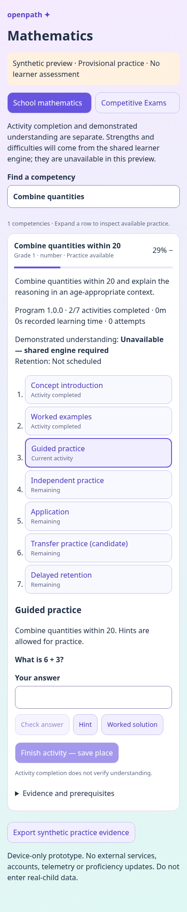
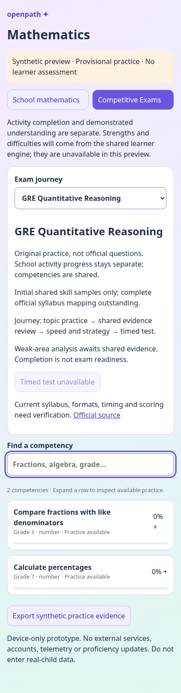

# Mathematics foundation v1

New integration work: [Mathematics learner journey v2](v2/README.md) adds real subject registration, account persistence and one complete provisional fractions program. The foundation and follow-up reports below describe their original versions.

Follow-up: [integration-readiness audit](FOLLOW_UP.md) and [follow-up test results](FOLLOW_UP_VALIDATION.md). A tested practice-only canonical ledger codec is now available in `packages/mathematics/src/canonical.ts`; production subject registration and account persistence remain pending. The 200-competency graph is frozen.

This branch supplies a modular curriculum, deterministic practice generator, fixed-program contract and synthetic mobile preview. It does **not** implement another learner model, change evidence eligibility, alter English/Tamil or integrate into production navigation. See [integration boundary](INTEGRATION.md), recorded before implementation.

## Run and validate

From `frontend/`, with the repository's Node >=22 and `npm ci` dependencies:

```sh
npm run typecheck
node --import tsx ../tools/mathematics/validate.mts
npm test
node scripts/build-mathematics.mjs
node scripts/preview-mathematics.mjs
# In another shell, from frontend/:
CHROMIUM_PATH=/usr/bin/chromium node --test e2e/mathematics.test.mjs
```

The preview listens on port **4176**. Open the forwarded development port, not the deployed learner application. Set `PORT` / `MATH_URL` for another port. With Playwright-managed Chromium use `CHROMIUM_PATH=''`; install it using `npx playwright install chromium` where necessary. No database, account, paid API or model calls. The independent preview avoids editing navigation shared with active essay work.

Try “Combine quantities”: expand → finish concept → worked example → guided answer → feedback → independent practice. Close/reload: the hash restores tab, track, search and expanded row, while device storage restores stage, attempt history, typed draft and hint/solution flags. Open Competitive Exams → GRE Quant → Compare fractions; its program completion is distinct from the school row for the **same** competency. Export generates structured **ineligible synthetic practice** envelopes. No real-child data should be entered in this prototype.




## Inventory and graph

The human-readable source is `content/mathematics/curriculum.v1.json`: **200 versioned competency records**, 12 grades, 11 strands. Each has stable ID/version, grade range, objective, demonstration criteria, prerequisite IDs, misconception hypothesis, program reference, candidate-family IDs and separate board mappings. [Coverage report](coverage.json) is generated by the validator, not a progress claim.

| Grade        |   1 |   2 |   3 |   4 |   5 |   6 |   7 |   8 |   9 |  10 |  11 |  12 |
| ------------ | --: | --: | --: | --: | --: | --: | --: | --: | --: | --: | --: | --: |
| Competencies |  15 |  16 |  16 |  15 |  15 |  15 |  16 |  17 |  15 |  17 |  20 |  23 |

| Strand                           | Count |
| -------------------------------- | ----: |
| Number sense/arithmetic          |    48 |
| Algebra, functions and sequences |    35 |
| Geometry/constructions           |    27 |
| Measurement/mensuration          |    29 |
| Statistics                       |    12 |
| Reasoning/problem-solving        |    12 |
| Probability                      |     9 |
| Coordinate/3D geometry           |     8 |
| Trigonometry                     |     7 |
| Calculus                         |    11 |
| Vectors                          |     2 |

Graph validation checks cycles, missing references, duplicate IDs, justified roots, grade bounds, board separation, family/program references and grade coverage. Within-strand progression plus selected cross-strand edges forms an initial authored DAG. Roots have explicit entry-level justifications. These prerequisites need educator review; this is not an empirically validated learning progression or a claim of exhaustive board alignment.

NCERT/CBSE placements are OpenPath proposals. Edition/chapter verification is outstanding. Tamil Nadu mappings deliberately have **no copied CBSE grade placement**; they are separately unmapped. All seven official-site checks on 2026-10-18 returned proxy CONNECT 403: NCERT, CBSE, Tamil Nadu textbook corporation, JEE Main, JEE Advanced, ETS GRE and CUET. Official references and null edition/version fields are recorded. Source access and expert mapping are needed before alignment claims.

## Deterministic questions

`packages/mathematics/src/generator.ts` supplies fourteen families:

| Family                          | Proposed band  | Validation / answer format                            |
| ------------------------------- | -------------- | ----------------------------------------------------- |
| Arithmetic addition             | 1–2            | Integer                                               |
| Equivalent fractions            | 4–5            | Missing numerator                                     |
| Percentages                     | 7–8            | Exact rational                                        |
| Linear equations                | 7–8            | Exact rational                                        |
| Algebraic simplification        | 7–9            | Bounded polynomial equivalence                        |
| Quadratic roots                 | 10–11          | Unordered multiple-selection set                      |
| Rectangle area                  | 5–6            | Integer with units specified in prompt                |
| Right-triangle ratios           | 10–11          | Exact rational                                        |
| Coordinate distance             | 10–11          | Single choice, shuffled correct position              |
| Probability                     | 9–10           | Exact rational                                        |
| Power-rule differentiation      | 12             | Bounded polynomial equivalence                        |
| Quadratic larger-root numerical | 10–11          | Exact numerical entry                                 |
| Derivative at a point           | 12             | Exact numerical entry                                 |
| Quantitative comparison         | 3–7 skill base | A/B/C/D comparison format; fully specified quantities |

Each item includes stable family, seed-derived ID/version, competency, parameter/difficulty assumptions, statement, answer, worked solution, mathematical-construction metadata and original AI-assisted provenance. All are provisional, uncalibrated **practice**, never official questions. No external question bank was copied. Educational validation is separate from mathematical correctness.

Uint32 seed replay is deterministic. Batch fingerprints exclude seeds; different seeds with identical parameters cannot masquerade as different items. The preview skips previously attempted fingerprints across journeys. Exhausted item spaces fail explicitly (e.g. only twelve scaled triangles in the trigonometry family). Families do not promise unlimited novel items. Variants are not independent evidence and are not validated unfamiliar transfer. Delay/transfer scheduling belongs to the host.

`answers.ts` uses reduced BigInt rational arithmetic and exact single-variable polynomial coefficients, with a bounded parser, no JavaScript evaluation and no floating-point sampling. Supported algebra: x, arithmetic, implicit multiplication, parentheses, nonzero **constant** division, powers 0–6, bounded expression length/degree. General rational functions, trig identities, units and arbitrary symbolic equivalence are not supported. Unsupported syntax returns an explicit unsupported result. Do not silently grade it as a mathematical error.

SymPy was investigated and used as an independent offline reference, not added to the mobile runtime. It can provide a future backend checker for broader symbolic domains; it does not by itself establish educational suitability. Optional reproducible reference check (requires SymPy 1.14.0 in Python):

```sh
# frontend/
node --import tsx ../tools/mathematics/symbolic-samples.mts > /tmp/math-symbolic.json
python ../tools/mathematics/check-symbolic.py < /tmp/math-symbolic.json
```

The Python checker accepts only the trusted generator output, never learner input.

## Programs and persistence

`program.ts` defines 200 fixed versioned programs: **12 provisional executable practice templates, 188 scaffolds**. Scaffolds cannot be marked complete. Concept/worked/guided/independent/application/transfer/retention stages retain stable IDs. Full authored lessons and authentic application/cross-context transfer tasks are outstanding; a new seed alone does not provide those.

`ProgramRecord` stores the host learner ID, journey, program/version, completed/current stages, recorded activity time, attempts, receipts, independent evidence references and retention status. JSON persistence/replay is tested. Idempotent attempt IDs prevent duplicate time accounting. The structure never replans itself. Time combines submitted question wall-clock durations with visible concept/worked-example time saved on activity completion, each capped at 60 minutes per receipt. Idempotent time receipts support host integration. This is not an attention measure; unfinished activity time and closed-tab periods are not counted. The host should checkpoint time through its existing persistence adapter.

Completion is completed activities / total fixed activities. It is not a mastery score. Retention cannot be completed by clicking; host scheduling is required. No stage changes the learner vector. `ProgramStoragePort` specifies versioned host persistence with expected-revision conflict checking; the standalone localStorage implementation is a **single-device, single-tab prototype**, without authentication, synchronization, migrations or cross-tab conflict resolution. Production must implement the port with its existing account store and explicit version migrations. Corrupt/version-mismatched local data must not be promoted into the ledger.

## Exams

`exam-tracks.v1.json` is configurable: JEE Main, JEE Advanced, GRE Quant and a CUET placeholder. Each records source/version-verification state, sample skill coverage, candidate formats, difficulty assumptions, modes, scoring/timing placeholders and journey version. These are initial **sample mappings**, not complete verified syllabi. CUET has no generated family yet.

JEE Main samples: original larger-root numerical questions and single-choice coordinate distance. JEE Advanced samples: numerical derivative-at-a-point and quadratic multiple-selection practice. GRE: quantitative comparison and numerical percentage practice. Registry format lists are candidates for later verification, not assertions of current exam specifications. Neither JEE multiple-select scoring nor GRE scaled scores are invented. These elementary family samples do not claim authentic exam-level difficulty.

**Timed modes and scoring remain disabled** because current official specifications could not be fetched. `exams.ts` separates speed/strategy practice receipts from conceptual evidence and school-program records. It rejects timed/scored receipts while rules are unverified. Readiness remains `not-estimated`. The same learner/competency IDs enable a GRE fractions concern to link to the existing school fractions program via `schoolProgramLink`; the host decides recommendations. No completion-to-readiness shortcut exists.

## Shared-engine integration checklist

1. Generalize framework registration outside this branch; register MATH definitions without changing English policies or estimator mathematics. Import the module; do not copy its learner state into a new engine.
2. Inject the existing authenticated learner ID. Replace `synthetic-preview` and local storage with the existing account's `ProgramStoragePort` implementation; handle optimistic concurrency, atomic saves and version migration.
3. Supply `SharedCompetencyView` (status, evidence IDs, retention) from the shared vector/gate. Populate strengths/difficulties and retention from that view. Preview currently renders unavailable; it invents no mastery estimate.
4. Convert `math-candidate@1` envelopes into the host's canonical response event **only after validation**. Preserve item/family/version/seed/parameters, learner and journey IDs, timestamp, exposure counts, hints, solution exposure, raw response and duration. Envelopes explicitly say `admissible:false`, `evidenceRole:practice`; they are not `LedgerEvent`s. No automatic converter calls `updater`.
5. Keep original generated provenance, provisional review status and uncalibrated difficulty. Establish educator review and admissible evidence under the **existing** rules before any estimate updates. No misconception is automatically diagnosed from an arbitrary wrong answer; candidate tags remain hypotheses pending reviewed error rules.
6. School/exam program keys include distinct journeys; conceptual candidates retain shared competency IDs. Store speed/strategy and any future verified scoring policy in the exam journey, not the conceptual vector.
7. Verify official current exam rules and complete board-specific mappings. Record source edition/chapter, review identity/date and exact content versions before enabling timed tests or claiming curriculum alignment.
8. Wire this isolated React view into production navigation after coordinating active Claude work. No essay contract, PR #49/#50, English entry point, Tamil file, estimator, evidence policy or research-repository file changes here.

## Maintenance

Edit the JSON inventory and bump versions for changed objectives/prerequisites/programs. Do not silently change historical IDs or migrate saved programs. Add a deterministic family and independent mathematical tests; link it only to matching competencies. Update curriculum source records when actually reviewed. Run the validator and regenerate `coverage.json`. The math-only GitHub workflow typechecks, runs frontend tests, builds and exercises Chromium; it never deploys. CI execution on GitHub must be checked separately from these local results.

See [actual validation results](VALIDATION.md). No child outcomes, educator approvals, numerical mastery calibration or educational efficacy claims are made.
