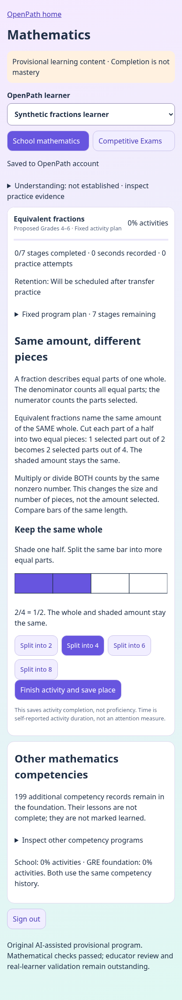
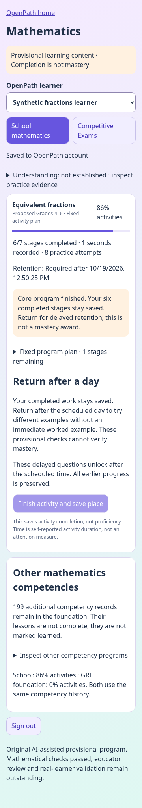
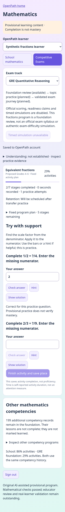

# Mathematics learner journey v2

Branch: `feat/mathematics-learner-journey-v2`, based on accepted `22e28c726cfb24aba33f5f8035537b404828586f`. No merge or deployment is authorized.

## Working experience

The additive **`/mathematics.html`** page is served beside the existing English application, on the same origin and using the same account session and CSRF protection. Sign in with an existing OpenPath parent account, select its existing pupil, and open the fixed equivalent-fractions program. Account/pupil setup remains in OpenPath home. There is no synthetic assessment mode or alternate mathematics identity in this page. Browser tests use synthetic test accounts and answers.

Start the API (existing Python environment and requirements):

```sh
cd backend
.venv/bin/python manage.py migrate --noinput
.venv/bin/python manage.py runserver 127.0.0.1:8012 --noreload --nothreading
```

Build and start the same-origin preview in another shell:

```sh
cd frontend
# npm ci if dependencies are not already installed
node scripts/build-mathematics-journey.mjs
PORT=4182 API_TARGET=http://127.0.0.1:8012 node scripts/preview-english.mjs
```

Open the forwarded **4182** preview port at `/mathematics.html`. Open `/` for the unchanged English entry point. Keep both processes running for authenticated saves. Single-threaded Django is used for this local SQLite preview because concurrent API/telemetry writes can otherwise produce the existing SQLite `database is locked` error. It is not a production server configuration or a change to production database behavior.

## Architecture reused

- `indexFramework` / `validateFramework` now accept **explicit optional subject registration** (`root`, stable capability IDs). Calls without options retain the existing EN namespace, hierarchy, names and validation. MATH registers through the real indexer, no in-memory registration bypass or English aliases.
- `registration.ts` constructs a MATH framework from the unchanged 200-competency graph. It reuses the existing host policy/prior verbatim; no mathematical calibration or estimator is introduced. All program items are hardcoded provisional regardless of client input. Shared profile views call the existing `leafView` via the tested adapter.
- Existing Django `Pupil`, `PupilEvent`, account/ownership/CSRF service and ordered per-subject events are reused. Mathematics activates the **already reserved subject stream** for the same pupil UUID. No new models, tables, identity, authentication service or inference ledger are introduced. English and mathematics retain the existing per-subject storage separation; school and exams share the mathematics stream and underlying competency.
- A `math_activity` receipt is appended atomically through the existing expected-sequence endpoint. It records versioned instructional actions and raw responses. Replay builds the shared core's canonical content and `EvidenceEvent`s from the fixed versioned content, then invokes the **existing `Ledger`**, code scorer and eligibility gate. The activity projection tracks instruction/navigation only, not ability or mastery. Raw activity receipts are the persisted source, not a second model snapshot.
- The server allows only the supported activity/version/journey fields, validates question/stage membership and numeric syntax, enforces ownership/sequence and rejects arbitrary native evidence or eligibility fields. The browser cannot promote an item to approved by posting `admissible:true`. Mathematical correctness is scored through the shared TypeScript code path; Python checks syntax/undefined denominators, not a second mastery algorithm.
- Each page visit records a visit/session ID under the existing pupil; closing/reopening retains learner identity and history while starting a new visit. Legacy development receipts lacking it replay with explicitly unknown visit lineage and remain provisional. Raw drafts and support events survive account reloads. Queued writes preserve order; failed requests/409 conflicts require reloading the saved record rather than silently overwriting another device's history. There is no offline write queue.

## Complete fixed fractions program

Existing competency: **`MATH.number.equivalent-fractions`**, proposed Grade 4 placement, offered here as a Grade 4–6 foundation/remediation program. No verified board alignment is asserted. Program version **2.0.0** is separate from the frozen v1 graph/scaffolds.

The fixed seven stages contain conceptual explanations, an accessible interactive equal-parts bar, worked multiplication/division examples and an incorrect additive contrast; two guided questions; two independent questions; two word problems about the same pizza/ribbon units; two reverse/alternative-context transfer activities; and two distinct delayed questions. **Ten original questions** have exact numeric/rational checking, hints and worked explanations. Mathematically checked does not mean educator approved, calibrated or educationally validated: all content remains provisional AI-assisted content.

The program never rewrites itself after an answer. Latest practice responses may be correct or need another look; those observations are separate from shared verified understanding. Completing an activity requires attempting its questions, not claiming comprehension. A child can review completed stages. Other competency rows expose their fixed v1 scaffolds as unimplemented, with no fabricated learning progress.

After the six immediate stages, the child sees **86% of all seven stages**, “Core program finished”, and a delayed retention requirement. All six completed stages remain saved. The server schedules the delay at its own receipt time plus **one day** and rejects early retention answers/completion, including forged client clocks. This one-day instructional delay is provisional; it does not change the existing seven-day mastery/evidence policy. A later completed retention activity reaches 100% **activity completion**, while verified understanding still cannot be granted from provisional content.

## Competitive journeys

The separate tab retains JEE Main, JEE Advanced and GRE Quant selection. Each has independently resumable foundation-program activity records under the same pupil and fraction competency. School → GRE reuses canonical item/family history and classifies previously answered questions as repeats. This is **foundation review**, not a verified exam syllabus or authentic exam difficulty. Broader topic practice remains planned; official scoring, timed simulation and readiness claims remain disabled.

## Navigation and active-work boundary

The existing English `App.tsx`, `main.tsx`, account UI, estimator, eligibility policies, Tamil source and essay branches are not edited. The build adds a separate entry beside English, with a return link to OpenPath home. **An existing production subject-menu link is deliberately not inserted into active shared navigation.** Enter the additive path directly in this integration branch. Coordinating a discoverable subject menu with the active essay/release integration work remains a navigation boundary, not a replacement application or a claim that these unmerged branches have been combined.

## Validation and limitations

See [actual test results](VALIDATION.md). The browser journey exercises real Django account/pupil APIs, a closed/reopened browser context, resumed drafts/stages, separate GRE/school histories, provisional native evidence, delayed requirements, failed saves and phone widths 320/360/412. Backend clock-controlled tests exercise actual server rejection before and acceptance after the retention deadline. Pure replay tests complete all seven stages and confirm zero direct evidence/mastery changes.

Remaining: educator/content review; real child/device/accessibility validation; official board/exam verification; production subject navigation coordination; production PostgreSQL load/concurrency testing; offline writes; checkpointing unsent activity time; and a multi-version content registry/migration policy before changing this fixed v2 content. Do not edit published v2 questions in place: historical replay depends on the preserved content version. Account event replay is linear and currently reloads the subject stream after each write; larger programs need incremental loading under the same existing store contract. Legacy core a/b values are transport placeholders held by the provisional gate, not calibrated mathematics difficulty.

No paid model calls, research-repository changes, merges or deployments.




