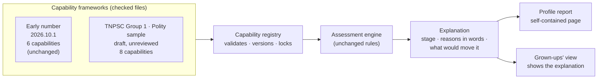

# M1 · Capability registry and observable profile

> **Superseded, 12 October 2026, before any code was written.** Its useful
> parts (several versioned frameworks, strict validation, fingerprint locking)
> carry into English milestone E1. See
> [`../english/IMPLEMENTATION_PLAN.md`](../english/IMPLEMENTATION_PLAN.md).

*Status: **Recommended. Awaiting your approval.** No M1 code has been written
yet. When it is finished, I report against every acceptance test below and
wait for your approval before M2 (A-30).*

---

## 1. Why this milestone comes first

The capability profile is the central product (A-25). Today it exists, but:

- **It is locked to one subject.** It can only describe the 6 early-number
  skills, because the server loads exactly one curriculum file.
- **It explains itself only as ticks.** The grown-ups' view lists the mastery
  criteria with ticks, but never says in words *why* a skill is where it is,
  or *what would move it*.
- **Only the code can see it.** Nobody but the code can look at a profile and
  its evidence trail.

M1 fixes these three things and changes nothing else.

## 2. What M1 delivers

### In scope

**1. A capability registry for several frameworks.**

- **Files, checked by tests.** Frameworks stay as files in
  `shared/curriculum/`, alongside a small index listing each framework's:
  - key and version
  - title, owner and licence
  - review status (*draft → in review → published → retired*)
  - fingerprint
- **No database tables yet.** That is the simpler choice (A-28). A database
  is added only if contributor editing later needs it.
- **The existing early-number file is not changed at all,** so every existing
  result stays identical.

**2. Stricter validation of frameworks.** A framework is refused, with a clear
message, if:

- a capability key is duplicated, within or across frameworks
- a prerequisite is unknown, or the prerequisites form a loop
- metadata is missing
- the mastery policy could allow mastery from one interaction (A-2). Every
  policy must require at least 2 sessions, separated by at least 1 day.

**3. Frameworks cannot be silently changed once published.**

- **Locked by fingerprint.** If a published framework file is edited without a
  new version number, the tests fail.
- **Old versions stay.** A new version is a new file, and the old one remains
  readable, so evidence judged against it can still be explained.

**4. A second, very different framework: a draft TNPSC Group 1 polity
sample.**

- **Eight capabilities.** They are listed in §5. The framework has no
  questions or activities yet (those come in M2 and M7).
- **Marked *draft, unreviewed*.** It is a test of the structure, not exam
  content.
- **A provisional mastery policy,** per the recommendation in O-7.

**5. Profiles per framework.**

- **Separate profiles.** A learner's profile can be computed for any
  framework, and evidence about one framework never appears in another's
  profile.
- **Same response for the children's app.** Its API response stays the same,
  plus the new fields below.

**6. Stage names and a plain-language explanation for every capability.**

- **Your stage names.** Each capability state gains a *stage*: unassessed,
  struggling, developing, demonstrated, mastered or needs review (R-4).
- **An explanation** with three parts:
  - **Summary:** for example, "Shown on its own 4 times in 2 different
    situations, all this week."
  - **Each criterion in words, met or not:** for example, "Unaided success
    in 2 sessions: 1 so far."
  - **What would move it:** for example, "Succeed again on or after 15 Oct to
    show it has stuck."
- **Same text everywhere.** It is computed by the engine on the server and by
  the copy in the children's app, and shared test cases prove both give
  identical text.

**7. The grown-ups' view shows the explanation** under each skill, in place
of the bare tick list. The child's view is untouched (A-9).

**8. A profile report for you.**

- **What it is.** A command produces a single self-contained page that opens
  in any browser, with no internet needed. It is not a website, adds no new
  login and opens no new way into learner data.
- **What it shows:**
  - each framework and its prerequisite graph
  - for each learner, every capability's stage, explanation and criteria
  - a timeline of observations, each one traceable to the session and the
    raw events behind it
- **Which learners.**
  - the eight existing pretend-learner scenarios: no sessions yet; one perfect
    session; two sessions the same day; two sessions 3 days apart; the same
    five apples every time; succeeds only with help; retained, then slips
    twice; one slip among many successes
  - any learner in a local test database, given their ID on the command line
    by someone with server access

### Out of scope (later milestones)

- Database tables for frameworks, and contributor editing
- Recording activity, rule and framework versions on each observation (M2)
- Confidence labels and misconceptions (M2)
- The `select_response` question type and any TNPSC questions (M2, M7)
- Goals, pathways and the recommender (M4, M5). "What next" still uses
  today's shopping planner.
- Accounts, guardian controls and product separation (M3)
- The practice app (M7)
- Any change to the game, art, Amma's scene (PRs #2 and #3), or folder layout
- AI of any kind

## 3. Acceptance tests

Every test is automated unless marked *(review)*. The milestone is finished
only when all of them pass and CI is green.

| # | Test | Passes when |
|---|---|---|
| AT-1 | **Both frameworks load** | The registry lists early number (6 capabilities) and the polity sample (8), each with its version, owner, licence and review status. Any capability can be looked up by key and tells you its framework |
| AT-2 | **Bad frameworks are refused** | Separate test files each break one rule: duplicate key, unknown prerequisite, prerequisite loop, missing metadata, a policy allowing mastery in 1 session or with no time gap. Each is refused with a message naming the problem |
| AT-3 | **Published frameworks are locked** | Changing one character of a published framework file without a new version fails the test suite. Adding a new version leaves the old one loadable, and a profile can be computed against either |
| AT-4 | **The children's game is unchanged** | All existing tests pass unmodified: 49 engine, 19 app and the Django suite. The golden test cases are identical. The browser test plays a full visit. Existing API fields are identical, and only new fields are added |
| AT-5 | **Frameworks stay separate** | A learner with early-number evidence gets a polity profile showing all 8 capabilities *unassessed*, with no evidence. Their early-number profile is the same as before |
| AT-6 | **Every stage is explained** | For each of the eight scenarios, every capability has a stage, a summary, each criterion stated in words with met or not, and a "what would move it" sentence. Expected wording is fixed by test, so any change in wording is visible in review |
| AT-7 | **Server and device agree** | The children's-app copy of the engine produces word-for-word the same explanations as the server for every scenario |
| AT-8 | **One session never shows as mastered** | For "one perfect session" and "two sessions the same day", nothing is *mastered*, and the explanation names the time gap still needed |
| AT-9 | **The engine stays independent** | An automated check confirms the assessment engine and the registry use nothing from the web framework or database. The new registry and explanation code mention no apples, fruit, shops or Amma. Today's shopping planner is the one known exception, and it leaves the engine in M5 |
| AT-10 | **No new door to learner data** | No new web address exposes learner data. The explanation appears only in the existing learner-authenticated response. The report is produced only from the command line |
| AT-11 | **The report works offline** | The report generates for every scenario and for a local learner. The page makes no network requests (checked in a headless browser) |
| AT-12 | *(review)* **The report is understandable** | I send you the report and screenshots of the grown-ups' view. You judge whether the profile is understandable without reading code |
| AT-13 | **CI is green** | All CI jobs pass on the pull request: backend on 3 Python versions, frontend, and browser end-to-end with PostgreSQL |

## 4. What you will receive at the end

- A pull request, not merged, with a summary written for you.
- The profile report, as a page you can open.
- Screenshots of the grown-ups' view with explanations.
- A table with each acceptance test and its result.
- A request to approve the merge, and, separately, M2's scope.

## 5. Questions for you before I start

**Q1 · Are the words for guardians acceptable for now?**

- **Context:** this is O-6. Children see none of this.
- **Proposed until you decide:**

| Stage | Words a guardian sees |
|---|---|
| Unassessed | Not tried yet |
| Struggling | Getting started |
| Developing | Growing |
| Demonstrated | Shown |
| Mastered | Mastered |
| Needs review | Time for a refresh |

- The internal stage names (unassessed, struggling, …) appear only in the
  report and the data.

**Q2 · Is the draft polity sample a reasonable test of structure?**

- **Context:** it is marked unreviewed, and a subject expert must check it
  before any learner sees it (O-4).
- **Proposed capabilities and their prerequisites:**

| Key | Capability | Needs first |
|---|---|---|
| `polity.constitution.making` | Explains how and when the Constitution was framed and adopted | — |
| `polity.constitution.structure` | Locates a topic in the Constitution's Parts and Schedules | making |
| `polity.preamble` | States the Preamble's ideals and what each means | making |
| `polity.fundamental_rights` | Identifies which Fundamental Right (Part III) a situation involves | structure |
| `polity.directive_principles` | Identifies Directive Principles (Part IV) and how they differ from rights | structure |
| `polity.fundamental_duties` | Identifies Fundamental Duties (Part IVA) | structure |
| `polity.rights_principles_duties.apply` | Decides whether an unfamiliar situation concerns a right, a principle or a duty | rights, principles, duties |
| `polity.union_executive` | Describes the President's election, powers and relation to the Council of Ministers | structure |

**Q3 · Is the provisional exam mastery policy acceptable for testing?**

- **Proposed (O-7):** at least 4 unaided correct answers, in 2 different
  phrasings, across 2 sessions at least 7 days apart, with 75% recent
  accuracy.
- It is data only, and easy to change.

**Size: M,** about a week of work. It runs on its own branch, with a pull
request that is not merged until you approve.
