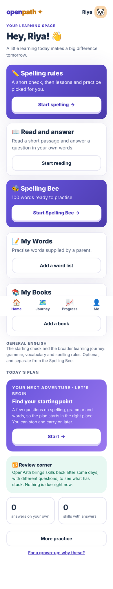
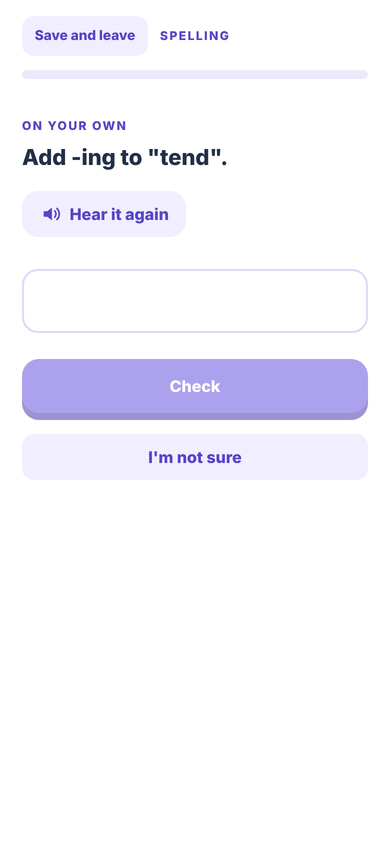
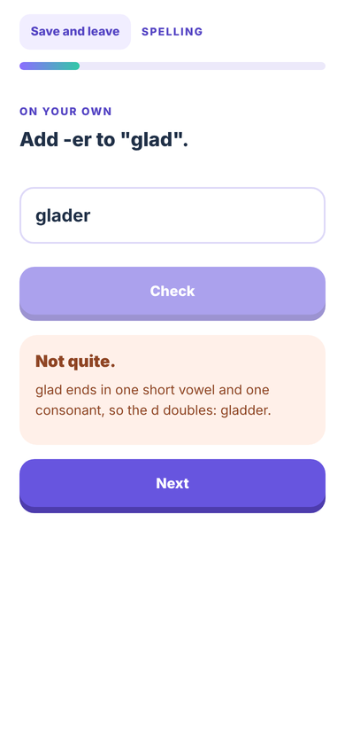
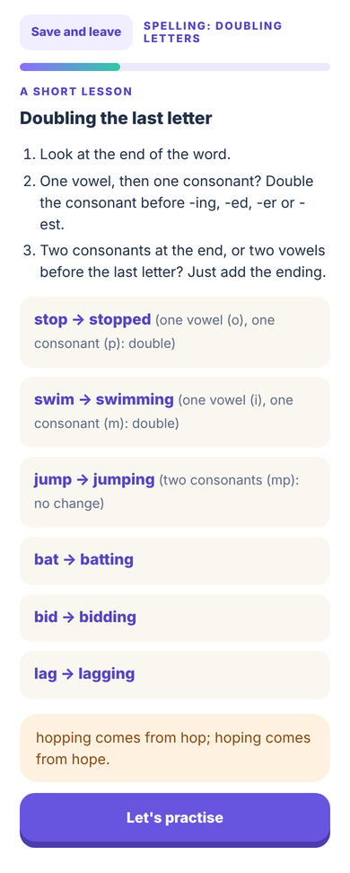
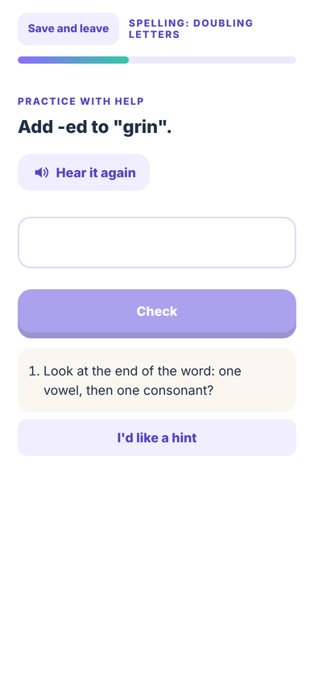
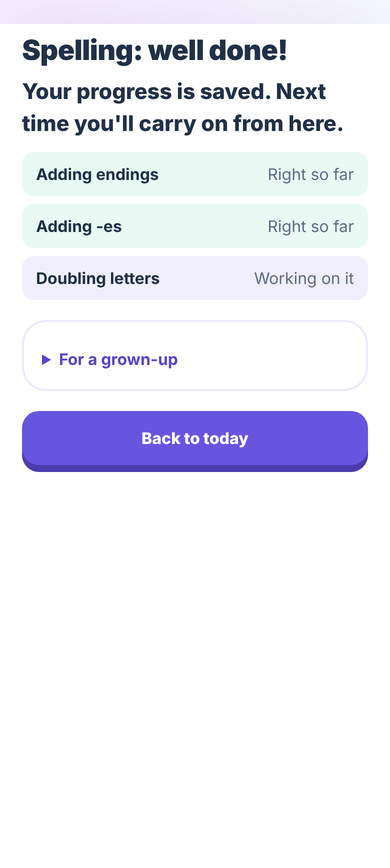
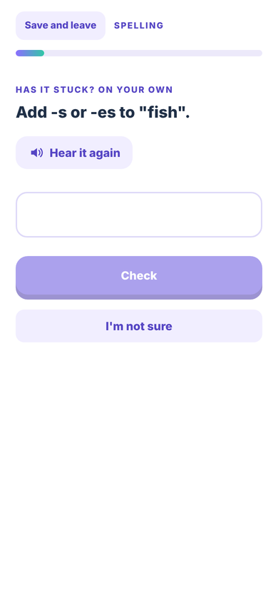
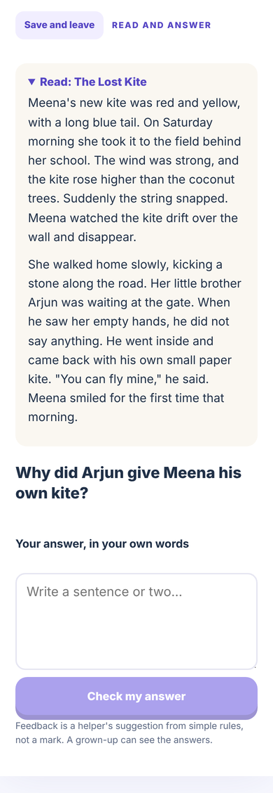
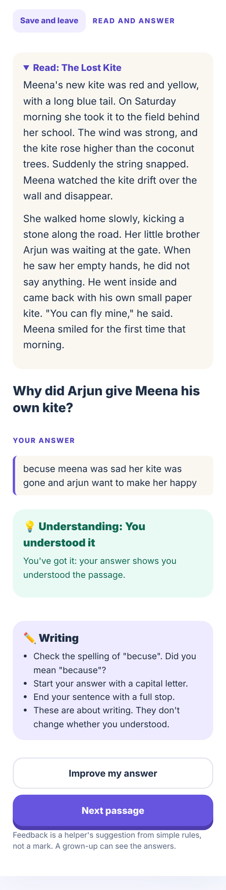
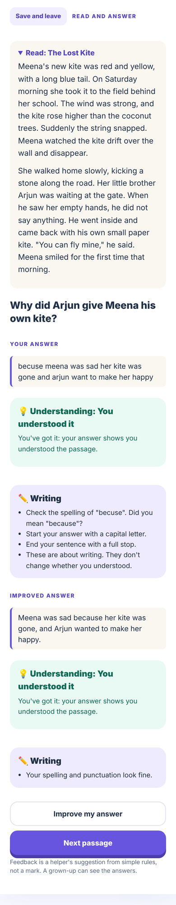

# English learning journey v1: status

*Branch `feat/english-learning-journey-v1`, 17 October 2026. Not merged, not deployed. Nothing here activates a research
policy: the production learner model (composite@1), rule-evidence projection and planner are used unchanged.*

## What a child can do now

1. **Spelling rules** (Home, first card). A short check across the eight inflection rules, a lesson the app chooses
   when the same kind of mistake shows up, practice with three levels of hints (the last one shows how), a check on
   new words, and a summary. Everything is saved as it happens. "Save and leave", or closing the app, resumes on the
   same step. A return more than a week later starts with a delayed check on unseen words.
2. **Read and answer** (Home, second card). A passage (with read-aloud), a question, and the child's own written
   answer. Feedback comes in two separate parts: understanding, and writing (spelling, grammar, punctuation). The child
   can improve the answer. The original and every revision are kept as separate events.

## How it is built (what was reused)

| Part | Reused | New |
|---|---|---|
| Words | SCOWL/ESDB, CMUdict and OEWN at the word bank's pinned commits; its loaders, classifiers, blocklist and licences | `tools/english/spelling/build_journey_bank.py` and `build_dictionary.py`, with `--check` steps in `wordbank.yml` |
| Decisions | `projectRuleEvidence`, `planRule`, `PLANNER_POLICY_DRAFT`, the content-validation gate (provisional evidence) | `logic/spelling-journey.ts`: which rule to work on, unseen-word choice, practice instead of dead ends |
| Record | The event log, `Learner.answer`, presented/hint/intervention provenance | Session type `spelling_journey`; event `written_answer` |
| Screens | Session bar, ItemView (spoken prompt with replay, no autocorrect), lesson and hint styles | `SpellingJourney.tsx`, `ReadingActivity.tsx`, two Home cards |

The doubling journey (`doubling_journey`), the Spelling Bee, My Words, My Books, placement and the pilot build are
unchanged. In a pilot build, both new activities are hidden and refused.

## Vocabulary coverage

The full table, generated by the pipeline, is in `content/english/spelling/JOURNEY_COVERAGE.md`.

- **4,411 inflection entries** (bank version 2) kept from about 37,000 classified candidates.
- **2,831 high-confidence words held back as independent evidence**: 1,259 checks, 510 delayed checks and 1,062 contrast words.
- 1,550 practice words, and 30 bank lesson examples (rules with few high-confidence words use only their hand-written
  lesson examples, so that every high-confidence word stays available for checks).
- Remaining gaps are listed in finding 3 below.

Morphology and homophones stay practice-only in the existing word bank. The engine has rule definitions for inflections only.

## Learning vector (kept apart)

`learningVector()` reports five things separately for each rule:

- **Estimated ability and uncertainty, per rule**: the production rule-evidence estimate (`RuleState.current`,
  Beta(1 + right, 1 + wrong) over the latest independent answers on new words, with an 80% range). Every independent
  journey answer updates it. Guided practice, hints, retries, repeats and slips do not. It survives reload and later
  sessions, because it is rebuilt from the event log. The grown-up summary shows it as "x of y new words right (likely
  a–b in 10)".
- **Capability band (composite@1)**: shown separately, with the reason the journey's answers do not move it (finding 1).
- **Observed evidence**: independent, contrast, with help, and practice answers, each labelled by content status.
- **Demonstrated understanding.**
- **Provisional progression**: not started, right so far, working on it, moving on, or paused.
- **Verified mastery**: always false on provisional words.

The v0.5 research estimator is **not** integrated, and its flag is `false`. The research integration plan requires a
TypeScript port that is parity-tested against golden vectors, plus calibration on real learners, before it can be used
even in shadow mode. No v0.5 advancement rule is used.

## Tests (local run, 17 October 2026)

| Suite | Result |
|---|---|
| Frontend unit tests (`npm test`) | 248 / 248 (230 existing + 18 new) |
| Core (`packages/english-core`) | 205 / 205 |
| Pipeline unit tests (python) | 8 / 8; the bank, coverage report and word list reproduce exactly (`--check`) |
| Browser: new `learning-journey.test.mjs` | 2 / 2 |
| Browser: english, bee, mywords, books, demo, pilot, pilot-bee | all pass (9, 12, 1, 1, 2, 2, 1) |
| Legacy game build and standalone build | build |
| Browser suites that need the account server (spelling, parent-content, accounts, developer) | not run here: the package registry is unreachable, so Django could not be installed. They will run in CI on a PR |
| TypeScript typecheck | not run here: `@types/react` is not installable offline. It will run in CI on a PR |

Tamil is not on `main` (it is on `feat/tamil-foundation`), so this branch has no Tamil code to regress.

## Walkthrough (phone size, from the browser test)

| | |
|---|---|
|  |  |
|  |  |
|  |  |
|  |  |
|  |  |

## Review findings (draft PR #41, 18 October 2026)

**1. Why journey answers did not update the learning vector's ability, and what was done.** There are two estimates
in production.

- **The capability band (composite@1).** The core updater's content-validation gate (`packages/english-core/src/updater.ts`)
  holds every answer on a provisional question (all journey check words) and on an unchecked generated item (all
  practice words). The answers are recorded, but the band is not changed, because their difficulty is a feature
  estimate, not calibrated (decision 3 of 12 October 2026). Moving the band would require treating uncalibrated
  difficulties as calibrated: an unvalidated statistical assumption. **This stays disabled.**
- **The per-rule estimate (rule-evidence policy).** Every independent answer on a new word already updates it,
  including provisional ones, and assisted answers are excluded. The learning vector was not showing it. **It now
  does** (`RuleVector.estimate`, tested in `spelling-journey.test.ts`). Nothing new was invented: this is the estimate
  the production status rules already use. It never becomes mastery: "demonstrated" and "verified" still come from the
  evidence rules, and verified requires validated content.

**The safe route to also move the band is the existing one:**
1. Educators approve words.
2. Approved words get `evidence_status: "validated"`, or `generated.checked` for practice words, as a **new item
   version**, with the provisional version retired. Changing a version in place would retroactively re-score earlier
   answers when the record is rebuilt.
3. Once difficulties are calibrated on real answers, the band can use them.

No v0.5 component is used.

**2. Does the reading evaluator abstain?** The first version did not reliably abstain: 9 of 14 adversarial answers were
labelled "understood", including the bare keyword list "scouts dance". This is fixed on this branch:
- Key words without a sentence, and a negation anywhere in the answer, now give "can't tell".
- A match is shown to the child as "You found the key ideas", never "You understood it".
- A match is recorded as "key points present (keyword match, not verified understanding)".

Six wrong answers are still credited. Word matching cannot read who did what, or whether a claim is inverted. For
example, "Roads like to eat ice cream" counts as naming a reason. These six are pinned in
`content/english/reading/fixture.json` (`known_limits`) by a test. **Comprehension claims need a meaning-aware
reviewer** (a teacher, or an evaluator qualified under the existing E3 checks) before they count for anything.

It also errs the other way. Correct answers in a child's own words that share few words with the key points are
under-credited ("partly") or not judged ("can't tell"). One such answer had been called "off topic". That is fixed: an
answer is now "off topic" only when no word relates to the passage or the question. Three paraphrase cases are pinned
as known limits, and a test checks they are never called wrong or off topic. In short, the evaluator separates
understanding from writing mechanics and abstains in the cases it can recognise. It **cannot** read meaning, and it
gives no numerical score.

**3. Spelling competencies that cannot satisfy the existing evidence requirements.** The worst case for one learner on
one rule, from `PLANNER_POLICY_DRAFT` and `RULE_EVIDENCE_POLICY_DRAFT`:
- check words: a diagnostic, plus a check after each teaching approach, plus four new words to be "shown"
  (13–15 words);
- contrast words: 3–4;
- delayed-check words: 2 per check.

| Rule | Check words (have / need) | Contrast words | Delayed-check words (have / 3 checks) |
|---|---|---|---|
| plain | 245 / 13 | **none: can never be "shown"** | 91 / 6 |
| es_plural | 73 / 13 | 250 / 3 | 30 / 6 |
| double_short | 206 / 15 | 250 / 4 | 76 / 6 |
| drop_e | 242 / 13 | 18 / 3 | 107 / 6 |
| y_to_i | 239 / 13 | 159 / 3 | 98 / 6 |
| stress_doubling | 34 / 13 | 250 / 3 | 14 / 6 |
| no_double_unstressed | 207 / 13 | 48 / 3 | 89 / 6 |
| exceptions | 13 / 13 (just enough) | 87 / 3 (new: final l after two vowels, reveal → revealed) | **5 / 6 short** |

Changes on this branch (bank version 2, same sources, same classifiers, same confidence rules; no requirement lowered):
- Rules with fewer than 120 high-confidence words keep all of them for checks, and use their hand-written lesson
  examples instead of bank words. This raised stress_doubling from 24 to 34 check words and exceptions from 8 to 13.
- The final-l rule now has its genuine contrast (after two vowels the l does not double), tagged with the engine's
  existing `over_doubling`. This gives exceptions 87 contrast words instead of none.

What remains blocked:
- **exceptions** is one delayed-check word short. All 18 of its high-confidence words are in use. The other 172 are
  medium or low confidence (less common, or no UK frequency tag), and lowering that bar would weaken the evidence.
- **plain** cannot have contrast words: "just add the ending" has no similar-looking word where the rule must not
  apply, other than the other rules' own words. Using those would test the wrong rule. The evidence rules require a
  contrast for "shown", so plain is screened only. This needs a policy decision (for example, whether a rule without
  contrasts may be shown on applications alone), not more content.

Across all three spelling competencies (inflections, morphological, homophones) there are **0 validated items**, so
no spelling rule can reach "verified" for any learner. Morphological and homophone spelling have no rule definitions
in the engine, and only 54 and 18 candidate hand-written items.

**4. Privacy documentation against actual storage.** The pilot is consistent; the feature outside the pilot is a blocker.
- What the documents say:
  - `pilot/PARENT_INFORMATION_SHEET.md` lists "Anything your child writes in their own words" under *Not recorded*.
  - `pilot/PILOT_LEAD_AND_DATA.md` lists "free text written by children" under *Never collected*.
  - The account consent says only "learning records" and "answers".
- What the code does:
  - `written_answer` events keep the child's text exactly as written, in the browser, and are included in every export.
  - In account mode they sync to the server.
  - Before this review they were shown unredacted to a developer when a parent turned on diagnostics sharing.
- What is fixed on this branch:
  - Developer diagnostics now blank the text and every quote taken from it, and keep only the judgement's shape
    (backend test; CI green).
  - Diagnosis reports, redacted or not, never contain written answers (test).
  - Telemetry records timings only, and the audit log records action names only: neither carries answers (checked).
  - `PILOT_LEAD_AND_DATA.md` now states that the pilot build has no own-words activity, and that enabling Read and
    answer outside the pilot requires the documents and consent to be updated first.
  - `DEVELOPER_DIAGNOSTICS.md` documents the redaction.
- What still holds the feature back:
  - Pilot builds refuse the activity, so the pilot documents stay true for pilot builds. They are not true for this
    feature anywhere else.
  - Before Read and answer is enabled for children, the documents and the consent need to describe free-text storage,
    sync, export and retention, and a data-protection reviewer must approve them.

## Blockers for a real-child pilot

1. **Educator review.** None of the content has been reviewed by an educator yet: the journey's lessons, hints and
   mistake explanations, the reading tasks, their key points, and a sample of the generated words. All of it is
   labelled provisional. The pilot gate keeps it out of pilot builds.
2. **Calibration and meaning (see finding 2).** Word difficulty is a feature estimate. The reading evaluator matches
   key words and still credits six known wrong answers. Its judgements must not count for anything until checked
   against children's answers marked by teachers, or until a meaning-aware evaluator is qualified. Session lengths and
   screening sizes are draft values.
3. **Privacy and consent for free text (blocker; see finding 4).** The documents say children's own words are never
   recorded. Read and answer stores them, exports them and, in account mode, syncs them. Wording, retention and a
   deletion rule need approval from a data-protection reviewer before children use it.
4. **Thin rules (see finding 3).** exceptions is one delayed-check word short. plain has no possible contrast words,
   so it can never be "shown" under the current evidence rules: that needs a policy decision.
5. **Speech.** Spoken prompts need a local device voice. "Hear it again" shows even when no voice is available.
   Spoken *answers* rely on the phone keyboard's own dictation.
6. **Bundle size.** `app.js` grew from 3.4 MB to 4.4 MB (the journey word list and the reading word list). These
   could be loaded on demand.
7. **Item versioning.** Journey questions take the bank's version (now 2). No version-1 record was ever released. Once
   real records exist, a rebuild that changes roles needs retired versions (as `retired-generated.json` does for
   generated items).
8. **Coverage.** Morphology and homophone journeys need rule definitions in the engine. Reading has 6 questions on 6
   passages.
9. **CI** has not run on this branch: it runs only on pull requests and `main`.
