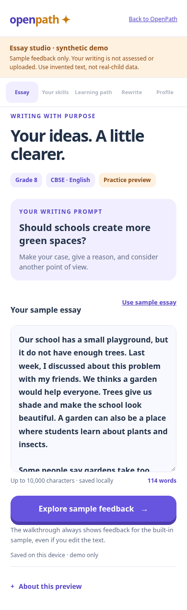
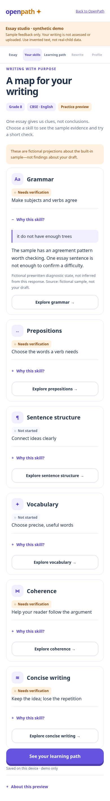
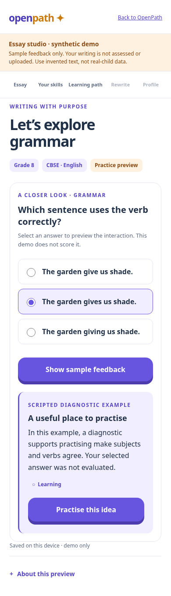
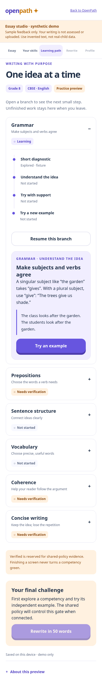
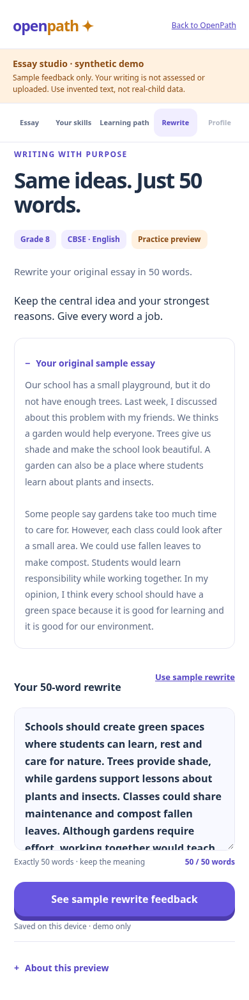
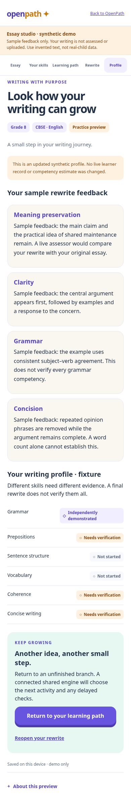

# Essay learning experience v1 — synthetic UX preview

A complete mobile essay journey inside the existing OpenPath English React app:

**Submission → competency evidence → short diagnostic → expandable learning branch → 50-word rewrite → sample updated profile.**

This branch is based on production `main` at `b578c7893136fcdea5cd1805296243089e7039ce`. It does not merge or change PR #41 (`feat/english-learning-journey-v1`, `5d303c6`) or PR #42 (`docs/autonomous-tutor-architecture`, `583de9c`). Existing English learning intelligence and the autonomous tutor UX branch are unchanged. No merge, application deployment, live scorer, external service or real-child research is authorized by this work.

## What is reused

- Existing `english.css` violet, mint and peach tokens, system typography, rounded cards, control styles and responsive shell.
- Existing `Brand` and English build/preview scripts.
- Existing React/TypeScript/esbuild/Playwright dependencies; no new dependency or lockfile change.
- The English entry point, with one explicit opt-in query: `?experience=essay-demo&no-sw`.

Normal app URLs continue to mount `App`; developer routing is preserved. The reviewed pilot refuses the essay demo before mounting it. Fixture mode installs neither telemetry hooks nor a service worker and does not open account APIs, English repositories or the learner engine. All essay-specific styling is scoped.

## Run

```sh
cd frontend
npm ci
npm run english:build
PORT=4190 npm run english:preview
```

On the development machine, open the English preview at local port **4190**, with query **`?experience=essay-demo&no-sw`**. This is a preview in the existing application, not a separate deployed app. There is no API, database, paid service or sign-in requirement.

1. Use the synthetic sample, or type/paste invented text. Grade 8, CBSE English, the prompt and a word counter are visible. Do not paste real-child writing or personal data.
2. Choose **Explore sample feedback**. Loading and retryable error states explicitly describe prewritten examples, not a running intelligence service.
3. Inspect six competency categories and **Why this skill?**. Evidence quotations always identify the built-in sample, even when you type a different draft.
4. Explore a competency and answer its targeted diagnostic. The prewritten feedback illustrates a suspected-pattern → supported-difficulty presentation. It does not assess the selected answer.
5. Open the branch, read its explanation, try a guided response with an optional hint, and try a new independent example. Feedback stays visible until a meaningful next action is selected.
6. Once the fixture storyboard permits the final challenge, rewrite the original draft in **exactly 50 words**. **Use sample rewrite** supplies a synthetic 50-word example. Word counting is whitespace-token counting, not a concision or semantic score.
7. Inspect separate meaning-preservation, clarity, grammar and concision feedback and the fictional updated profile. Only the exercised skill becomes *independently demonstrated* in the storyboard; no competency becomes verified/green, and no real profile is updated.

The shared-shaped fixture uses a fixed fictional writer and `fixture:` evidence IDs, not evidence collected from the person trying the UI. All raw drafts and navigation state remain under the separate browser key `openpath.essay-ux.fixture.v1`. Drafts, partial diagnostic/practice responses, expanded branches, current step, rewrite and interruption markers resume on reload. **Back to OpenPath** returns to the ordinary app; revisiting the query restores the demo. **About this preview → Clear this demo** removes only this key, not English learner records. Storage refusal is reported; unreadable saved data is preserved until explicitly cleared. This local demo does not provide cross-device sync, multitab conflict resolution, backup export or research data collection.

## Status semantics

- **Not started:** no sample evidence for this part yet.
- **Needs verification:** suspected pattern or insufficient evidence; not a confirmed difficulty.
- **Learning:** the scripted diagnostic illustrates a difficulty worth practising.
- **Independently demonstrated:** the storyboard has reached an independent example; not delayed verification or broad mastery.
- **Verified:** reserved for a connected shared-contract projection backed by its evidence policy. Fixture mode always downgrades this state and never renders a green competency badge.

Diagnostic confirmation of a difficulty is different from verified competence. Clicking through a lesson, the correctness of an answer, or reaching 50 words cannot promote mastery in this UI. No numerical mastery percentages, knowledge estimates or local scoring rules exist here.

## Fixture boundary and Claude integration

During implementation Claude published **`essay-contract@1`** on `feat/essay-learning-intelligence-v1` at commit `447a56d71a00ac9965516f099d01253594e5e6ad`. Its `packages/english-core/src/essay/contract.ts` is imported byte-for-byte from that commit. No updater, ledger, estimator or index changes from the intelligence branch are copied. The fixture uses the actual `EssaySubmission`, `EssayAnalysis`, `EssayLearnerProfile`, `CompetencyStatus`, `LearningJourney` and `RewriteEvaluation` types; it does not redeclare those contracts. `shared-fixture.ts` builds explicitly synthetic, prewritten contract projections. `fixtures.ts` and `presenter.ts` retain only UI storyboard/navigation types, versioned `essay-ux-fixture.v1`.

`EssayJourney` accepts an injected `EssayPresenter`. All script transitions live in the fixture presenter, outside React components. Competency display states map the imported profile projections; evidence uses the imported analysis spans; tree steps and final-rewrite availability come from the imported `LearningJourney`; rewrite feedback renders the imported evaluation dimensions. The shared contract is integrated, but a live intelligence service is not connected. Diagnostic and practice answers are saved as text but never compared with an answer key, analyzed or scored. Different answers deliberately produce the same prewritten fixture projections (covered by tests). The fake loading failure is exposed only under **About this preview**.

To connect the live intelligence implementation:

1. Continue importing Claude’s package/schema types directly; the published contract file is already imported unchanged. Replace only the fixture presenter with a service adapter. Resolve the identical contract file normally when the intelligence branch merges; do not fork or edit it independently.
2. Map the shared learner/session/task IDs and contract/policy versions into session loading, essay submission, targeted diagnostics, teaching actions, independent work, final rewrite and profile refresh. Preserve one existing learner identity and one authoritative profile; never copy this fixture record into the real evidence ledger.
3. The shared service supplies competency statuses, whether a weakness is suspected or diagnostically supported, evidence quotations/references, available learning steps, the next activity and final-challenge eligibility. React renders these fields; it must not derive them from word count, response strings or completed screens.
4. Verification must carry a valid shared-policy decision/evidence reference. The `visibleStatus` presentation guard already uses the imported engine verification vocabulary and refuses green in fixture mode. Supply the actual contract verification and policy provenance through the service adapter; never infer it from a completed screen. Review green-state rendering against real shared responses.
5. Preserve support/hint, exposure/family, independence, scorer provenance, uncertainty and retention metadata from the real API. The current local storyboard does not claim to implement or collect that evidence.
6. Return separate meaning-preservation, clarity, grammar and concision feedback for the rewrite. Return a fresh shared learner profile; do not mark every skill verified after one rewrite.
7. Agree error envelopes, retry/idempotency, cancellation, interrupted-request recovery, authorization, privacy/consent and draft-storage boundaries. Keep live integration off until its backend and evidence-policy tests are ready.
8. Replace fixed sample quotations with server-provided, validated references to the actual submitted draft; retain HTML-safe rendering. Rerun the journey and policy-boundary tests against the real adapter. Remove or retain fixture mode only as an explicitly labelled development option.

## Validation and screenshots

See [VALIDATION.md](VALIDATION.md) for actual test results and commands. Screenshots contain synthetic writing only:

| Submission | Competency evidence |
| --- | --- |
|  |  |
| Diagnostic | Expandable learning branch |
|  |  |
| 50-word rewrite | Updated sample profile |
|  |  |

Real Samsung/Android hardware, native IME/virtual-keyboard behavior, screen-reader usability with children, and educational assessment effectiveness are not claimed. No child data or educator approval was fabricated.
