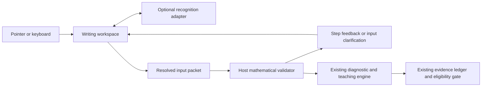

# Integration contract — openpath-math-input@1

## Existing interfaces inspected

- React 19, TypeScript, esbuild and Playwright are already installed and reused.
- `frontend/src/mathematics/journey/service.ts` wraps the existing account/CSRF API,
  canonical pupil identity and mathematics activity stream.
- `packages/mathematics/src/canonical.ts` prepares provisional practice against the
  existing English-core ledger, competency registration and verification policy.
- `packages/mathematics/src/fractions-program.ts` defines current instructional
  receipts. `backend/family/mathematics.py` restricts that endpoint to known
  `math_activity` fields, stages, lesson version and owner.
- Existing mathematics/English entry points and standalone build scripts establish
  the additive build pattern. The writing demonstration reuses the preview server;
  its new build has no imports from the learning engine or curriculum.

**Do not POST a Work or InputPacket to the existing mathematics activity endpoint.**
It is not a valid instructional receipt there. Do not broaden that endpoint or turn
recognition scores into binary observations to accommodate this workspace.



The diagram shows responsibility boundaries, not an implemented backend integration.
Only the first input and optional recognition layers are implemented here; the demo
validator acknowledges receipt. The host owns all downstream decisions.

## Public frontend API

Import from `frontend/src/writing/index.ts`. The controlled component accepts:

```tsx
const [work, setWork] = useState(() =>
  createWork(hostDraftId, hostProblem, hostLayout));

<WritingWorkspace
  work={work}
  onChange={next => { setWork(next); hostSaveQueue.enqueue(next); }}
  recognizer={hostRecognizer}       // optional; defaults to unavailable
  validator={hostValidator}         // optional; defaults to local receipt-only mock
  confidenceThreshold={0.90}
  onConfirmedInput={packet => hostRecordInputSubmission(packet)}
/>
```

`hostDraftId` must be scoped to the **existing** learner, question/activity, school
or exam journey and attempt. The component does not create identities or learn
from answers. `onChange` supplies immutable work snapshots, including undo/redo;
the host must serialize saves, show failures and authorize draft access. A host may
restore `WorkStore.load` before mounting. Only `BrowserWorkStore` is delivered;
no authenticated handwriting backend has been invented. Connect a secure existing
draft facility or agree one with the mathematics/backend owner before server use.

`onConfirmedInput` means the input's recognition ambiguities have been resolved,
**not** that mathematics is correct. It runs after a matching validator response,
including a response requesting further clarification. It is not an evidence event.
The host must check its validator result and existing provenance/eligibility policy
before submitting anything to the ledger. Synthetic and provisional input does not
become mastery evidence merely because it was typed, recognized or sent.

`packet(work)` independently enforces no uncertain tokens or unmapped active ink.
The host must revalidate input and authorization server-side; browser confirmation
is not an attestation of independent work, identity, content approval or correctness.

## Record structure

The complete TypeScript interfaces live in `contract.ts`.

- `Work`: contract version, stable draft/problem IDs, revision and update time,
  configurable paper/layout (regions, text guides and line rules), original strokes, erased IDs, interpreted tokens,
  correction history, bounded undo and redo snapshots.
- `Stroke`: stable ID, input method, original ordered points, start/time-origin,
  pointer/contact metadata and initial region association. Each point has paper
  `x,y`, event timestamp, pressure, tilt, twist and optional available pen angles.
  Screen-coordinate scaling never changes saved paper units.
- `Token`: stable provider/manual ID, intended text, bounding box, original stroke
  references, region, recognition confidence or `null`, origin, status, revision
  and original token creation order. `accepted` is an interpretation status.
  `confirmed` means the student typed/confirmed the intended input.
- `Correction`: before/after text, token ID, original stroke IDs, timestamp,
  keyboard/keypad method and clarification versus student-edit reason. Changing a
  confident token and confirming an uncertain token both preserve original ink.
- `InputPacket`: problem, layout, all strokes (including archived erased strokes),
  erased IDs, interpreted region steps in worksheet order, correction history,
  and `entrySequence` in token creation order. Tokens retain spatial positions;
  strokes and corrections retain their own chronology. `steps.text` is a display
  serialization with spaces, **not** a canonical expression or mathematical AST.
  E.g. three quotient digit tokens display `1 2 6`; the host uses their positions
  and token text to interpret `126`. Formative/synthetic provenance is explicit.

Undo/redo restore input snapshots and advance the current revision; they do not
roll back learner records. Erasing invalidates interpretations linked to erased
ink but keeps original stroke data and historical corrections. A newly drawn
replacement is new input. Confirmed tokens are protected against re-recognition;
stable incoming token IDs preserve creation order. No estimator is touched.

The JSON restore validator rejects unknown contract versions, invalid layouts,
corrupt points/references and unsupported metadata rather than guessing a migration.
Version 1 has no earlier released handwriting schema to migrate. Future versions
must supply an explicit lossless migration or refuse to overwrite the old draft.

## Recognition adapter

Implement `Recognizer.available()` and
`recognize(RecognitionRequest, AbortSignal): Promise<RecognitionResult>`.
Requests contain active strokes, regions, work ID, contract and revision. Results
carry that revision, provider ID and candidates. Bounds must fit the named region;
stroke references must belong to the active work. Return `confidence:null` when a
provider does not offer a usable candidate confidence. Do not turn a whole-page
confidence into invented per-digit certainty. If segmentation cannot localize an
uncertain mark, return the smallest supported expression region for typed correction.

Stable token IDs and stroke references are required to preserve confirmed edits.
Late revisions, malformed results and failed recognition are refused without
changing ink or reporting mathematical errors. Abort is supported; hosts must not
send ink to third parties unless that service's use is authorized.

## Validator adapter

Implement `Validator.submit(InputPacket, AbortSignal)`. Return `ValidationFeedback`
with matching contract, work ID and revision; status `received`, `clarification`
or `feedback`; and region-linked messages. Messages distinguish `information`,
`mathematical-feedback` and `input-clarification`. A clarification can optionally
name a `tokenId`; its button opens that token for editing, otherwise it opens the
region's typed input. Stale feedback is discarded. The host decides all correctness
and diagnostic meanings; the widget merely renders the feedback.

The mathematics owner still needs to agree canonical expression parsing, step/region
roles for each real lesson, supported feedback mapping, authenticated storage and
learner evidence provenance. No claim is made that an active peer branch already
implements or has adopted this provisional transport contract. Mounted component
tests demonstrate the host API with explicit test adapters.
