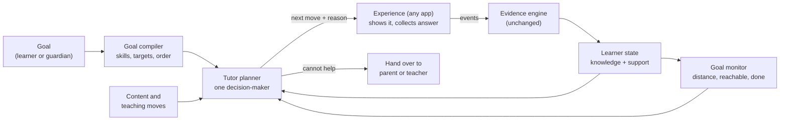
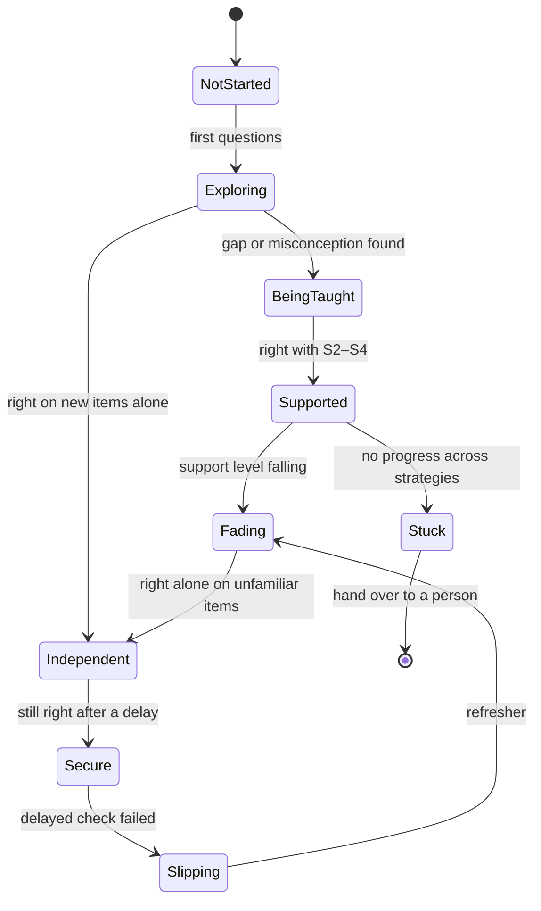

# Autonomous tutor architecture: an independent system that teaches towards a goal

*Proposal, 18 Oct 2026. Nothing in this document has been built. Every item is
**Recommended** unless it is labelled otherwise, and each milestone waits for
your approval before any code is written.*

| Label | Meaning |
|---|---|
| **Agreed** | You stated this as a requirement. |
| **Recommended** | My proposal. It waits for your approval. |
| **Future** | Room is kept for it. It is not approved. |
| **Open** | Needs your decision (Section 11). |

---

## 0. In one paragraph

OpenPath already has a careful **measurement engine**. It records what a learner
did, separates independent answers from helped ones, refuses to claim mastery
from weak evidence, and explains every decision. What it does not yet have is a
**tutor**: one system that takes a goal, works out where the learner is in the
process of learning (not just whether they know something), teaches, adjusts
how much help it gives, checks without help, and keeps going until the goal is
reached or a person is needed. Today those pieces exist separately, mostly for
English spelling. This proposal joins them into one subject-independent loop,
adds the missing "learning with help" state, and proves independence on a
second, different subject.

---

## 1. What we are building

**Agreed** (your direction, Oct 2026):

- OpenPath is one shared learning intelligence that powers several lightweight
  products. A single experience (spelling, the shopping game) is replaceable.
- The living, evidence-based learner profile is the central product, and it must
  be observable and explainable.
- Learning experiences stay independent of the core engine.
- The architecture stays simple: no microservices, no marketplace, no training
  of foundation models, and an interchangeable LLM provider.
- Simulated learners test behaviour and edge cases only, never whether children
  learn.

**Recommended definition of "autonomous tutor".** Given a learner and a goal,
the tutor can, without a person choosing each step:

1. turn the goal into the skills it needs and the order to learn them in;
2. know, for every skill, where the learner is in the *process* of learning it;
3. decide the next thing to do, and say why;
4. teach, with help that rises when the learner struggles and fades as they
   improve;
5. check without help, and record only that as evidence of independence;
6. track how far the learner is from the goal, re-plan, and recognise when the
   goal is reached;
7. recognise when it cannot help (no content, repeated failure, a misfit) and
   hand over to a parent or teacher.

**Success criterion.** The same tutor code, with no subject-specific branches,
drives a learner towards a goal in two different subjects. Subject knowledge
lives only in plug-in modules and content.

---

## 2. What exists today

The evidence engine and three planners are real, tested and in use. They live in
`packages/english-core/src`, although several are written to be subject-neutral.

| Piece | Where | What it does | Subject-neutral? | Used by the app? |
|---|---|---|---|---|
| Event ledger and local store | `types.ts`, `store.ts`, `updater.ts` | Append-only events. The ledger is the only thing that must be kept; everything else is rebuilt from it. | Yes | Yes |
| Evidence provenance | `types.ts` (`isIndependentProvenance`), `updater.ts` | Hints, retries, feedback and teaching mark an answer as assisted. Assisted answers never change an estimate. | Yes | Yes |
| Capability framework and goals | `framework.ts`, `content.ts`, `content/english/goals.json` | Capability tree, prerequisites, goal weights and target bands. | Structure yes, content English | Yes |
| Composite estimate | `composite.ts`, `model.ts` | One estimate per capability, with uncertainty, misconceptions and stages. | Yes | Yes |
| Rule evidence | `rule-evidence.ts` + `subject-english-inflections.ts` | Per-rule status, misconceptions, interventions and what followed them, retention. Uses a `SubjectRules` plug-in. | Yes (via plug-in) | Yes |
| Activity selection | `selection.ts` (`recommend`) | Assessment mode (reduce uncertainty) or learning mode (progress to the goal's target, respecting prerequisites). | Yes | Yes |
| Development plan | `development.ts` (`planDevelopment`) | Up to three ranked actions across capabilities, each with reason, evidence and "what would change this". | Yes | Yes (Home) |
| Rule teaching planner | `planner.ts` (`planRule`) | Assess, teach, guided practice, reassess on unfamiliar words, change strategy, retention, recommend a person. | Yes | Yes (consonant-doubling journey; PR #41 extends it to all spelling rules) |
| Retention | `retention.ts` | Spaced checks; "previously shown" kept apart from "currently verified". | Yes | Yes |
| Free-text evaluation | `evaluation.ts`, `freeform.ts` | An LLM (or person) proposes what an answer shows, with quotes; code decides. | Yes | Partly |
| Research model (shadow only) | `openpath-research`, branch `feat/versioned-engine-contract` | Rule-state model with recognise/produce, word memory and misconception states. Better at diagnosis; not used for decisions. | Spelling only | No |

The foundation is sound. The problem is what sits on top of it.

---

## 3. The gaps

**G1 — No "learning with help" state.** The system knows *not known*,
*misconception*, *shown*, *retained* and *forgotten*. It does not track the
middle, where learning happens: *can do it with a lot of help*, *with a little
help*, and whether the help needed is shrinking. Assisted answers are correctly
kept out of estimates, but they are not used for anything else either. The
development plan's "mostly with help" rule only triggers a test without help;
`planRule` labels `help_dependence` but then acts as for any failure; and the
research bridge drops assisted answers entirely.

**G2 — Help does not adapt.** Guided practice is always a fixed four items.
Hints appear only when the child asks. Nothing steps support down from item to
item, so the learner jumps from "help available" straight to "no help".

**G3 — Three planners, no single decision-maker.** `recommend`,
`planDevelopment` and `planRule` each decide at a different scale and are
stitched together in app code (`frontend/src/english/logic/*`). There is no one
place that answers "what next, towards this goal, and why".

**G4 — No goal monitor.** Goals weight capabilities and set target bands, but
nothing says how far the learner is from the goal, whether the goal is reachable
with the content that exists, or when it has been reached.

**G5 — Teaching is the thinnest layer.** Teaching is hand-written lessons for 13
capabilities (`docs/english/LEARNER_PROFILE.md` §5). Teaching moves (explain,
worked example, contrast, faded practice) are not modelled as general actions
the planner can choose between.

**G6 — Subject-neutral in name, English in practice.** The neutral modules sit in
an English package and there is no second subject, so neutrality has never been
tested.

**G7 — No session-level judgement.** Nothing tracks within a session whether the
learner is tiring, guessing or stuck, or decides to switch to something easier,
review, or end on a success.

**G8 — The research engine cannot study any of this.** Simulated learners there
respond to practice with a flat chance of improving; they never take or depend
on a hint, so no policy about help can be tested even for safety.

---

## 4. The proposed architecture

### 4.1 The loop



The evidence engine stays exactly as it is. Everything new either **reads** the
ledger (projections) or **decides** (planner). Nothing new writes estimates.

### 4.2 Components

| Component | Responsibility | Built from |
|---|---|---|
| **Goal compiler** | Goal → required skills, target level per skill, learning order (prerequisites, then goal weight). Reports skills with no content. | `goalWeights`, `resolveTarget`, framework prerequisites |
| **Learner state** | Per skill: knowledge standing (exists) **plus** support level and support trend (new, G1). | `composite.ts`, `rule-evidence.ts`, `development.ts` standings, new support projection |
| **Tutor planner** | One pure function: state + goal + content → next move with reason, evidence and "what would change this". Decides at three horizons (Section 4.5). | Wraps `planDevelopment`, `recommend`, `planRule` |
| **Teaching layer** | A catalogue of teaching moves and a support ladder that any subject fills with content (Section 4.4). | Existing lessons, strategies and hint levels |
| **Response understanding** | Score answers: code for closed answers, an evaluator proposal for free text. | `evaluation.ts`, `freeform.ts` (unchanged) |
| **Evidence engine** | Record events, decide what counts as evidence, update estimates. | Unchanged |
| **Goal monitor** | Distance to goal by skill phase, reachability, completion, stall detection. | New, read-only |
| **Subject plug-in** | Everything subject-specific: skills, rules, items, scoring, error classification, teaching content. | Generalises `SubjectRules` |

### 4.3 Learner state: two axes, one learning phase

Today's state is one axis, *what is known*. The tutor needs a second axis, *how
much help is needed*, because that is what shows learning in progress.

**Axis 1: knowledge standing** (exists, unchanged): not checked, uncertain,
misconception, developing, found hard, improving, shown, confirmed, check due,
not kept.

**Axis 2: support level** (new). For each attempt, the most help given before
the learner got it right:

| Level | Meaning | Example (spelling) |
|---|---|---|
| S0 | No help | First try, no hint |
| S1 | A nudge | "Look at the ending again" |
| S2 | A rule reminder | "Short vowel + one consonant: double it" |
| S3 | A similar example | "hop → hopping. Now try *run*." |
| S4 | Worked answer shown | The answer is shown and explained |
| S5 | Not reached even with S4 | Wrong after seeing the answer |

The existing hint levels already fit this ladder: the earlier levels are nudges
and reminders, and the last is recorded as a worked example (S4). Subjects that
have no S3 content simply skip that level. The support projection reads `hint` and `assisted_response`
events that the app already records. It changes no estimate.

**Support trend:** over the last few practice items on a skill, is the level
needed falling, flat or rising?

**Learning phase** (what the tutor and the child-facing UI use), derived from
both axes:



| Phase | Defined by |
|---|---|
| Not started | No answers |
| Exploring | Too little independent evidence to judge |
| Being taught | A teaching move was shown; no supported practice yet |
| Supported | Right in practice, needing S2–S4 |
| Fading | Support needed is falling, now at S0–S1 in practice |
| Independent | The existing "shown" standing (independent, unfamiliar items) |
| Secure | The existing "confirmed" standing (retained after a delay) |
| Slipping | The existing "not kept" standing |
| Stuck | Teaching strategies exhausted, or S5 repeatedly |

Only *Independent* and *Secure* depend on evidence of independence, and they
come from the existing engine unchanged. *Supported* and *Fading* describe
learning in progress and never count towards mastery. This fits the
child-facing labels already proposed for the tutor UI ("Practising", "Getting
stronger", "Ready for a new challenge", "Time to revisit") without inventing
numbers.

### 4.4 Teaching moves and the support ladder

The tutor chooses from a fixed, subject-neutral set of moves. A subject plug-in
supplies the content for each move, or says it has none.

| Move | Purpose | Counts as evidence? |
|---|---|---|
| `diagnose` | Find out what is known, unaided | Yes (if independent) |
| `explain` | Teach the idea, one step at a time | No |
| `worked_example` | Show a full solution | No |
| `contrast` | Show where the rule does and does not apply | No |
| `guided_practice(level)` | Practise with help available from the given level | No |
| `faded_step` | One item with help available but not offered | No |
| `independent_check` | Unfamiliar item, no help | Yes |
| `retention_check` | Delayed check, no help | Yes |
| `review` | Short practice of a secure skill (interleaving) | No |
| `refer_to_person` | Hand over with a plain summary | No |

**The support ladder** is the rule that makes help adaptive (G2):

- Start guided practice at the level the last item needed, not at "no hint".
- Two successes in a row at a level: offer the next item one level lower.
- A failure at a level: offer the next level up on the same item.
- Success at S0–S1 in practice: one `faded_step`, then `independent_check`.
- S5 twice, or no fall in support level across a block: change strategy; after
  the existing limit of failed strategies, `refer_to_person`.
- Guided practice length follows the ladder, between a minimum and a maximum,
  instead of a fixed four.

All numbers are draft policy values (versioned, as `planner-policy@0-draft` is
today). None is a claim about what works for children.

### 4.5 One tutor planner, three horizons

One pure, deterministic function answers "what next?". Internally it decides at
three scales, reusing today's planners:

| Horizon | Question | Today | Change |
|---|---|---|---|
| Goal | Which skill to work on now? | `planDevelopment`, `recommend` | Read goal monitor; prefer skills in *Supported/Fading* over starting new ones; schedule reviews |
| Session | What mix fits this session? | App code | One focus skill, due reviews, end on a success; stop or switch when stuck or tiring (G7) |
| Item | Which move, with how much help? | `planRule` | Add the support ladder; `help_dependence` leads to fading, not a new strategy |

Every decision keeps today's standard: an action, a plain reason, the evidence
behind it, and what would change it. Experiences (the Codex tutor UI, a future
maths app) only ask the planner and show its decision; they never decide.

### 4.6 Goal monitor

- **Distance to goal:** the count of required skills in each phase. Example:
  "Of 6 skills in this goal: 2 secure, 1 independent, 2 being practised, 1 not
  started." No percentages.
- **Reached:** every required skill is *Secure* at its target on content that
  is allowed to count. Until content is educator-validated, the monitor says
  "reached on practice content, not yet confirmed", in line with the existing
  content rules.
- **Reachable:** a required skill with no teaching or no unused check items is
  reported as a content gap, not as a learner weakness.
- **Stalled:** no phase change across several sessions leads to a plain note
  for the parent and a suggested change.

### 4.7 Subject plug-in contract

A subject supplies data and small pure functions; the tutor supplies the loop.
Sketch only, to be finalised in milestone T0:

```ts
interface SubjectModule {
  id: string;                         // versioned, recorded with every decision
  framework: FrameworkFile;           // skills, prerequisites, bands
  items: Item[];                      // with role: apply | contrast, and content status
  score(item, response): Score;       // code scoring, or "needs evaluator"
  classify(item, response): Signature;// error and misconception tags
  rules?: SubjectRules;               // existing interface, where rules apply
  teaching(skill): {                  // content per move; absence is reported, not faked
    strategies: Strategy[];           // each with explain / worked example / contrast
    hints(item, level: 1 | 2 | 3 | 4): string | null;
  };
}
```

The English spelling module becomes the first implementation. The test of the
contract is a second subject that needs **no change to tutor code**.

### 4.8 The role of an LLM

**Agreed:** no foundation model training; the provider stays interchangeable.

**Recommended:** in this plan an LLM may only do what it already does, which is
propose an evaluation of a free-text answer that code then checks. It does not
choose moves, set state, or write teaching content that a child sees. LLM-written
explanations or hints are **Future**, and would enter as provisional content
under the existing validation rules.

### 4.9 Out of scope

Animation and characters, accounts and sync, a teacher dashboard, institutional
features, new estimators, and replacing the composite with the research model.

---

## 5. Invariants that must not change

1. Only first, unaided answers on unfamiliar, allowed content can establish
   *shown* or *confirmed*. Support levels, phases and the goal monitor never
   change an estimate.
2. Provisional and unchecked generated content never changes an estimate.
   Owner approval is not educator review.
3. No invented numbers: no mastery percentages, no progress bars built from
   estimates.
4. An evaluator (LLM or person) proposes; the controlled updater decides.
5. The ledger is the only source of truth. Every projection and decision rebuilds
   deterministically from it, byte for byte.
6. Pseudonymous, local-first learner data, as today.
7. Every decision is explainable: action, reason, evidence, what would change it.

Each milestone's tests include a replay of existing fixtures showing that
estimates and existing decisions are unchanged unless the milestone explicitly
changes a decision.

---

## 6. What is reused, generalised and new

| Status | Items |
|---|---|
| **Reused unchanged** | Ledger, store, updater, provenance, composite, rule evidence, retention, evaluation, content validation |
| **Generalised** | `SubjectRules` → `SubjectModule`; lessons, strategies and hints → teaching moves; three planners → one tutor planner (the old functions stay, called from it) |
| **New** | Support-level projection, learning phase, support ladder policy, session horizon, goal monitor, second subject module |

---

## 7. Milestones

Each milestone is its own pull request. I stop after each, report what was done
with test results, and wait for approval before starting the next.

### T0 — Contract and definitions (no behaviour change)
Scope: types for support level, learning phase, teaching moves, `SubjectModule`,
tutor decision; this document updated with your decisions.
Acceptance tests:
- Types compile and are exported; no runtime code path changes.
- The full existing test suite passes with no test modified.
- The English spelling module type-checks against `SubjectModule` through an adapter.

### T1 — Learning state, read-only
Scope: support-level and phase projection from existing events; shown in
developer diagnostics only.
Acceptance tests:
- Golden ledgers for every phase (one per row of the phase table) give that phase.
- A ledger with hints, retries and worked examples rebuilds byte-identical
  estimates with and without the projection.
- Legacy events without provenance give "support unknown", never S0.
- Existing child-facing screens are unchanged.

### T2 — Adaptive support in teaching (spelling first)
Scope: the support ladder, adaptive guided-practice length, `faded_step`,
`help_dependence` leading to fading. Planner policy only.
Acceptance tests:
- Learner right at S0 twice in guided practice moves to the faded step, then the
  independent check (fewer than four guided items).
- Learner needing S4 repeatedly gets more guided items (up to the cap), then a
  strategy change.
- `help_dependence` after a failed block leads to faded practice, not a new
  strategy, unless faded practice has already failed.
- No assisted, guided or faded answer ever changes an estimate (replay test).
- Simulation: no increase in false *shown* claims against today's planner
  (safety check only).
- Existing pilot flows, Save and Leave, and session recovery are unchanged.

### T3 — One tutor planner and goal monitor
Scope: a single `nextMove(goal, state, content)` that wraps the three planners;
goal monitor; the app's home and session flow use it.
Acceptance tests:
- With ladder and session features switched off, `nextMove` makes the same
  decisions as today on all existing scenario fixtures (parity).
- New learner, returning learner mid-session, goal reached, goal blocked by a
  content gap, stalled learner: each gives the expected decision with a reason.
- Every decision carries reason, evidence and "what would change it".
- The goal monitor never reports "reached" on provisional content without saying so.

### T4 — Second subject (the independence test)
Scope: one small skill in a different subject (Section 11, OT-2) as a
`SubjectModule`, run through the same tutor.
Acceptance tests:
- Zero changes to tutor code in this PR; only the new subject module and content.
- The subject module passes the shared contract tests.
- A simulated learner is taken from *Not started* to *Independent* and, with a
  simulated delay, *Secure*, with every decision explained.
- Content is marked provisional; the goal monitor says so.

### T5 — Real-learner validation (with the pilot)
Scope: predeclared pilot questions on the new state. Does the support needed on
a skill fall across sessions? Does reaching *Fading* predict later independent
success? Analysis plan agreed before data is collected.
Acceptance: analysis plan approved by you before the pilot; results reported
including negative ones.

---

## 8. Validation

- **Simulation** checks behaviour and safety: no false claims, no loops, correct
  hand-over, parity with today. It needs simulated learners that respond to
  help. That work belongs in `openpath-research` (a hypothesis H002 on
  assistance), on its own branch, with production read-only.
- **Real learners** are the only evidence that the tutor helps children learn.
  Nothing in T0–T4 is described as effective.

---

## 9. Relationship to work in progress

- **PR #41** (spelling, reading, evidence, CI, privacy): T0 and T1 touch only new
  files and can proceed alongside it. T2 and T3 change `planner.ts` and the app's
  journey logic, so they start after PR #41 is merged, rebased on it.
- **Codex tutor UX** (`feat/autonomous-tutor-ux-v1`): the UI should show the
  planner's decision and call the existing hint functions, not decide or invent
  hints. Once T3 lands, the UI switches to `nextMove` with no redesign.
- **openpath-research**: keeps the rule-state model in shadow. H002 adds help-aware
  simulated learners so T2's policy can be safety-tested there.

---

## 10. Risks

| Risk | Mitigation |
|---|---|
| Support levels read as mastery | Kept out of estimates by invariant 1 and a replay test in every milestone |
| One planner becomes a large, opaque function | Three horizons as separate pure functions; parity tests; every decision explained |
| Second subject reveals English assumptions in "neutral" code | That is the purpose of T4; fixes go in their own reviewed PR |
| Thin content blocks the loop | Goal monitor reports content gaps explicitly instead of hiding them |
| Draft thresholds are wrong for children | Versioned policy values, labelled draft, tested in the pilot (T5) |

---

## 11. Decisions needed

**OT-1 · Learner state with two axes.** Approve knowledge standing **plus**
support level and trend, with the learning phases in 4.3.
*Recommendation: approve.*

**OT-2 · Second subject for the independence test (T4).**
Options: (a) one small maths skill, for example adding fractions with unlike
denominators; (b) a non-spelling English skill; (c) a TNPSC practice slice.
*Recommendation: (a).* Maths is a different subject with clear misconceptions
and code-scorable answers, and was one of your first planned subjects. (b) would
not test subject independence; (c) is paused.

**OT-3 · Package structure.** Move the subject-neutral modules out of
`packages/english-core` into a `learning-core` package. Moves only, no logic
change, in its own PR.
*Recommendation: at the start of T3, not before, to keep PR #41 conflicts low.*

**OT-4 · LLM-written teaching content.** *Recommendation: not in this plan
(Future).* Evaluation of free text continues as today.

**OT-5 · Support ladder levels.** Approve S0–S5 as defined in 4.3, or name your
own. *Recommendation: approve; the wording of hints stays per subject.*

**OT-6 · Research model for decisions.** *Recommendation: no change in this
plan.* The research engine stays in shadow; the tutor uses today's engine.

**OT-7 · Start.** Approve T0 to begin now, alongside PR #41.
