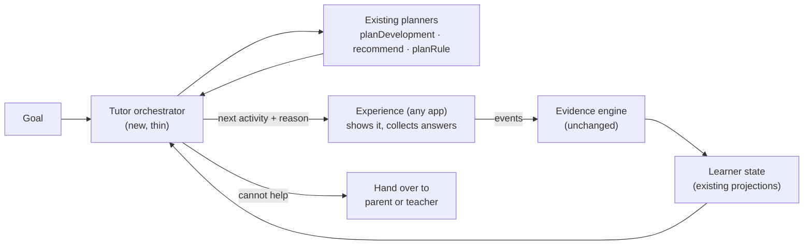

# Autonomous tutor architecture: an independent system that teaches towards a goal

*Proposal, revision 2, 18 Oct 2026. Nothing in this document has been built.
Revision 2 applies the owner's review of revision 1 (Sections 9 and 10). Items are
**Recommended** unless labelled otherwise, and each milestone waits for approval
before any code is written.*

| Label | Meaning |
|---|---|
| **Agreed** | You stated or decided this. |
| **Recommended** | My proposal. It waits for your approval. |
| **Future** | Room is kept for it. It is not approved. |
| **Open** | Needs your decision. |

---

## 0. In one paragraph

OpenPath already has an evidence engine, goal-weighted selection and teaching
planners. It does not need another learning engine. It needs an **orchestration
layer**: one tutor that connects those pieces so a learner moves through
evidence → state → decision → teaching → new evidence, towards a goal, without
a person choosing each step. This proposal builds that loop from existing code
first, adds a "how much help is needed" view of the learner only where it
changes a teaching decision, and then proves the same loop works for a small
maths skill.

---

## 1. What we are building

**Agreed** (your direction, Oct 2026):

- One shared learning intelligence powering several lightweight products; any
  single experience is replaceable.
- The evidence-based learner profile is the central product, observable and
  explainable.
- Experiences stay independent of the core engine.
- Simple architecture: no microservices, no foundation-model training, an
  interchangeable LLM provider.
- Simulated learners test software behaviour only; educational benefit needs
  real children.
- **Review, 18 Oct:** reuse the existing engine and planners; prioritise one
  genuine autonomous tutor session, then use a small maths module to show the
  mechanism generalises; avoid turning an integration problem into a large
  architecture project.

**Definition of "autonomous tutor".** Given a learner and a goal, the tutor can,
without a person choosing each step:

1. work out which skills the goal needs and in what order;
2. know where the learner is on each skill, including whether they currently
   need help;
3. decide the next thing to do, and say why;
4. teach, with help that responds to how the learner is doing;
5. check without help, and count only that as evidence of independence;
6. report progress towards the goal honestly and re-plan;
7. recognise when it cannot help, and hand over to a parent or teacher.

**Success criterion.** A learner can open OpenPath, complete a real tutor
session chosen by the system, and resume later. Then the same tutor code, with
no subject-specific branches, runs a session for a small maths skill.

---

## 2. What exists today

The pieces are real, tested and in use. They live in `packages/english-core/src`,
and several are already written to be subject-neutral.

| Piece | Where | What it does | Subject-neutral? | Used by the app? |
|---|---|---|---|---|
| Event ledger and local store | `types.ts`, `store.ts`, `updater.ts` | Append-only events; everything else is rebuilt from them. | Yes | Yes |
| Evidence provenance | `types.ts` (`isIndependentProvenance`), `updater.ts` | Hints, retries, feedback and teaching mark an answer as assisted. Assisted answers never change an estimate. | Yes | Yes |
| Capability framework and goals | `framework.ts`, `content.ts`, `content/english/goals.json` | Capability tree, prerequisites, goal weights, target bands. | Structure yes, content English | Yes |
| Composite estimate | `composite.ts`, `model.ts` | Estimate per capability with uncertainty, misconceptions and stages. | Yes | Yes |
| Rule evidence | `rule-evidence.ts` + `subject-english-inflections.ts` | Per-rule status, misconceptions, interventions and outcomes, retention, via a `SubjectRules` plug-in. | Yes (via plug-in) | Yes |
| Activity selection | `selection.ts` (`recommend`) | Assessment mode, or learning mode towards the goal's targets, respecting prerequisites. | Yes | Yes |
| Development plan | `development.ts` (`planDevelopment`) | Up to three ranked actions across capabilities, each with reason, evidence and "what would change this". | Yes | Yes (Home) |
| Rule teaching planner | `planner.ts` (`planRule`) | Assess, teach, guided practice, reassess, change strategy, retention, recommend a person. | Yes | Yes (consonant-doubling journey; PR #41 extends it to all spelling rules) |
| Retention | `retention.ts` | Spaced checks; "previously shown" kept apart from "currently verified". | Yes | Yes |
| Free-text evaluation | `evaluation.ts`, `freeform.ts` | An evaluator proposes what an answer shows, with quotes; code decides. | Yes | Partly |
| Research model (shadow only) | `openpath-research`, `feat/versioned-engine-contract` | Rule-state model; better at diagnosis; not used for decisions. | Spelling only | No |

---

## 3. The gaps

**G1 — No single tutor loop.** `recommend`, `planDevelopment` and `planRule`
each decide at a different scale and are joined in app code
(`frontend/src/english/logic/*`). Nothing owns "what next, towards this goal,
and why" across a whole session, including resuming one.

**G2 — Help is recorded but not used to teach.** Hints and assisted answers are
recorded carefully and kept out of estimates, but they barely shape teaching:
guided practice is a fixed four items, hints appear only on request,
`planRule`'s `help_dependence` diagnosis leads to the same action as any other
failure, and the development plan's "mostly with help" rule goes straight to a
test without help.

**G3 — Progress towards a goal is not reported.** Goals weight capabilities and
set targets, but nothing says how far the learner is from the goal, separates
progress from verified attainment, or reports when the goal is blocked by
missing content.

**G4 — Session decisions are not explicit.** Nothing decides, from observable
behaviour, when to switch activity or end a session.

**G5 — Subject-neutral in name only.** No second subject has run through the
neutral modules.

---

## 4. The proposed architecture

### 4.1 The loop

The orchestrator is thin. It calls the existing planners, applies session
rules, records its decision with a reason, and returns one next activity. It
writes no estimates and keeps no learner state of its own.

### 4.2 Components

| Component | Responsibility | Built from |
|---|---|---|
| **Tutor orchestrator** | One entry point (`nextMove`) for a session: start or resume, ask the planners, apply session rules, explain the decision. | New, small; calls existing planners |
| **Goal progress report** | Read-only summary of where each required skill stands, in the three outcome levels of 4.4. | Existing standings and retention |
| **Support view** | Read-only summary of help needed on a skill, from existing `hint` and `assisted_response` events. Added only in T1, where it changes a decision. | New projection, no estimate changes |
| **Subject module** | Everything subject-specific: skills, items, scoring, error classification, teaching content, support steps. | Existing English modules; `SubjectRules` |
| **Evidence engine and planners** | As today. | Unchanged |

### 4.3 How the tutor decides

The orchestrator does **not** impose a single universal priority order. Each
decision balances the factors the existing planners already weigh, plus session
factors:

- prerequisites the framework defines;
- expected benefit towards the goal (goal weight and current standing);
- review urgency (retention checks due or overdue);
- recent observable difficulty on a skill (repeated errors, help needed);
- available content (a skill with no lessons or no unused checks is reported,
  not attempted).

For example, continuing a skill the learner is practising is often right, but an
overdue review, a prerequisite gap, or a run of difficulty can each justify
something else. Every decision records which factors drove it, in plain words,
with the evidence behind it and what would change it, as `planDevelopment`
does today. The weighting is versioned draft policy, not a claim about what
works for children.

**Session rules use observable behaviour only.** The tutor reacts to:

- repeated difficulty on the current skill (a run of wrong answers, or answers
  that needed the most help);
- long inactivity;
- session duration;
- the learner's explicit request to stop.

It may respond by switching to an easier or review activity, or ending the
session on a completed item. It does **not** label a learner as tired,
frustrated, bored or guessing; those are interpretations the evidence cannot
establish. Messages to the child describe the activity ("Let's try a different
one"), not the child's feelings.

### 4.4 Three outcome levels

The tutor reports progress in three levels, which are never merged:

| Level | Meaning | Comes from | What it allows |
|---|---|---|---|
| **Learning progress** | Improving during practice: right more often, or needing less help | Practice and assisted answers | Encouragement; continuing the skill |
| **Demonstrated independence** | Right without help on appropriate unfamiliar items, possibly on provisional content | Existing "shown" standing and rule evidence | Moving on to new material **provisionally** |
| **Verified attainment** | Evidence meets the existing content and retention requirements: educator-validated content, unfamiliar items, a passed delayed check | Existing "confirmed" standing | Counting towards a **verified** goal |

**A goal is verified only when every required skill has verified attainment.**
Before that, the progress report states each skill's level plainly, for example
"Of 6 skills: 1 verified, 2 shown independently (not yet verified), 2 being
practised, 1 not started." It never says a goal is reached on provisional
content. No percentages.

The report also says when a skill is **blocked**: no teaching content, or no
unused check items. This is a content gap, not a learner weakness.

### 4.5 The second axis: support needed

**Agreed in concept (OT-1):** what a learner can do independently is kept
separate from how much help they need while learning.

**How it is recorded.** Each subject defines its own sequence of support steps,
because help is not comparable across subjects: showing a worked maths solution
is not the same kind of help as showing a spelling, and a learner may need a
different explanation rather than more of the same one. Each step is tagged
with one of a few **shared reporting categories**, so reports and the
orchestrator can read them in any subject:

| Shared category | Meaning | Spelling example | Maths example |
|---|---|---|---|
| `none` | No help | First try, no hint | First try, no hint |
| `prompt` | A nudge to check or look again | "Look at the ending" | "Check the denominators" |
| `reminder` | The rule or idea restated | "Short vowel + one consonant: double it" | "Make the denominators the same first" |
| `example` | A similar worked case | "hop → hopping" | A worked sum with other numbers |
| `answer_shown` | The answer itself shown | The spelling shown | This sum's solution shown |
| `not_reached` | Wrong even after the answer was shown | | |

A subject may have more or fewer steps, in its own order, and may offer
alternative explanations at the same category. The existing spelling hint
levels map onto this directly (the last is already recorded as a worked
example).

The **support view** summarises, per skill, the category the learner currently
needs and whether it is falling. It is read-only, never changes an estimate,
and never counts towards demonstrated independence or verified attainment.

**When it is used.** Only where it changes a teaching decision (T1):

- guided practice length responds to how the learner is doing, within a
  minimum and maximum, instead of a fixed four;
- a learner succeeding with little or no help gets one item with help available
  but not offered, before the independent check;
- a learner who is right only with help gets more practice with fading help,
  instead of an immediately different teaching strategy;
- a learner needing `answer_shown` or reaching `not_reached` repeatedly gets a
  different strategy, then the existing hand-over.

Learning phases such as "Supported" or "Fading" are **not** introduced as new
stored states. If the UI needs labels, they are derived from the standing and
the support view at display time, and refined with the tutor UI work.

### 4.6 The role of an LLM

**Agreed:** no foundation-model training; the provider stays interchangeable.

In this plan an LLM does only what it already does: propose an evaluation of a
free-text answer, which code checks. It never decides mastery or writes learner
state.

**Future (not prohibited):** an LLM helping choose or explain an instructional
strategy within the tutor's constraints, or drafting explanations and hints
that enter as provisional content under the existing validation rules. Each
would be its own proposal.

### 4.7 Out of scope for this plan

Package restructuring (deferred until reuse makes it necessary), new estimators,
replacing the composite with the research model, new research simulations,
animation, accounts and sync, teacher dashboards.

---

## 5. Invariants that must not change

1. Only first, unaided answers on unfamiliar, allowed content can establish
   demonstrated independence or verified attainment. The support view and the
   progress report never change an estimate.
2. Provisional and unchecked generated content never produces verified
   attainment. Owner approval is not educator review.
3. No invented numbers: no mastery percentages, no progress bars built from
   estimates.
4. An evaluator (LLM or person) proposes; the controlled updater decides.
5. The ledger is the only source of truth; decisions and projections rebuild
   deterministically from it.
6. Pseudonymous, local-first learner data, as today.
7. Every decision is explainable: action, reason, evidence, what would change it.
8. The tutor does not label a learner's emotional or mental state.

Every milestone includes a replay of existing fixtures showing estimates are
unchanged.

---

## 6. Milestones (revised)

The first milestone is the smallest working end-to-end tutor session built from
existing code. New abstractions are added only when a later milestone needs
them. Each milestone is one pull request; I stop after each, report results
from tests that actually ran, and wait for approval.

### T0 — One end-to-end tutor session, from existing code

**Scope.** A thin orchestrator `nextMove(learner, goal)` for English, calling
`planDevelopment`, `recommend` and `planRule` as they are. It starts or resumes
a session, returns one next activity with its reason, applies the session rules
in 4.3, and ends with a short goal progress report in the three outcome levels.
The app's existing activity screens deliver the activities. No package moves,
no new learner states, no support view yet, no planner policy changes.

**Acceptance tests.**
1. New learner: the first move is the starting-point check, with its reason.
2. Returning learner with an unfinished session: it resumes where it stopped,
   including after reload.
3. Parity: on all existing scenario fixtures, the activity chosen is the one
   today's planners would choose.
4. Each move carries action, reason, evidence and "what would change this".
5. Session rules: an explicit stop ends the session cleanly; long inactivity
   saves and closes; a run of difficulty leads to a switch, with a reason that
   names the observed behaviour, not a feeling.
6. Progress report: provisional-only evidence is never shown as verified; a
   skill with no content is shown as blocked.
7. Replay: estimates and existing decisions are byte-identical with and without
   the orchestrator.
8. Existing pilot flows, Save and Leave, and session recovery are unchanged.

The Codex tutor UX can call `nextMove` once T0 lands.

### T1 — Help that adapts, where it changes a decision

**Scope.** The support view (4.5), with spelling's support steps tagged by
shared category, used for the four decisions listed in 4.5. Planner policy and
the support view only. Starts after PR #41 merges, because it changes
`planner.ts`.

**Acceptance tests.**
1. Right twice in guided practice with little or no help: one faded item, then
   the independent check (fewer than four guided items).
2. Needing `answer_shown` repeatedly: more guided items up to the cap, then a
   different strategy.
3. Right only with help after a teaching block: fading practice before any new
   strategy.
4. Each of these decisions differs from today's in a test that states why.
5. No guided, faded or assisted answer changes an estimate (replay).
6. Legacy events without provenance give "support unknown", never `none`.

### T2 — A small maths skill through the same loop

**Scope.** One narrow, prerequisite-aware maths skill (for example adding
fractions with unlike denominators, with its prerequisite of equivalent
fractions) as a subject module with its own support steps, run through the same
orchestrator. Content is provisional.

**Acceptance tests.**
1. No changes to orchestrator or planner code in this PR; if any are needed,
   they go in a separate, reviewed PR first.
2. The prerequisite is checked or taught before the target skill when evidence
   shows a gap.
3. A simulated learner reaches **demonstrated independence** on provisional
   content and passes a simulated delayed check.
4. **Verified attainment stays blocked**: the progress report says "shown
   independently, not yet verified", and the goal is not reported as verified.
5. Every decision is explained.

### T3 — Real-learner check, with the pilot

**Scope.** Predeclared pilot questions: does the help needed on a skill fall
across sessions, and does demonstrated independence follow? Analysis plan
agreed before data is collected; results reported including negative ones.

No new research simulations are part of this plan. Existing tests establish
software correctness; real children are needed for educational benefit.

---

## 7. Relationship to work in progress

- **PR #41:** T0 adds new files and calls existing functions, so it can proceed
  alongside PR #41, with overlaps listed in its PR. T1 starts after PR #41 is
  merged.
- **Codex tutor UX** (`feat/autonomous-tutor-ux-v1`): the UI shows the
  orchestrator's decision and calls existing hint functions; it does not decide
  or invent hints.
- **openpath-research:** unchanged; the research model stays in shadow.

---

## 8. Risks

| Risk | Mitigation |
|---|---|
| The orchestrator grows into a second engine | It holds no state and makes no estimates; parity test in T0 |
| Support information is read as mastery | Invariant 1 and a replay test in every milestone |
| Session rules feel abrupt or judgemental | Observable triggers only; neutral wording; tested messages |
| Maths reveals English assumptions in neutral code | Fixes go in their own reviewed PR before T2 |
| Thin content blocks the loop | Reported as blocked, not hidden |

---

## 9. Decisions (owner review, 18 Oct 2026)

| Decision | Outcome | Where applied |
|---|---|---|
| OT-1 Two-axis learner state | **Approved in concept**; phase definitions to be refined | 4.5 (no new stored phases) |
| OT-2 Second subject | **Maths approved**, narrow and prerequisite-aware | T2 |
| OT-3 Package restructuring | **Deferred** until reuse makes it necessary | 4.7 |
| OT-4 LLM-written teaching | **Deferred, not prohibited** | 4.6 |
| OT-5 Support ladder | **Approved as a configurable starting model** | 4.5 (subject-defined steps, shared categories) |
| OT-6 Research estimator | **Shadow only** | 4.7, 7 |
| OT-7 Start | **Revise T0 first**, then approve implementation | 6 (T0 revised; awaiting approval) |

**Open now:** approve the revised T0 scope and acceptance tests in Section 6.

---

## 10. Changes from revision 1

1. Support ladder: from one universal S0–S5 scale to subject-defined steps with
   shared reporting categories.
2. Planner: removed the rule preferring skills in practice over new ones; the
   orchestrator balances factors and explains which drove each decision.
3. Outcomes: three separate levels (learning progress, demonstrated
   independence, verified attainment); a goal is verified only on the third.
   Removed "reached on practice content".
4. Session behaviour: observable triggers only; no fatigue, frustration or
   guessing inference.
5. Maths test: shows provisional independence and delayed recall, and asserts
   verified attainment stays blocked.
6. Milestones: from six (contract, projection, ladder, planner, maths, pilot) to
   four, starting with the smallest end-to-end session from existing code; no
   package extraction; no new learning phases; no new research simulations.
7. LLM: constrained instructional help is Future, not prohibited.
